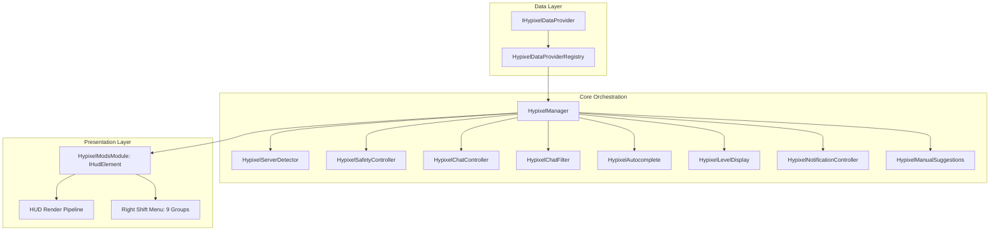
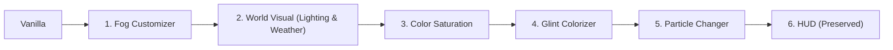

# Architektura Systemu — ZombekClient

## 1. Wprowadzenie i wizja systemu

ZombekClient to zintegrowana platforma dla Minecraft Java Edition, składająca się z dwóch głównych środowisk wykonawczych:
1. **Desktop Launcher** — natywna aplikacja desktopowa (Electron + React + TypeScript + Vite) zarządzająca instalacjami, profilami, kontami oraz konfiguracją.
2. **Minecraft In-Game Client** — klient uruchamiany wewnątrz wirtualnej maszyny Javy Minecrafta (Java 17+, Fabric Loom) odpowiadający za modyfikacje w grze, renderowanie HUD oraz synchronizację kosmetyków.

## 2. Model Monorepo i Separacja Odpowiedzialności

Projekt zorganizowany jest w modelu monorepo zarządzanym przez **pnpm workspaces**:

```
zombekclient/
├── apps/               # Aplikacje wykonywalne
│   ├── launcher/       # Launcher desktopowy (Electron + React + Vite)
│   └── minecraft-client/fabric/ # Mod klienta w grze (Fabric)
├── packages/           # Współdzielone biblioteki i kontrakty TS
│   ├── shared-types/   # Podstawowe typy domenowe
│   ├── config-schema/  # Schemat i walidacja konfiguracji
│   └── contracts/      # Ścisłe kontrakty IPC Electrona
├── services/           # Usługi backendowe (np. cosmetics-api)
└── docs/               # Dokumentacja architektoniczna i decyzje
```

### Kluczowe zasady separacji:
- **Zero mieszania kodu Java i TypeScript:** Kod launchera i kod moda działają w odrębnych procesach i środowiskach (Node.js/Chromium vs OpenJDK).
- **Abstrakcja Mod Loaderów:** Kod moda został umieszczony w `apps/minecraft-client/fabric/`. Architektura umożliwia dodanie w przyszłości modułów `forge/`, `neoforge/` oraz `quilt/` współdzielących logikę domenową.
- **Współdzielone kontrakty:** Wszystkie kanały komunikacji IPC i schematy konfiguracyjne są zdefiniowane jako niezależne pakiety (`packages/contracts`, `packages/config-schema`), eliminując duplikację i zapewniając bezpieczeństwo typów w czasie kompilacji.

## 3. Architektura Bezpieczeństwa Electron (Launcher)

W Electronie zastosowano rygorystyczny model bezpieczeństwa oparty na izolacji procesów:

1. **Main Process (`apps/launcher/electron/main/`):**
   - Pełny dostęp do Node.js, operacji wejścia/wyjścia (I/O), procesów potomnych (uruchamianie Minecrafta) oraz natywnego okna.
   - Rejestracja typed handlerów IPC (`ipcMain.handle`).
   - Wymuszone opcje okna:
     - `contextIsolation: true`
     - `nodeIntegration: false`
     - `sandbox: true`
     - `webSecurity: true`
   - Blokowanie nieautoryzowanych nawigacji i otwieranie zewnętrznych linków w domyślnej przeglądarce systemowej (`shell.openExternal`).

2. **Preload Script (`apps/launcher/electron/preload/`):**
   - Działa jako bezpieczny mostek (Bridge).
   - Wykorzystuje `contextBridge.exposeInMainWorld('zombekDesktopApi', ...)` do udostępnienia ściśle określonych metod.
   - Nigdy nie eksponuje bezpośredniego obiektu `ipcRenderer` ani modułów Node.js do środowiska renderera.

3. **Renderer Process (`apps/launcher/src/`):**
   - Aplikacja SPA w React 19 + TypeScript + Vite.
   - Brak bezpośredniego dostępu do Node.js czy systemu plików.
   - Komunikacja ze światem zewnętrznym odbywa się wyłącznie poprzez typowany interfejs `window.zombekDesktopApi`.

## 4. Architektura Wielomodułowa Klienta In-Game (`apps/minecraft-client/`)

Klient gry ZombekClient został zaprojektowany w architekturze wielomodułowej (Multi-Loader Architecture), w której 100% logiki domenowej jest współdzielone i całkowicie odseparowane od API konkretnych loaderów:

```
apps/minecraft-client/
├── core/                                      # Loader-agnostic pure Java 17 library
│   ├── bootstrap/                             # ZombekCore & cykl życia
│   ├── config/                                # ModuleConfigManager (JSON schema v1, auto-save, backup)
│   ├── lifecycle/                             # IClientModule, Error Boundary
│   ├── modules/                               # ModuleManager, ModuleCategory (PVP, HUD, VISUAL, SURVIVAL, OTHER)
│   ├── platform/                              # IPlatformAdapter (kontrakt interakcji z platformą)
│   ├── settings/                              # Silnie typowane ustawienia (Boolean, Number, Color, Enum, etc.)
│   └── modules/impl/                          # Referencyjny CoreTestModule
├── fabric/                                    # Adapter Fabric (Minecraft 1.20.4, Yarn)
│   └── zombekclient-fabric-0.1.0-alpha.jar    # DrawContext, fabric.mod.json, KeyBinding
├── forge/                                     # Adapter Forge (Minecraft 1.20.4, Forge 49.2.13, Official Mappings)
│   └── zombekclient-forge-0.1.0-alpha.jar     # GuiGraphics, Screen, mods.toml, DisplayTest.IGNORESERVERONLY
└── neoforge/                                  # Adapter NeoForge (Minecraft 1.20.4, NeoForge 20.4.237, Official Mappings)
    └── zombekclient-neoforge-0.1.0-alpha.jar  # GuiGraphics, Screen, neoforge.mods.toml, IGNORE_SERVER_VERSION
```

### Zasady architektoniczne modułu In-Game:
1. **Zero zależności silnikowych w `:core`**: Moduł `:core` nie importuje żadnych klas Minecrafta, Fabric, Forge ani NeoForge.
2. **Kontrakt `IPlatformAdapter`**: Każdy loader implementuje interfejs platformy, dostarczając nazwę, wersję, ścieżkę katalogu konfiguracji oraz metodę otwierania ekranu.
3. **Oficjalne mapowania Mojanga (Forge & NeoForge)**: Zarówno Forge jak i NeoForge współdzielą standard Mojang Official Mappings (`Screen`, `GuiGraphics`, `Component`).
4. **Bezpieczeństwo serwerów dedykowanych (Client-Only)**: Moduły klienta są oznaczane jako client-only z regułą ignorowania obecności modu na serwerach sieciowych (`IGNORE_SERVER_VERSION`).

## 5. Przyszła komunikacja Launcher <-> Minecraft

W kolejnych etapach komunikacja między procesem Launchera a uruchomionym procesem Minecrafta będzie realizowana przez:
1. Przekazywanie argumentów startowych i tokenów sesji podczas uruchamiania JVM.
2. Lokalny socket IPC / loopback HTTP dla dwukierunkowej synchronizacji statusu gry i zmian konfiguracji w locie.

## 6. Architektura Silnika Gry Minecraft (Etap 3)

Silnik pobierania, weryfikacji i uruchamiania Vanilla Minecraft Java Edition został zaimplementowany w warstwie Electron Main (`apps/launcher/electron/engine/`) z pełną separacją odpowiedzialności:

```
apps/launcher/electron/engine/
├── paths.ts                   # Zarządzanie strukturą katalogów (%APPDATA%/ZombekClient) i ochrona przed Path Traversal
├── types.ts                   # Typy manifestów Mojang, zadań pobierania i reguł OS
├── DownloadManager.ts         # Asynchroniczny menedżer pobierania z pulą wątków, weryfikacją SHA-1 i retry
├── VersionManifestService.ts  # Klient oficjalnego manifestu wersji Mojang z cache na dysku
├── InstallationRepository.ts  # Zarządzanie wieloinstancyjnością i plikami instance.json
├── JavaRuntimeManager.ts      # Wykrywanie Java w systemie oraz pobieranie Mojang Java Runtimes (Delta, Gamma, Legacy)
├── zip.ts                     # Bezpieczne rozpakowywanie archiwów native z ochroną przed Zip Slip
├── GameInstaller.ts           # Instalator JAR klienta, bibliotek OS, indeksów i obiektów assetów Minecrafta
├── GameArgumentsBuilder.ts    # Generator pełnej linii poleceń JVM i gry z podstawianiem zmiennych i budowaniem Classpath
├── GameSessionProvider.ts     # Fabryka sesji gracza (offline UUID v3 MD5 z gotowym interfejsem pod Microsoft OAuth)
└── GameLauncher.ts            # Koordynator cyklu życia: pobieranie -> konfiguracja -> spawn procesu -> log streaming
```

### Kluczowe właściwości silnika:
1. **Lokalizacja poza repozytorium:** Dane gry i instancje są przechowywane w domyślnym katalogu systemowym użytkownika (`%APPDATA%/ZombekClient` na Windows), nigdy wewnątrz repozytorium gita.
2. **Bezpieczeństwo procesowe:** Uruchomienie procesu gry następuje zawsze za pomocą `child_process.spawn` ze ścisłą tablicą argumentów, bez podatności `child_process.exec`.
3. **Izolacja instancji:** Każdy profil posiada własny katalog roboczy z podkatalogami `saves/`, `resourcepacks/`, `config/` oraz `natives/`.
4. **Współdzielenie zasobów:** Pliki bibliotek (`libraries/`) oraz zasobów gry (`assets/objects/`) są pobierane w oparciu o ich sumy kontrolne SHA-1 i współdzielone między instancjami bez powielania danych na dysku.

## 7. Architektura Systemu Kont i Autoryzacji (Etap 4)

Warstwa kont graczy została zaimplementowana w module `apps/launcher/electron/auth/`:

```
apps/launcher/electron/auth/
├── types.ts                  # Definicje struktur Microsoft OAuth, Xbox Live, XSTS, Minecraft Services i tokenów
├── TokenStorage.ts           # Sprzętowo szyfrowany magazyn tokenów (Electron safeStorage / Windows DPAPI)
├── AccountRepository.ts      # CRUD metadanych kont w accounts.json (bez sekretów), walidacja nicku offline
└── MicrosoftAuthService.ts   # Obsługa potoku OAuth2 PKCE, Xbox Live, XSTS, entitlements i profilu Mojang
```

### Podział odpowiedzialności:
- **`AccountRepository`:** Przechowuje publiczne dane kont (`AccountRecord`) w `%APPDATA%/ZombekClient/accounts/accounts.json`. Odpowiada za przełączanie aktywnego konta, dodawanie profili lokalnych oraz powiązania kont z instalacjami.
- **`TokenStorage`:** Przechowuje zaszyfrowane tokeny odświeżania i tokeny dostępowe w `%APPDATA%/ZombekClient/accounts/tokens.enc`. Wykorzystuje Windows DPAPI (`safeStorage`). Żaden token nie trafia do React state ani nie opuszcza procesu Electron Main.
- **`MicrosoftAuthService`:** Realizuje 6-krokowy potok uwierzytelniania w zewnętrznej przeglądarce za pośrednictwem serwera loopback, weryfikuje licencję w `/entitlements/mcstore` oraz pobiera profil z `/minecraft/profile`. Obsługuje diagnostykę błędu 403 `Invalid app registration`.
- **`CompositeSessionProvider`:** Pośredniczy między bazą kont a silnikiem uruchamiania `GameLauncher`, dostarczając sesje `MicrosoftGameSession` lub `OfflineGameSession` z automatycznym odnawianiem wygasających tokenów.

## 8. Architektura ModLoaderów i Integracji z Fabric (Etap 5A)

Obsługa modloaderów została zaprojektowana w oparciu o wzorzec Adaptera w katalogu `apps/launcher/electron/loaders/`:

```
apps/launcher/electron/loaders/
├── ModLoaderAdapter.ts       # Generyczny interfejs loadera (Fabric, Forge, NeoForge, Quilt)
├── FabricMetaService.ts      # Klient oficjalnego Fabric Meta API z lokalnym buforem na dysku
└── FabricLoaderAdapter.ts    # Implementacja adaptera dla Minecraft Fabric
```

### Podział odpowiedzialności:
- **`ModLoaderAdapter`:** Kontrakt definiujący metody `isVersionSupported`, `getLoaderVersions`, `resolveProfile` oraz `install`. Umożliwia rozszerzenie launchera o kolejne loadery w przyszłości bez modyfikowania rdzenia silnika.
- **`FabricMetaService`:** Komunikuje się z oficjalnymi punktami końcowymi `https://meta.fabricmc.net/v2`:
  - `/versions/game` — lista kompatybilnych wydań Minecrafta,
  - `/versions/loader/{game_version}` — lista wersji loadera Fabric (w tym flaga stabilności `stable`),
  - `/versions/loader/{game_version}/{loader_version}/profile/json` — oficjalny profil instalacyjny Fabric.
  - Zapewnia lokalne buforowanie w `%APPDATA%/ZombekClient/game-data/fabric_meta_cache.json` dla bezbłędnej pracy w trybie offline.
- **`FabricLoaderAdapter`:**
  - Dynamicznie pobiera i łączy profil Fabric z bazową wersją Vanilla Minecraft (`inheritsFrom`).
  - Łączy biblioteki Mojang i biblioteki Maven Fabrica (`https://maven.fabricmc.net/`) z deduplikacją koordynatów Maven.
  - Podmienia klasę główną na `net.fabricmc.loader.impl.launch.knot.KnotClient`.
  - Łączy argumenty JVM (np. `-DFabricMcEmu= net.minecraft.client.main.Main `) oraz argumenty gry.
  - Zapewnia izolowaną strukturę katalogów w `instances/<id>/`:
    - `instances/<id>/mods/` — dedykowany katalog na modyfikacje dla danego profilu,
    - `instances/<id>/config/` — dedykowana konfiguracja modów,
    - `instances/<id>/saves/`, `resourcepacks/`, `screenshots/`, `natives/`.

## 9. Architektura ModLoaderów i Integracji z Forge (Etap 5B)

Integracja z Minecraft Forge została zaimplementowana w module `apps/launcher/electron/loaders/` jako kolejny adapter w architekturze `ModLoaderAdapter`:

```
apps/launcher/electron/loaders/
├── ModLoaderAdapter.ts        # Wspólny interfejs loaderów (Fabric, Forge, itp.)
├── ForgeMetaService.ts        # Klient oficjalnych metadanych Forge (promotions_slim.json & maven-metadata.xml)
├── ForgeProcessorManager.ts   # Silnik ewaluacji procesorów Forge (install_profile.json) i podstawiania tokenów
└── ForgeLoaderAdapter.ts      # Koordynator 9-etapowej instalacji, stagingu i generowania profili Forge
```

### Podział odpowiedzialności:
- **`ForgeMetaService`:**
  - Komunikuje się z oficjalnym `https://files.minecraftforge.net/net/minecraftforge/forge/promotions_slim.json` w celu pobrania wersji `recommended` i `latest` dla każdego wydania Minecrafta.
  - Odpytuje oficjalne Maven Metadata `https://maven.minecraftforge.net/net/minecraftforge/forge/maven-metadata.xml` w celu uzyskania pełnej listy dostępnych buildów.
  - Łączy obie bazy, oznaczając buildy tagami `isRecommended` oraz `isLatest`.
  - Buforuje metadane w `%APPDATA%/ZombekClient/game-data/forge_meta_cache.json` z obsługą działania offline.

- **`ForgeProcessorManager`:**
  - Obsługuje specyfikację procesorów instalacyjnych Forge (`ForgeProcessorEntry` z `install_profile.json`).
  - Dokonuje podstawiania tokenów zmiennych:
    - `{MINECRAFT_JAR}` — ścieżka do bazowego JAR klienta gry (`versions/<id>/<id>.jar`),
    - `{INSTALLER}` — ścieżka do pobranego instalatora JAR,
    - `{ROOT}` / `{LIBRARY_DIR}` — katalog główny gry oraz folder bibliotek,
    - `[group:artifact:version:classifier@ext]` — dynamiczne rozwiązywanie koordynatów Maven w nawiasach kwadratowych,
    - `'wartość'` — dosłowne literały w apostrofach,
    - `/data/...` — ścieżki zasobów wewnątrz archiwum instalatora.
  - Filtruje procesory po stronie instalacji (`sides: ['client']`), ignorując procesory serwerowe.
  - Wykonuje procesory w procesie JVM z dynamicznym odczytem `Main-Class` z `META-INF/MANIFEST.MF`.

- **`ForgeLoaderAdapter`:**
  - Realizuje 9-etapowy proces instalacji:
    1. Pobranie oficjalnego instalatora JAR z `https://maven.minecraftforge.net/net/minecraftforge/forge/{version}/forge-{version}-installer.jar`.
    2. Weryfikację integralności i rozmiaru pliku instalatora.
    3. Przygotowanie izolowanego katalogu staging (`game-data/forge-staging/`) — instalator nigdy nie ma dostępu do prawdziwego `.minecraft` użytkownika.
    4. Przygotowanie i synchronizację bazowego profilu Vanilla (`versions/<version>/<version>.json`).
    5. Uruchomienie oficjalnego instalatora Forge z argumentem `--installClient <stagingDir>` oraz flagą JVM `-Djavax.net.ssl.trustStoreType=WINDOWS-ROOT` (zapewniającą zaufanie certyfikatów systemowych Windows).
    6. Weryfikację wygenerowanego profilu JSON i spatchowanego pliku `forge-{version}-client.jar`.
    7. Synchronizację wygenerowanych bibliotek do globalnego katalogu `game-data/libraries/`.
    8. Utworzenie izolowanego katalogu instancji `instances/<id>/` z podfolderami `mods/`, `config/`, `saves/`, `resourcepacks/`, `natives/`, `logs/`.
    9. Finalizację konfiguracji `instance.json` oraz rejestrację profilu.

## 10. Architektura ModLoaderów i Integracji z NeoForge (Etap 5C)

Integracja z Minecraft NeoForge została zaimplementowana w module `apps/launcher/electron/loaders/` jako trzeci dedykowany adapter w architekturze `ModLoaderAdapter`:

```
apps/launcher/electron/loaders/
├── ModLoaderAdapter.ts           # Wspólny interfejs loaderów (Fabric, Forge, NeoForge)
├── NeoForgeMetaService.ts        # Klient metadanych Maven NeoForge (Modern & Transition)
├── NeoForgeProcessorManager.ts   # Silnik ewaluacji procesorów NeoForge i podstawiania tokenów
└── NeoForgeLoaderAdapter.ts      # Koordynator 9-etapowej instalacji, stagingu i generowania profili NeoForge
```

### Podział odpowiedzialności:
- **`NeoForgeMetaService`:**
  - Rozpoznaje generację loadera na podstawie wersji gry:
    - **Transition (1.20.1):** współrzędne `net.neoforged:forge`, prefiks wersji `1.20.1-47.1.`, oficjalny URL: `https://maven.neoforged.net/releases/net/neoforged/forge/maven-metadata.xml`.
    - **Modern (1.20.2+):** współrzędne `net.neoforged:neoforge`, prefiks wersji `20.x.` lub `21.x.`, oficjalny URL: `https://maven.neoforged.net/releases/net/neoforged/neoforge/maven-metadata.xml`.
    - **Wersje starsze (< 1.20.1):** zwraca brak wsparcia (NeoForge nie istniało przed 1.20.1).
  - Sortuje wersje malejąco według numeru buildu.
  - Oznacza wersję stabilną jako `isRecommended` (najwyższy build bez etykiet beta/alpha/pre/snapshot) oraz najnowszą jako `isLatest`.
  - Buforuje odpowiedzi na dysku w `%APPDATA%/ZombekClient/game-data/neoforge_meta_cache.json` dla pełnego wsparcia trybu offline.

- **`NeoForgeProcessorManager`:**
  - Obsługuje specyfikację procesorów NeoForge (`NeoForgeProcessorEntry` z `install_profile.json`).
  - Rozwiązuje koordynaty Maven (obsługa rozszerzeń `@jar`, `@zip`, `@tsrg` oraz klasyfikatorów).
  - Podstawia zmienne i tokeny: `{INSTALLER}`, `{MINECRAFT_JAR}`, `{ROOT}`, `{LIBRARY_DIR}`, klucze słownika danych `{KEY}` (np. `MC_SLIM`, `PATCHED`), literały w apostrofach oraz ścieżki w archiwum `/data/...`.
  - Filtruje procesory po stronie klienta (`sides: ['client']`), odrzucając procesory czysto serwerowe.
  - Wykonuje procesory w procesie JVM z odczytem `Main-Class` z manifestu JAR.

- **`NeoForgeLoaderAdapter`:**
  - Realizuje 9-etapowy proces instalacji:
    1. Walidację i rozwiązanie wybranej wersji NeoForge.
    2. Pobranie oficjalnego instalatora JAR z oficjalnego Maven NeoForge.
    3. Weryfikację integralności i rozmiaru pliku instalatora.
    4. Przygotowanie izolowanego katalogu staging (`game-data/neoforge-staging/`) z minimalnym plikiem `launcher_profiles.json` oraz bazowymi plikami Vanilla.
    5. Uruchomienie instalatora z argumentem `--installClient <stagingDir>` oraz flagą JVM `-Djavax.net.ssl.trustStoreType=WINDOWS-ROOT`.
    6. Synchronizację wygenerowanych bibliotek Maven i profilu JSON ze stagingu do globalnych katalogów `game-data/libraries/` i `game-data/versions/`.
    7. Przygotowanie profilu uruchomieniowego (`inheritsFrom: gameVersion`, klasa główna `cpw.mods.bootstraplauncher.BootstrapLauncher`, scalenie argumentów JVM i gry).
    8. Utworzenie izolowanego katalogu instancji `instances/<id>/` z podfolderami `mods/`, `config/`, `saves/`, `resourcepacks/`, `natives/`, `logs/`.
    9. Finalizację konfiguracji `instance.json` oraz czyszczenie katalogu staging.

### 11. Architektura Obsługi Modloadera Quilt (Etap 5D)

ZombekClient wspiera oficjalny modloader **Quilt** (QuiltMC) poprzez dedykowany adapter `QuiltLoaderAdapter` oraz serwis metadanych `QuiltMetaService`.

- **`QuiltMetaService`:**
  - Komunikuje się bezpośrednio z oficjalnym API Quilt Meta v3 (`https://meta.quiltmc.org/v3`).
  - Wysyła wymagany przez QuiltMC nagłówek: `User-Agent: ZombekClient/0.1.0 (desktop launcher)`.
  - Endpointy:
    - `GET /v3/versions/game` — pobiera listę kompatybilnych wydań Minecraft (release i snapshot).
    - `GET /v3/versions/loader/{game_version}` — pobiera dostępne wersje Quilt Loader dla danej wersji gry.
    - `GET /v3/versions/loader/{game_version}/{loader_version}/profile/json` — pobiera oficjalny profil launchera zawierający listę bibliotek Maven oraz klasę startową.
  - Buforuje odpowiedzi na dysku w `%APPDATA%/ZombekClient/game-data/quilt_meta_cache.json` dla pełnej odporności na awarie sieci i pracy w trybie offline.

- **`QuiltLoaderAdapter`:**
  - Implementuje kontrakt `ModLoaderAdapter` dla `loaderType: 'quilt'`.
  - Klasa główna (Main-Class): `org.quiltmc.loader.impl.launch.knot.KnotClient`.
  - Łączy profil bazowy Vanilla z profilem Quilt (`inheritsFrom: gameVersion`), przeprowadzając deduplikację bibliotek i scalając argumenty JVM oraz gry.
  - **Polityka niestosowania przestarzałego QSL (Quilt Standard Libraries):** Zgodnie z oficjalną decyzją projektu QuiltMC z grudnia 2025 r. o zakończeniu rozwoju i wsparcia dla QSL, launcher ZombekClient nie dodaje ani nie wstrzykuje biblioteki QSL jako sztucznej zależności. Instalowany jest wyłącznie oficjalny, stabilny Quilt Loader.
  - Zapewnia pełną izolację katalogu instancji `instances/<id>/` (`mods/`, `config/`, `saves/`, `resourcepacks/`, `screenshots/`, `natives/`, `logs/latest.log`), uniemożliwiając konflikt modów z innymi instancjami.

- **Przygotowanie pod Menedżer Modpacków (ModCompatibilityTarget):**
  - Wprowadzono typy klasyfikacji kompatybilności modów: `'quilt' | 'fabric' | 'fabric-and-quilt' | 'quilt-incompatible' | 'forge' | 'neoforge'`, co umożliwia w kolejnych etapach automatyczne wykrywanie czy dany mod Fabric może działać pod Quilt.

## 12. Architektura Modpack Managera Core (Etap 6A)

W ETAPIE 6A zaimplementowano kompletną architekturę zarządzania lokalnymi plikami modów (`.jar`) oraz profilami modpacków dla wszystkich 5 środowisk Minecraft (Vanilla, Fabric, Forge, NeoForge, Quilt).

```
apps/launcher/electron/modpacks/
├── JarArchiveReader.ts         # Bezpieczny odczyt ZIP w pamięci, ochrona ZipSlip, brak Java runtime
├── SimpleTomlParser.ts         # Lekki parser TOML dla mods.toml i neoforge.mods.toml (bez zewn. bibliotek)
├── ModMetadataReader.ts        # Wielomodułowy ekstraktor metadanych (Fabric, Quilt, NeoForge, Forge)
├── ModCompatibilityChecker.ts  # Weryfikacja zgodności z loaderem, zakresem MC i środowiskiem (client/server)
├── ModDependencyAnalyzer.ts    # Analiza brakujących zależności (depends) i konfliktów (breaks/conflicts)
├── ModFileManager.ts           # Niskopoziomowe operacje I/O, SHA-256, bezpieczne kopiowanie i przenoszenie
├── ModRepository.ts            # Agregacja modów instancji, pamięć podręczna .mods-cache.json, przełącznik włączenia
├── ModInstallationService.ts   # Walidacja kandydata przed instalacją, wykrywanie duplikatów po hashu i nazwie
├── ModpackRepository.ts        # Trwałość profili modpacków w %APPDATA%/ZombekClient/game-data/modpacks.json
├── ModpackProfileManager.ts    # Głębokie klonowanie plików i konfiguracji modpacka, powiązanie z instancją
└── ModpackValidator.ts         # Walidacja integralności paczki modów przed uruchomieniem gry
```

### Kluczowe zasady architektoniczne:

1. **Bezpieczny odczyt metadanych w pamięci (Zero Java Execution):**
   - Żaden plik `.jar` nie jest uruchamiany w procesie Java ani nie są z niego ładowane klasy Java (`ClassLoader`).
   - Parser `JarArchiveReader` odczytuje nagłówek End of Central Directory (EOCD) oraz rekordy katalogu centralnego bezpośrednio z bufora bajtów w pamięci Node.js.
   - Dekompresja wpisów (`fabric.mod.json`, `quilt.mod.json`, `META-INF/mods.toml`, `META-INF/neoforge.mods.toml`) następuje przez natywne `node:zlib.inflateRawSync` dla Deflate (metoda 8) oraz bezpośredni wycinek bufora dla metody Stored (metoda 0).
   - Ochrona przed atakami **ZipSlip** (ścieżki zawierające `..`, ścieżki bezwzględne oraz separatory dysków Windows `:` są natychmiast odrzucane).
   - Ochrona przed **Zip Bombami** (limit maksymalnego rozmiaru pliku JAR 500 MB, limit wpisów 15 000, limit pojedynczego wpisu tekstowego 5 MB).

2. **Strategia włączania/wyłączania modów (`disabled-mods/`):**
   - Tradycyjne launchery często zmieniają rozszerzenie pliku na `.disabled` lub `.jar.bak`. W ZombekClient zastosowano profesjonalną strategię katalogową:
     - Włączone mody: `instances/<id>/mods/<filename>.jar`
     - Wyłączone mody: `instances/<id>/disabled-mods/<filename>.jar`
   - Minecraft ani żaden modloader nigdy nie przeszukują folderu `disabled-mods/`, co w 100% gwarantuje, że wyłączony mod nie zostanie załadowany do gry.
   - Nazwa i rozszerzenie pliku pozostają niezmienne, co eliminuje problemy z integracją zewnętrznych narzędzi i rozszerzeń.

3. **Autonomiczny parser TOML (`SimpleTomlParser`):**
   - Zero zewnętrznych zależności npm, pełna odporność na błędy składniowe.
   - Obsługa tablic obiektów `[[mods]]`, `[[dependencies.<id>]]`, wieloliniowych ciągów znaków (`'''` i `"""`), komentarzy `#` oraz typów podstawowych (boolean, number, string, inline array).

4. **Matryca zgodności wstecznej:**
   - **Quilt -> Fabric:** `ModCompatibilityChecker` oznacza mody Fabric uruchamiane w instancji Quilt jako `Possibly Compatible` ("Mod Fabric może działać na Quilt dzięki wstecznej kompatybilności QuiltMC").
   - **Vanilla:** Modyfikacje w instancji Vanilla są wyraźnie oznaczane statusem `Incompatible`, a interfejs wyświetla ostrzeżenie o konieczności wyboru loadera Fabric, Forge, NeoForge lub Quilt.
   - **Porównywanie wersji:** Obsługa standardowych zakresów semver i Maven: `[1.20, 1.21)`, `>=1.20`, `~1.20.4`, `1.20.x`, `*`.

5. **Głębokie klonowanie i izolacja instancji (`ModpackProfileManager`):**
   - Duplikacja profilu modpacka wykonuje rzeczywistą kopię głęboką (deep copy) plików modów oraz podkatalogu konfiguracji `config/`, zapewniając, że zmiana ustawień w kopii nie wpływa na oryginał.
   - Każda instancja posiada unikalny plik `modpack.json` opisujący aktualnie wdrożony modpack.

---

## 13. Architektura Integracji z Modrinth (ETAP 6B)

W ETAPIE 6B zaimplementowano kompletną integrację z oficjalnym Modrinth API v2 (`https://api.modrinth.com/v2`), umożliwiając bezpośrednie przeglądanie, wyszukiwanie, pobieranie i bezpieczne instalowanie modyfikacji do aktywnych profili gracza.

```
apps/launcher/electron/modrinth/
├── ModrinthApiClient.ts          # Klient HTTP API v2, User-Agent, budowanie facetów, buforowanie i rate-limiting
├── ModrinthDownloader.ts         # Bezpieczny potok pobierania z Modrinth CDN, streaming, weryfikacja SHA-512 i SHA-1
└── ModrinthInstallationManager.ts # Orkiestrator instalacji: walidacja instancji, zgodność loadera, duplikaty, zależności
```

### 13.1. Klient Modrinth API v2 (`ModrinthApiClient`)
1. **Zgodność z polityką Modrinth:**
   - Każde zapytanie HTTP zawiera unikalny nagłówek `User-Agent: ZombekClient/0.1.0 (https://github.com/zombekclient/zombekclient)`.
   - Śledzenie nagłówków rate limit (`x-ratelimit-limit`, `x-ratelimit-remaining`, `x-ratelimit-reset`).
   - Przy kodzie HTTP 429 zgłaszany jest dedykowany błąd `ModrinthRateLimitError`, a aplikacja przechodzi w stan cooldown bez spamowania serwerów.
2. **Budowanie zapytań `facets`:**
   - Format Modrinth API: tablica tablic w formacie JSON (`[["project_type:mod"], ["categories:fabric"], ["versions:1.20.4"]]`).
   - Elementy w tablicy wewnętrznej łączone są logicznym OR, a elementy zewnętrzne logicznym AND.
   - Domyślny filtr środowiska wyklucza modyfikacje wyłącznie serwerowe (`client_side:required`, `client_side:optional`, `client_side:unknown`).
3. **Dwuwarstwowy system pamięci podręcznej (Cache):**
   - **Pamięć RAM (L1):** Wyniki wyszukiwania (TTL 2 minuty), szczegóły projektów (TTL 10 minut), listy wydań (TTL 5 minut).
   - **Pamięć dyskowa (L2):** Statyczne tagi Modrinth (`categories.json`, `loaders.json`, `game_versions.json`) buforowane w `%APPDATA%/ZombekClient/cache/modrinth/` z czasem życia 24h.

### 13.2. Bezpieczny Potok Pobierania (`ModrinthDownloader`)
1. **Ochrona przed SSRF i złośliwymi domenami:**
   - Restrykcyjna biała lista domen: `cdn.modrinth.com`, `edge.modrinth.com` oraz `*.modrinth.com`.
   - Wymuszony bezpieczny protokół HTTPS (odrzucanie HTTP, file://, ftp://).
   - Odrzucanie adresów pętli zwrotnej i sieci prywatnych (`localhost`, `127.0.0.1`, `10.*`, `192.168.*`, `172.16.*`).
2. **Streaming do plików tymczasowych:**
   - Pobrany plik trafia do katalogu roboczego `%APPDATA%/ZombekClient/game-data/temp-downloads/` z losowym identyfikatorem.
   - Pomiar postępu w czasie rzeczywistym (`downloadedBytes`, `totalBytes`, `percent`, `speedMb`).
3. **Weryfikacja kryptograficzna (SHA-512 & SHA-1):**
   - Priorytetowa weryfikacja sumy kontrolnej SHA-512 deklarowanej przez Modrinth API.
   - W przypadku braku SHA-512 następuje weryfikacja zapasowa SHA-1.
   - Jeśli plik nie zgadza się co do bajtu z deklarowanym hashem, jest natychmiastowo usuwany z dysku przed skopiowaniem do katalogu gry.

### 13.3. Menedżer Instalacji Modrinth (`ModrinthInstallationManager`)
1. **Weryfikacja kompatybilności:**
   - Sprawdzenie zgodności wybranego wydania moda z loaderem docelowej instalacji (`fabric`, `forge`, `neoforge`, `quilt`).
   - Obsługa kompatybilności wstecznej: instancja Quilt pozwala na instalację modów oznaczonych jako `fabric`.
   - Blokada instalacji modów w instancjach Vanilla.
2. **Wybór pliku głównego (Primary JAR):**
   - Automatyczny wybór pliku z flagą `primary: true`.
   - W przypadku braku flagi selekcja pliku z rozszerzeniem `.jar` (z pominięciem plików javadoc czy sources).
3. **Zapobieganie duplikatom:**
   - Wykrywanie istniejących modów w folderze `mods/` po nazwie pliku oraz sumie SHA-256.
   - Żądanie potwierdzenia nadpisania pliku w przypadku wykrycia konfliktu.
4. **Analiza zależności Modrinth:**
   - Sprawdzanie tablicy `dependencies` danego wydania.
   - Identyfikacja zależności wymaganych (`dependency_type === 'required'`) i generowanie ostrzeżeń w UI dla gracza.
5. **Finalizacja instalacji:**
   - Bezpieczne skopiowanie pliku przez `ModFileManager.copyModFile`.
   - Automatyczne unieważnienie cache w `ModRepository` i odświeżenie listy zainstalowanych modyfikacji w UI.

---

## 14. Architektura Automatycznych Zależności, Aktualizacji i Transakcji (ETAP 6C)

W ETAPIE 6C rozbudowano system modpacków o rekurencyjny silnik rozwiązywania zależności, wsadowe wykrywanie aktualizacji z oficjalnym Modrinth API, system blokowania wersji (Pinning), plik stanu `modpack.lock.json` oraz transakcyjny potok wprowadzania zmian z automatycznym rollbackiem i kopiami zapasowymi.

```
apps/launcher/electron/modpacks/
├── ModDependencyResolver.ts       # Rekurencyjne rozwiązywanie drzewa A -> B -> C, JiJ, detekcja cykli
├── ModConflictResolver.ts         # Weryfikacja loadera, wersji MC, konfliktów jawnych i wersji przypiętych
├── ModUpdateManager.ts           # Wykrywanie aktualizacji przez SHA-512, POST /version_files/update
├── ModpackLockfileManager.ts     # Schema v1 modpack.lock.json, synchronizacja z dyskiem, pinning i polityki
├── ModpackBackupManager.ts       # Migawki snapshotów z manifestem, retencja (10 kopii), 1-klik rollback
└── ModpackTransactionManager.ts  # Blokada gry, staging, weryfikacja sum kontrolnych, atomic commit i auto-rollback
```

### 14.1. Rekurencyjny Resolver Zależności (`ModDependencyResolver`)
1. **Analiza wielopoziomowa (A -> B -> C -> D):**
   - Podczas instalacji lub aktualizacji modyfikacji resolver analizuje tablicę `dependencies` z Modrinth API.
   - Dla każdej wymaganej zależności (`dependency_type === 'required'`) wyszukiwane jest optymalne wydanie zgodne z loaderem i wersją Minecrafta danej instalacji.
   - Zależność jest rekurencyjnie badana pod kątem jej własnych zależności aż do pełnego zamknięcia grafu.
2. **Obsługa 4 typów relacji w Modrinth:**
   - `required`: biblioteki niezbędne do uruchomienia — dodawane do planu instalacji (`toInstall`).
   - `optional`: rekomendowane usprawnienia — prezentowane użytkownikowi w planie instalacji bez wymuszenia (`optionalRecommendations`).
   - `incompatible`: zadeklarowane kolizje — natychmiastowe zablokowanie instalacji ze wskazaniem kolidującego modu (`conflicts`).
   - `embedded`: biblioteki spakowane wewnątrz głównego pliku JAR (Jar-in-Jar / JiJ) — rejestrowane jako spełnione (`alreadySatisfied`, `isEmbedded: true`) bez pobierania zbędnych duplikatów.
3. **Detekcja cykli i ochrona przed pętlami:**
   - Wykorzystanie struktur `visitedProjects` oraz `visitedVersions` zapobiega zapętleniu w przypadku wzajemnych zależności (A wymaga B, B wymaga A).
4. **Wybór optymalnego wydania:**
   - Zgodność z loaderem (`fabric`, `forge`, `neoforge`, `quilt` z uwzględnieniem kompatybilności wstecznej Quilt dla Fabric).
   - Zgodność z wersją Minecrafta instalacji.
   - Uwzględnienie polityki stabilności (domyślnie wydania stabilne `release`, opcjonalnie `beta` lub `alpha`).

### 14.2. Detektor Konfliktów Środowiskowych (`ModConflictResolver`)
1. **Niezgodność silnika (Loader Mismatch):** Wykrywanie prób instalacji modów Forge/NeoForge na środowisku Fabric/Quilt.
2. **Niezgodność wersji gry (Minecraft Version Mismatch):** Sprawdzanie czy wydanie wspiera wersję docelowej instancji.
3. **Zadeklarowane kolizje (Incompatible Mods):** Sprawdzanie czy nowo instalowany mod lub jego zależność nie wyklucza innego moda obecnego w modpacku (np. Iris Shaders wykluczające OptiFine).
4. **Kolizja z wersją przypiętą (Pinned Version Collision):** Wykrywanie sytuacji, w której nowa zależność wymagałaby nadpisania modu oznaczonego przez użytkownika flagą `pinned: true`.

### 14.3. Modpack Lockfile Schema v1 (`ModpackLockfileManager`)
Plik `modpack.lock.json` znajduje się w katalogu głównym każdej instancji (`instances/<id>/modpack.lock.json`) i stanowi jedyne źródło prawdy o stanie i pochodzeniu plików:
- `schemaVersion`: wersja schematu (aktualnie `1`).
- `instanceId`, `gameVersion`, `loader`: metadane środowiska.
- `mods`: tablica rekordów modyfikacji zawierająca:
  - `fileName`: nazwa pliku na dysku.
  - `name`, `version`: czytelne metadane.
  - `projectId`, `versionId`: powiązanie z oficjalnym Modrinth API.
  - `sha512`, `sha1`: kryptograficzne sumy kontrolne.
  - `source`: `'modrinth'` dla pobranych z katalogu, `'local'` dla plików wrzuconych ręcznie.
  - `pinned`: flaga blokady przed aktualizacjami automatycznymi.
  - `updatePolicy`: preferowany kanał (`'stable-only'`, `'stable-and-beta'`, `'all-versions'`).
  - `dependencies`: identyfikatory zarejestrowanych zależności.

### 14.4. Menedżer Aktualizacji Modów (`ModUpdateManager`)
1. **Wsadowe zapytania o sumy kontrolne:**
   - Obliczenie sumy SHA-512 dla każdego pliku `.jar` w katalogu `mods/`.
   - Jednorazowe zapytanie `POST /version_files/update` do Modrinth API z tablicą hashy, filtrem loadera i wersji gry.
   - Ograniczenie narzutu sieciowego: 1 zapytanie HTTP sprawdza dostępność aktualizacji dla setek modów jednocześnie.
2. **Klasyfikacja plików:**
   - `available`: dostępna nowsza wersja zgodna z polityką użytkownika.
   - `up-to-date`: plik jest w najnowszej wersji lub nowsze wersje nie spełniają polityki (np. tylko beta).
   - `pinned`: mod ma zablokowaną wersję — aktualizacja jest celowo pomijana.
   - `manual-action`: plik nie występuje w bazie Modrinth (własny mod autorski lub custom build).
   - `conflict`: nowsza wersja powoduje konflikt środowiskowy.

### 14.5. Menedżer Kopii Zapasowych i Rollback (`ModpackBackupManager`)
1. **Struktura kopii zapasowej:**
   - Przechowywanie w katalogu `%APPDATA%/ZombekClient/backups/<instanceId>/<backupId>/`.
   - Każda kopia zawiera:
     - Fizyczne kopie modyfikowanych plików JAR.
     - Kopię pliku `modpack.lock.json`.
     - Plik `manifest.json` z metadanymi (data, powód utworzenia, liczba plików, rozmiar w bajtach, lista modów).
2. **Polityka retencji:** Automatyczne utrzymywanie maksymalnie 10 najnowszych kopii zapasowych na instancję; starsze kopie są bezpiecznie usuwane z dysku.
3. **1-kliknięcie Rollback:**
   - Przywrócenie plików JAR z kopii do folderu `mods/`.
   - Usunięcie plików JAR wprowadzonych po utworzeniu kopii.
   - Przywrócenie zawartości pliku `modpack.lock.json`.
   - Unieważnienie pamięci podręcznej `ModRepository`.

### 14.6. Transakcyjny Silnik Modyfikacji (`ModpackTransactionManager`)
1. **Blokada aktywnej gry:** Przed przystąpieniem do jakichkolwiek modyfikacji sprawdzany jest stan `GameLauncher.getStatus()`. Jeśli gra na danej instancji jest w stanie `running`, transakcja zostaje zablokowana z komunikatem w języku polskim.
2. **Etap Staging:** Wszystkie nowe pliki są pobierane i weryfikowane kryptograficznie (SHA-512) w odizolowanym folderze tymczasowym `%APPDATA%/ZombekClient/temp-transactions/<txId>/`.
3. **Kopia bezpieczeństwa:** Przed wprowadzeniem zmian w katalogu gry tworzony jest punkt przywracania przez `ModpackBackupManager`.
4. **Atomowa podmiana:**
   - Usunięcie zastępowanych wersji plików.
   - Przeniesienie zweryfikowanych plików ze stagingu do `mods/`.
   - Zaktualizowanie `modpack.lock.json`.
5. **Auto-Rollback:** W razie wystąpienia jakiegokolwiek błędu na etapie pobierania, walidacji czy kopiowania, transakcja natychmiast cofa wszystkie zmiany, przywraca stan z kopii zapasowej i czyści pliki tymczasowe.

---

## 15. Architektura Importu i Eksportu Modpacków MRPACK (Etap 6D)

W Etapie 6D wprowadzono pełną, bezpieczną i zgodną ze specyfikacją obsługę formatu Modrinth Modpack (`.mrpack`, `formatVersion: 1`).

```
┌─────────────────────────────────────────────────────────────────────────────┐
│                       MODRINTH MODPACK (.mrpack)                            │
├─────────────────────────────────────────────────────────────────────────────┤
│  modrinth.index.json  ──► [MrpackManifestValidator]                         │
│                           - formatVersion: 1, game: "minecraft"             │
│                           - Detekcja loadera (Fabric/Forge/NeoForge/Quilt)  │
│                           - Weryfikacja formatu sum SHA-512 i SHA-1         │
│                                                                             │
│  ZIP Architecture     ──► [MrpackArchiveReader] / [MrpackArchiveWriter]     │
│                           - Zero zależności npm (node:zlib + CRC32 table)   │
│                           - Ochrona Zip Slip & Zip Bomb (max 500MB / 2GB)   │
│                           - Symlink traversal attack rejection              │
│                                                                             │
│  overrides/           ──► [MrpackOverrideManager]                           │
│  client-overrides/        - client-overrides nadpisują overrides bazowe     │
│  server-overrides/        - server-overrides izolowane w .mrpack-preserved/ │
│                           - Eksport: ścisła filtracja saves/logs/tokens     │
│                                                                             │
│  Pipeline             ──► [MrpackImporter] / [MrpackExporter]               │
│                           - Podgląd przed instalacją (inspect)              │
│                           - Biała lista hostów CDN & blokada prywatnych IP  │
│                           - Równoległe pobieranie + weryfikacja SHA-512     │
│                           - Atomowa instalacja, generowanie lockfile, rollback│
└─────────────────────────────────────────────────────────────────────────────┘
```

### 15.1. Bezpieczeństwo Ścieżek i Archiwów (`MrpackPathValidator`, `MrpackArchiveReader`)
1. **Ochrona przed Zip Slip:**
   - Odrzucanie wszelkich sekwencji wyjścia z katalogu (`..`, `../`, `..\`).
   - Odrzucanie ścieżek absolutnych (`/`, `\`), liter dysków Windows (`C:`, `D:`) oraz ścieżek sieciowych UNC (`\\server\share`, `//server/share`).
   - Odrzucanie zastrzeżonych nazw urządzeń Windows (`CON`, `PRN`, `AUX`, `NUL`, `COM1-9`, `LPT1-9`).
   - Odrzucanie znaków niedozwolonych (`<`, `>`, `:`, `"`, `|`, `?`, `*`) oraz null bytes (`\0`).
   - Wymuszanie przynależności ścieżki do katalogu bazowego przez `assertSafePath`.
2. **Ochrona przed Zip Bomb:**
   - Limit rozmiaru archiwum: 500 MB.
   - Limit całkowitego rozmiaru po dekompresji: 2 GB.
   - Limit pojedynczego pliku: 250 MB (manifest `modrinth.index.json`: max 5 MB).
   - Maksymalna liczba wpisów w archiwum: 20 000.
3. **Wykrywanie dowiązań symbolicznych (Symlink Traversal):**
   - Badanie atrybutów `externalFileAttributes` w nagłówku Central Directory (`(attrs >> 16) & 0o170000 === 0o120000`).
   - Natychmiastowe odrzucanie archiwów zawierających symlinki w celu ochrony przed atakami na pliki systemowe.

### 15.2. Walidator Specyfikacji Manifestu (`MrpackManifestValidator`)
- Wymagane `formatVersion === 1` oraz `game === "minecraft"`.
- Wymagane pola metadanych: `name`, `versionId`, `dependencies.minecraft`.
- Automatyczna detekcja loadera na podstawie kluczy zależności:
  - `fabric-loader` ➔ `fabric`
  - `forge` ➔ `forge`
  - `neoforge` ➔ `neoforge`
  - `quilt-loader` ➔ `quilt`
  - Brak klucza loadera ➔ `vanilla`
- Wykrywanie i odrzucanie sprzecznych deklaracji wielu loaderów w jednej paczce (np. jednoczesne zadeklarowanie `fabric-loader` i `forge`).
- Weryfikacja sum kontrolnych: SHA-1 (dokładnie 40 znaków hex), SHA-512 (dokładnie 128 znaków hex).
- Weryfikacja adresów URL pobierania: wymuszenie protokołu HTTPS oraz obecności co najmniej jednego adresu URL w tablicy `downloads`.

### 15.3. Menedżer Warstw Overrides (`MrpackOverrideManager`)
1. **Reguły pierwszeństwa:**
   - `overrides/`: rozpakowywane jako baza do katalogu głównego instancji (`instances/<id>/`).
   - `client-overrides/`: nakładane na pliki z `overrides/`, mające bezwzględny priorytet dla klienta gry.
   - `server-overrides/`: **nie są instalowane** do katalogu gry klienta; są bezpiecznie zachowywane w ukrytym katalogu `.mrpack-preserved/server-overrides/` na wypadek ponownego eksportu.
2. **Ścisła filtracja danych prywatnych przy eksporcie:**
   - Podczas eksportu wykluczane są wszelkie katalogi wrażliwe: `saves/`, `screenshots/`, `logs/`, `crash-reports/`, `accounts/`, `backups/`, `natives/`, `runtimes/`, `.cache/`, `temp-transactions/`.
   - Wykluczane są pliki prywatne: `launcher_accounts.json`, `usercache.json`, `usernamecache.json`, `latest.log`, `modpack.lock.json`, `.session`.

### 15.4. Potok Importu (`MrpackImporter`)
1. **Inspekcja (Dry-Run Preview):** Skanowanie archiwum ZIP w pamięci, walidacja manifestu i wygenerowanie raportu (`MrpackInspectionResult`) bez dokonywania zmian na dysku.
2. **Weryfikacja hostów CDN:** Biała lista dozwolonych serwerów pobierania (`cdn.modrinth.com`, `edge.modrinth.com`, `github.com`, `raw.githubusercontent.com`, `gitlab.com`). Blokada adresów prywatnych (`127.0.0.1`, `localhost`, `10.x`, `192.168.x`, `172.16-31.x`).
3. **Pobieranie i weryfikacja:** Pobieranie do folderu tymczasowego staging z obsługą przekierowań (max 3), weryfikacja sumy SHA-512 oraz rozmiaru pliku.
4. **Instalacja i Lockfile:** Tworzenie instancji w `InstallationRepository`, rozpakowanie overrides, przeniesienie modów do `mods/`, wygenerowanie `modpack.lock.json`.
5. **Transakcyjny Rollback:** W razie jakiegokolwiek błędu następuje automatyczne usunięcie instancji, oczyszczenie plików staging i przywrócenie stanu pierwotnego.

### 15.5. Potok Eksportu (`MrpackExporter`)
1. Odczyt metadanych instancji i zainstalowanych modów.
2. Rozpoznanie modów z Modrinth przez `modpack.lock.json` i wygenerowanie wpisów `files` z oficjalnymi URL-ami Modrinth CDN oraz sumami SHA-512/SHA-1.
3. Obsługa modów autorskich / lokalnych JAR: pakowanie do `overrides/mods/` pod warunkiem zaakceptowania przez użytkownika oświadczenia o prawach autorskich.
4. Zgromadzenie plików konfiguracyjnych i opcji z zachowaniem filtrów prywatności.
5. Wygenerowanie `modrinth.index.json` i zbudowanie archiwum `.mrpack` za pomocą `MrpackArchiveWriter`.

---

## 16. Architektura Systemu Modułów i Menu w Grze (Etap 7B)

Rdzeń modyfikacji klienta Minecraft (`apps/minecraft-client/fabric`) został wyposażony w autonomiczny framework modułów oraz świąteczne menu konfiguracyjne otwierane klawiszem **RIGHT SHIFT**.

```
apps/minecraft-client/fabric/src/main/java/pl/zombek/client/
├── core/
│   ├── ClientConstants.java      # Identyfikatory moda, wersja klienta i loader
│   └── ZombekClientMod.java      # Punkt wejścia Fabric ClientModInitializer, bootstrap podsystemów
├── modules/
│   ├── IClientModule.java        # Kontrakt bazowy modułu
│   ├── ModuleCategory.java       # 5 kategorii domenowych: PVP, HUD, VISUAL, SURVIVAL, OTHER
│   ├── ModuleMetadata.java       # Niemutowalne metadane modułu (ID, autor, wersja, kategoria)
│   ├── AbstractModule.java       # Klasa bazowa z cyklem życia i bezpieczną izolacją błędów (Error Boundary)
│   ├── ModuleManager.java        # Centralny rejestr, wyszukiwarka i koordynator tick/render
│   └── impl/
│       └── CoreTestModule.java   # Referencyjny moduł demonstracyjny ze wszystkimi typami ustawień
├── settings/
│   ├── Setting.java              # Generyczna klasa bazowa z obsługą warunkowej widoczności (.visibleWhen)
│   ├── BooleanSetting.java       # Przełącznik logiczny ON / OFF
│   ├── NumberSetting.java        # Suwak liczbowy z granicami, kwantyzacją kroku i precyzją
│   ├── ColorSetting.java         # Selektor koloru ARGB/RGBA z heksadecymalnym zapisem (#RRGGBB / #RRGGBBAA)
│   ├── EnumSetting.java          # Przełącznik cykliczny dla wartości typów wyliczeniowych
│   ├── StringSetting.java        # Pole tekstowe z limitami długości i walidacją regex
│   ├── KeybindSetting.java       # Przypisanie klawisza GLFW / przycisku myszy z formatowaniem nazw
│   ├── MultiSelectSetting.java   # Wielokrotny wybór z predefiniowanej listy opcji
│   └── SettingGroup.java         # Logiczne grupowanie hierarchiczne ustawień
├── keybind/
│   └── KeybindManager.java       # Obsługa domyślnego klawisza RIGHT SHIFT, detekcja krawędzi i konfliktów
├── config/
│   ├── IClientConfig.java        # Kontrakt zapisu i odczytu konfiguracji
│   └── ModuleConfigManager.java  # Schema v1 (modules.json), atomowy zapis, debouncing 300ms, auto-recovery
└── gui/
    ├── ZombekTheme.java          # Stałe kolorystyczne świątecznej palety Festive Dark
    └── ZombekMenuScreen.java     # Responsywne menu oparte o Screen i DrawContext bez hacków OpenGL
```

### 16.1. Izolacja Błędów (Error Boundary)
Każde wywołanie użytkownika (`onEnable`, `onDisable`, `onTick`, `onRender`) w `AbstractModule` zabezpieczone jest blokiem `try-catch(Throwable)` w metodach `safeEnable`, `safeDisable`, `safeTick`, `safeRender`. W razie awarii moduł jest natychmiast odłączany, oznaczany flagą błędu, a wyjątek logowany. Główna pętla Minecrafta nie ulega zatrzymaniu.

### 16.2. Trwałość Danych i Debouncing
`ModuleConfigManager` realizuje atomowy zapis do pliku tymczasowego (`.tmp`) z podmianą atomową `Files.move(..., ATOMIC_MOVE, REPLACE_EXISTING)`. Modyfikacje suwaków i ustawień w GUI są buforowane przez 300 ms (`ScheduledExecutorService`), chroniąc dysk przed wielokrotnym zapisem podczas przeciągania. Uszkodzone pliki JSON są automatycznie archiwizowane pod nazwą `modules.json.bak`.

---

## 17. Architektura Multiloader i Adapter Minecraft Forge (Etap 7C1)

W ramach etapu 7C1 ZombekClient In-Game Client został przekształcony w architekturę wielomodułową z wydzielonym, loader-agnostycznym rdzeniem (`apps/minecraft-client/core/`) oraz dedykowanymi adapterami dla środowisk Fabric i Forge.

```
apps/minecraft-client/
├── core/                                    # Czysta Java 17 - zero zależności Minecraft
│   └── src/main/java/pl/zombek/client/core/
│       ├── bootstrap/ZombekCore.java        # Centralny punkt wejścia i inicjalizacji Core
│       ├── config/ModuleConfigManager.java  # Schema v1 JSON, atomowy zapis, backup
│       ├── lifecycle/IClientModule.java     # Kontrakt cyklu życia modułu
│       ├── modules/ModuleManager.java       # Rejestr, filtry, tick i render dispatch
│       ├── platform/IPlatformAdapter.java   # Abstrakcja środowiska platformy
│       └── settings/                        # System typowanych ustawień (.visibleWhen)
├── fabric/                                  # Adapter Fabric (Minecraft 1.20.4, Yarn)
│   └── src/main/java/pl/zombek/client/
│       ├── core/FabricPlatformAdapter.java  # Implementacja IPlatformAdapter dla Fabric
│       ├── core/ZombekClientMod.java        # ClientModInitializer
│       ├── gui/ZombekMenuScreen.java        # Yarn DrawContext / Screen
│       └── keybind/KeybindManager.java      # Fabric KeyBinding
└── forge/                                   # Adapter Forge (Minecraft 1.20.4, Official Mappings)
    └── src/main/java/pl/zombek/client/forge/
        ├── entrypoint/ZombekForgeMod.java   # @Mod("zombekclient") FML entrypoint
        ├── integration/ForgePlatformAdapter # Implementacja IPlatformAdapter dla Forge
        ├── input/ForgeKeybindManager.java   # Forge KeyMapping i edge-detection
        ├── events/ForgeClientEvents.java    # @SubscribeEvent TickEvent.ClientTickEvent
        ├── gui/ZombekForgeScreen.java       # Mojang Screen & GuiGraphics
        └── render/ForgeTheme.java           # Paleta Festive Dark
```

### 17.1. Czysty Rdzeń (Loader-Agnostic Core)
Moduł `:core` nie importuje żadnych klas Fabric, Forge, NeoForge ani Minecrafta. Odpowiada za:
- rejestrację modułów (`ModuleManager`),
- typowany system ustawień (`BooleanSetting`, `NumberSetting`, `ColorSetting`, `EnumSetting`, `StringSetting`, `KeybindSetting`, `MultiSelectSetting`),
- mechanizm warunkowości (`.visibleWhen(BooleanSupplier)`),
- trwałość konfiguracji (`ModuleConfigManager` zapisujący do `config/zombekclient/modules.json`),
- cykl życia modułów z izolacją błędów (Error Boundary).

### 17.2. Bezpieczeństwo Serwera Dedykowanego na Forge
Aby zapobiec awarii serwerów dedykowanych przy ładowaniu klas klienta (`Screen`, `KeyMapping`, `GuiGraphics`):
1. **`DisplayTest.IGNORESERVERONLY`**: Oznaczenie moda jako client-only, dzięki czemu serwery sieciowe nie wymagają obecności moda u siebie.
2. **`DistExecutor.unsafeRunWhenOn(Dist.CLIENT, ...)`**: Opakowanie punktu wejścia klienta w bezpieczny executor sprawdzający środowisko `Dist.CLIENT`.

### 17.3. Oficjalne Mapowania Mojanga w GUI Forge
`ZombekForgeScreen` wykorzystuje natywne mapowania Mojanga (`Screen`, `GuiGraphics`, `Component`), renderując identyczny interfejs ze świąteczną paletą Festive Dark, panelem kategorii, wyszukiwaniem i interaktywnymi suwakami.

### 17.4. Rejestr Wydań i Dystrybucja w Launcherze
Plik `apps/minecraft-client/client-releases.json` oraz serwis `ClientReleaseService` umożliwiają automatyczne rozpoznanie profilu instancji (Fabric vs Forge) i zainstalowanie odpowiedniego, samowystarczalnego archiwum JAR (`zombekclient-fabric.jar` vs `zombekclient-forge.jar`) z weryfikacją sumy kontrolnej SHA-256.

---

## 18. Adapter Minecraft NeoForge (`:neoforge`, Etap 7C2)

W etapie 7C2 dodano pełną obsługę Minecraft NeoForge 1.20.4 (NeoForge 20.4.237+):
- **Adnotacja `@Mod(value = "zombekclient", dist = Dist.CLIENT)`**: Gwarantuje bezpieczeństwo serwera dedykowanego bezpośrednio w metadanych adnotacji.
- **`NeoForgePlatformAdapter`**: Implementuje `IPlatformAdapter`, dostarczając ścieżki `FMLPaths.CONFIGDIR` oraz obsługę wątku renderowania.
- **`NeoForgeKeybindManager` & `NeoForgeClientEvents`**: Rejestracja zdarzeń na Mod Event Bus i Game Event Bus (`NeoForge.EVENT_BUS`), obsługa skrótu RIGHT SHIFT.
- **`ZombekNeoForgeScreen`**: Odpowiednik ekranu w oficjalnych mapowaniach Mojanga z motywem Festive Dark.
- **Artefakt**: `zombekclient-neoforge-0.1.0-alpha.jar` pakowany z modułem `:core`.

---

## 19. Adapter Minecraft Quilt (`:quilt`, Etap 7C3)

W etapie 7C3 dodano pełną obsługę Quilt Loader 1.20.4 (Quilt 0.27.1-beta.1+):
- **Wspólny Rdzeń**: Współdzielenie identycznego modułu `apps/minecraft-client/core/` co Fabric, Forge i NeoForge (100% loader-agnostyczny, zero duplikacji).
- **Punkty Wejścia Quilt**: Implementacja `PreLaunchEntrypoint` (`onPreLaunch(ModContainer)`) oraz `ClientModInitializer` w klasie `QuiltClientBootstrap` z adnotacją `@ClientOnly` i runtime guardem `MinecraftQuiltLoader.getEnvironmentType() != EnvType.CLIENT`.
- **Minimalny Miksin Klienta**: `MinecraftClientMixin` wstrzykujący się do `MinecraftClient.<init>` i `tick()`, eliminujący konieczność zależności od porzuconego QSL lub Quilted Fabric API.
- **Hybrydowy System Klawiszy**: `QuiltKeybindManager` z domyślnym klawiszem **RIGHT SHIFT (`GLFW.GLFW_KEY_RIGHT_SHIFT`)**, detekcją zbocza narastającego (rising edge detection) oraz rejestracją w `GameOptions.allKeys`.
- **Menu Ekranowe w Yarn**: `ZombekQuiltScreen` (`Screen`, `DrawContext`, `Text`) z 5 kategoriami, filtrowaniem na żywo, interaktywnymi suwakami i przechwytywaniem klawiszy.
- **Artefakt**: `zombekclient-quilt-0.1.0-alpha.jar` (69 568 bajtów, SHA-256 `ef1608220e502f3745cf0fbb30f147a0d6cd9057b14e01421f6ce814e02eb137`) zintegrowany z `client-releases.json` i `ClientReleaseService`.

---

## 20. Architektura Renderowania HUD, Moduły Keystrokes i CPS Counter (Etap 8A1)

W etapie 8A1 wdrożono wspólną architekturę renderowania elementów HUD oraz pierwsze rzeczywiste moduły PvP:
- **`IHudRenderer` & `IHudElement` (`core/hud`)**:
  - Loader-agnostyczny kontrakt renderujący w czystej Javie 17 (`fill`, `drawBorder`, `drawText`, pomiar szerokości tekstu i wymiarów okna gry).
  - Cała logika kafli, odstępów, geometrii i kolorów znajduje się w `:core`.
  - Rejestr `HudElementRegistry` zarządza bezpieczną iteracją i izolacją błędów (`error containment`) podczas renderowania.
- **Wieloplatformowe Adaptery HUD**:
  - `FabricHudRenderer` i `QuiltHudRenderer`: oparte na `DrawContext` (Yarn).
  - `ForgeHudRenderer` i `NeoForgeHudRenderer`: oparte na `GuiGraphics` (Mojang mappings).
- **Zunifikowane Śledzenie Wejścia (`core/tracking`)**:
  - `ClickTracker`: precyzyjny pomiar nanosekundowy za pomocą `System.nanoTime()` w przesuwnym oknie 1000 ms, śledzenie peak CPS i brak modyfikacji pakietów sieciowych (zero autoclickera).
  - `KeyTracker`: bezpieczny stan wciśnięcia klawiszy (W, A, S, D, SPACE, SHIFT, CTRL) oraz przycisków myszy. Natychmiastowy reset (`resetAll()`) w momencie otwarcia jakiegokolwiek ekranu GUI (`screen != null`) lub utraty fokusu okna.
- **Moduły PvP**:
  - `KeystrokesModule`: responsywne kafle klawiszy i myszy, 4 warianty zakotwiczenia ekranowego (`HudAnchor`), konfigurowalne kolory, obramowania i animacja wciśnięcia.
  - `CPSModule`: dedykowany licznik CPS dla LPM i RPM w stylach `BOXED`, `STACKED` i `INLINE`.

---

## 21. Architektura Modułów PvP: Armor Status, Combo Counter, Cooldowns (Etap 8A2)

W etapie 8A2 rozbudowano pakiet modułów PvP o kolejne trzy rzeczywiste, w pełni funkcjonalne moduły w `:core`:
- `ArmorStatusModule`
- `ComboCounterModule`
- `CooldownsModule`

### 21.1. Wzorzec Rejestrów Dostawców Danych (`IArmorDataProvider`, `ICooldownDataProvider`)
Aby zachować moduł `:core` w 100% niezależny od klas Minecrafta (brak zależności Loom/Mojang/Yarn), wprowadzono abstrakcyjne interfejsy i rejestry:
1. **`IArmorDataProvider` & `ArmorDataProviderRegistry`**:
   - `getArmorPieces()`: zwraca listę `List<ArmorItemData>` dla 4 slotów (`HELMET`, `CHESTPLATE`, `LEGGINGS`, `BOOTS`).
   - `ArmorItemData`: niemutowalna migawka zawierająca slot, nazwę przedmiotu, maksymalną i aktualną trwałość, flagę `hasDurability`, procent pozostałej trwałości, zaklęcia oraz uchwyt `itemHandle` dla natywnego renderera.
   - Jeśli gracz założy na głowę dynię lub mob head (`!isDamageable()`), flaga `hasDurability` przyjmuje `false`, co uniemożliwia wyświetlanie fałszywych wartości punktowych trwałości.
2. **`ICooldownDataProvider` & `CooldownDataProviderRegistry`**:
   - `getActiveCooldowns()`: zwraca listę `List<CooldownItemData>` aktywnych cooldownów.
   - `CooldownItemData`: identyfikator, nazwa, postęp (`0.0 - 1.0`), pozostały czas w sekundach i `itemHandle`.
   - Iteruje bezpiecznie po ekwipunku gracza (41 slotów) sprawdzając `isCoolingDown(item)` bez naruszania wewnętrznych struktur pamięci czy prywatnego refleksu.

### 21.2. Precyzyjne Śledzenie Trafień Combo (`ComboTracker`)
`ComboTracker` w pakiecie `pl.zombek.client.core.tracking` implementuje legalną detekcję trafień opartą na czasie monotonicznym `System.nanoTime()`:
- **Deduplikacja 50ms**: Odrzuca zduplikowane zdarzenia w obrębie 50 ms.
- **Detekcja zmiany celu**: Zmiana atakowanego celu (różny hashcode/ID) resetuje combo lub inkrementuje nowe w zależności od polityki.
- **Detekcja spudłowania (Miss Detection)**: Sygnał z pętli wejścia gracza (zamach w powietrze bez trafionego bytu) może natychmiast zresetować serię.
- **Reset po śmierci gracza**: Detekcja zerowego zdrowia (`getHealth() <= 0`) lub ponownego odrodzenia czyści licznik.
- **Wygasanie czasowe**: Konfigurowalny timeout (domyślnie 2.5s) resetuje serię, gdy przeciwnik ucieknie lub wymiana ciosów ustanie.
- **Rekord sesji**: Śledzenie najwyższego osiągniętego combo w danej sesji gry.
- **Tiers & Pulse**: 4 progi kolorystyczne (1-3, 4-6, 7-9, 10+) oraz animacja powiększenia/pulsu po każdym trafionym ciosie.
- **Zero cheatów / autoclickerów**: Moduł jest czystym pasywnym wyświetlaczem HUD. Nie modyfikuje żadnych pakietów sieciowych, nie generuje kliknięć myszy i nie manipuluje atrybutami gracza.

### 21.3. Rozszerzenie `IHudRenderer` o `renderItem`
Do interfejsu `IHudRenderer` dodano metody:
- `void renderItem(Object itemHandle, int x, int y)`
- `void renderItem(Object itemHandle, int x, int y, float scale)`

Każdy z 4 loaderów implementuje je natywnie:
- **Fabric & Quilt**: `context.drawItem((ItemStack) itemHandle, x, y)`
- **Forge & NeoForge**: `guiGraphics.renderItem((ItemStack) itemHandle, x, y)`
W testach jednostkowych `:core` metody te posiadają domyślną, bezpieczną implementację no-op, co pozwala na błyskawiczne testy bez uruchamiania środowiska gry.

---

## 22. Architektura Modułów Wizualnych i Świata 3D: Crosshair, Hit Color, Hitbox (Etap 8A3)

W etapie 8A3 zaimplementowano trzy kluczowe moduły wizualne i pomocnicze PvP:
- `CrosshairModule` (`crosshair`)
- `HitColorModule` (`hit-color`)
- `HitboxModule` (`hitbox`)

### 22.1. Architektura Modułu Crosshair i Proceduralny Renderer 2D
- **Proceduralna Geometria**: `CrosshairRenderer` generuje 8 stylów celowników (`CLASSIC_CROSS`, `SIMPLE_CROSS`, `DOT`, `CIRCLE`, `SQUARE`, `T_SHAPE`, `DYNAMIC_CROSS`, `CUSTOM`) z precyzyjnym uwzględnieniem grubości linii, obrysu, punktu centralnego i cieniowania tła.
- **Dynamiczne Reagowanie i Interpolacja Barw**: `CrosshairColorResolver` we współpracy z `ICrosshairTargetProvider` dynamicznie zmienia barwę celownika w momencie najechania na wrogi byt, gracza, byt pasywny/neutralny lub blok interaktywny, z obsługą płynnych przejść ARGB.
- **Wskaźnik Cooldownu Ataku**: Opcjonalne rozszerzanie przerwy centralnej (`gap`) lub zmiana barwy w oparciu o postęp odnowienia ataku broni (`getAttackStrengthScale(0.0f)`).

### 22.2. Mechanizm Tłumienia Celownika Vanilla w 4 Środowiskach
Celownik domyślny gry Minecraft nie jest trwale wyłączany w opcjach gracza, co chroni przed błędami po awarii lub wyłączeniu moda.
Tłumienie następuje wyłącznie w klatce renderowania, gdy spełniony jest warunek `CrosshairModule.shouldHideVanillaCrosshair()`:
- **Fabric**: Wstrzyknięcie `@Inject(method = "renderCrosshair", at = @At("HEAD"), cancellable = true)` w `InGameHudMixin`.
- **Quilt**: Wstrzyknięcie `@Inject(method = "renderCrosshair", at = @At("HEAD"), cancellable = true)` w `InGameHudMixin`.
- **Forge**: Subskrypcja `RenderGuiOverlayEvent.Pre` dla `VanillaGuiOverlay.CROSSHAIR.id()`.
- **NeoForge**: Subskrypcja `RenderGuiOverlayEvent.Pre` dla `VanillaGuiOverlay.CROSSHAIR.id()`.

### 22.3. Architektura Modułu Hit Color i Śledzenie Obrażeń w Czasie Rzeczywistym
- **Client-Side Only**: Zmiana koloru zranionego bytu bez manipulacji pakietami, mechaniką trafień czy zasięgiem.
- **Wykrywanie Uderzeń**: Dwutorowe — zdarzenia uderzeń gracza (`AttackEntityCallback` / `AttackEntityEvent`) oraz detekcja klatki uderzenia (`living.hurtTime == 9`) na ticku klienta.
- **`HitColorTracker` & `FadeCurve`**: Śledzenie do 64 bytów jednocześnie z wygaszaniem liniowym (`LINEAR`), wykładniczym (`EXPONENTIAL`) lub płynnym łagodnym (`EASE_OUT`).
- **Target Isolation**: Filtry `only_targeted` (tylko celowany byt) oraz `only_local_player` (tylko uderzenia własne).

### 22.4. Architektura Modułu Hitbox i Renderowanie w Świecie 3D
- **Transformacja Współrzędnych Relatywnych do Kamery**: `HitboxGeometryCalculator` oblicza współrzędne 12 krawędzi, 6 ścian, linii wzroku (`eyeY`) oraz wektora patrzenia (`lookX, lookY, lookZ`) względem pozycji kamery (`camPos.x, camPos.y, camPos.z`).
- **Abstrakcja `IHitboxRenderer`**: Czysty interfejs ze zoptymalizowanymi implementacjami dla każdego loadera (`FabricHitboxRenderer`, `QuiltHitboxRenderer`, `ForgeHitboxRenderer`, `NeoForgeHitboxRenderer`).
- **Podpięcie do Potoku Renderowania**:
  - Fabric: `WorldRenderEvents.AFTER_ENTITIES`
  - Quilt: Mixin do `WorldRenderer.render(...)` na pozycji `TAIL`
  - Forge: `RenderLevelStageEvent.Stage.AFTER_ENTITIES`
  - NeoForge: `RenderLevelStageEvent.Stage.AFTER_ENTITIES`

### 22.5. Gwarancja Bufora Głębokości (Depth Test) i Zasady Fair-Play
Wszystkie operacje renderowania 3D modułu Hitbox wykorzystują bufory wierzchołków podlegające sprzętowemu testowi głębokości (`GL_DEPTH_TEST`). Bounding boxy bytów znajdujących się za ścianami lub terenem są w 100% przysłaniane przez geometrię poziomu, uniemożliwiając wykorzystanie modułu jako wallhacka / x-ray. Ponadto hitbox własnego gracza jest celowo pomijany w trybie widoku pierwszoosobowego.

---

## 23. Architektura Freelook, Reach Display i PvP Info (Etap 8A4)

W etapie 8A4 zaimplementowano trzy zaawansowane moduły analityczne i wizualne:
- `FreelookModule` (`freelook`) w kategorii `Category.VISUAL`
- `ReachDisplayModule` (`reach_display`) w kategorii `Category.PVP`
- `PvPInfoModule` (`pvp_info`) w kategorii `Category.PVP`

### 23.1. Kamera Niezależna i Separacja Ruchu
- **Decoupled Camera**: Stan kamery jest zarządzany przez singleton `FreelookCameraController` we wspólnym module `:core`.
- **Integracja Multi-loader**:
  - **Fabric & Quilt**: Wstrzyknięcie `CameraMixin` na `@At("TAIL")` metody `Camera.update(...)` nadpisujące rotację kamery. Handlery `FabricInputHandler` oraz `QuiltInputHandler` przekazują delty myszy do kontrolera i przywracają rotację ciała gracza (`player.setYaw()`, `player.headYaw`, `player.bodyYaw`).
  - **Forge & NeoForge**: Subskrypcja zdarzenia `ViewportEvent.ComputeCameraAngles` podmieniająca kąty renderowania widoku (`event.setYaw()`, `event.setPitch()`) bez ingerencji w ciało encji.
- **Sterowanie WASD i Pakiety**: Ruch postaci oraz pakiety rotacji wysyłane do serwera pozostają ściśle związane z prawdziwym ciałem gracza, co zapewnia całkowitą niewykrywalność i zgodność z mechanikami anti-cheat.

### 23.2. Płynny Powrót Kamery (Snapback)
Gdy opcja `snapback` jest włączona, po zwolnieniu klawisza następuje płynna animacja powrotu kamery do bieżącej rotacji ciała gracza przy użyciu wybranej funkcji interpolacji:
- `LINEAR`: liniowe przejście czasu.
- `EASE_OUT`: szybki start z łagodnym wyhamowaniem.
- `SMOOTH_STEP`: hermite'owska gładka krzywa $S_1(t) = 3t^2 - 2t^3$.
Różnica kąta `yaw` jest wrapowana do zakresu $[-180^\circ, +180^\circ]$, co zapobiega obracaniu kamery o pełne 360° w trakcie powrotu.

### 23.3. Precyzyjny Pomiar Zasięgu do AABB (`ReachTracker`)
Odległość mierzona jest od pozycji oczu gracza $(x_e, y_e, z_e)$ do najbliższego punktu na bryle AABB celu $[min, max]$:
$$x_c = \text{clamp}(x_e, minX, maxX), \quad y_c = \text{clamp}(y_e, minY, maxY), \quad z_c = \text{clamp}(z_e, minZ, maxZ)$$
$$\text{Reach} = \sqrt{(x_e - x_c)^2 + (y_e - y_c)^2 + (z_e - z_c)^2}$$
Rozróżniane są zdarzenia:
- `OBSERVED_HIT`: trafienie potwierdzone przez silnik gry lub namierzenie bytu.
- `ATTACK_ATTEMPT`: kliknięcie w pustkę (miss).
Moduł przechowuje buforowaną historię ostatnich uderzeń i na bieżąco oblicza średnią, wartość minimalną i maksymalną.

### 23.4. Architektura Agregacji Statystyk Sesji PvP (`PvPSessionManager`)
- **Śledzenie Trójsekcyjne**:
  - `MELEE`: ataki, trafienia, celność procentowa, combo.
  - `PROJECTILE`: zliczanie wystrzałów broni miotanej (łuk, kusza, śnieżki, jajka, trójzęby, mikstury, wędka) oraz skuteczności.
  - `HEALTH`: monitorowanie punktów życia gracza, absorpcji, otrzymanych obrażeń oraz stanu zdrowia przeciwnika.
- **Automatyczny Cykl Życia**: Sesja rozpoczyna się przy pierwszej akcji bojowej i resetuje automatycznie przy śmierci gracza, zmianie świata/wymiaru lub ręcznym wywołaniu `resetSession()`.

### 23.5. Bezpieczeństwo Sieciowe i Anti-Cheat Compliance
Wszystkie moduły z etapu 8A4 działają w 100% po stronie klienta (client-side only):
- Brak modyfikacji pakietów ataków (`PlayerInteractEntityC2SPacket`, `ServerboundInteractPacket`).
- Brak sztucznego powiększania zasięgu gracza (Reach Display jedynie odczytuje i wizualizuje dystans).
- Brak fałszowania kierunku poruszania się w trybie Freelook.
- Bezpieczny auto-reset przy utracie fokusu okna gry (`GLFW_FOCUSED == 0`) lub otwarciu menu.

---

## 24. Architektura Toggle Sprint, Toggle Sneak i UHC Overlay (Etap 8A5)

W etapie 8A5 wprowadzono moduły ułatwiające poruszanie się oraz turniejowy panel survivalowy:
- `ToggleSprintModule` (`toggle_sprint`) w kategorii `Category.PVP`
- `ToggleSneakModule` (`toggle_sneak`) w kategorii `Category.PVP`
- `UHCOverlayModule` (`uhc_overlay`) w kategorii `Category.SURVIVAL`
- Wspólny singleton `MovementToggleController` w `pl.zombek.client.core.movement`
- Zestaw śledzenia UHC: `UhcSessionTracker`, `UhcTimer`, `UhcScoreboardParser`, `UhcChatParser`, `IUhcDataProvider`

### 24.1. Centralny Kontroler Ruchu (`MovementToggleController`)
Kontroler unifikuje sterowanie sprintem i kucaniem bez wprowadzania duplikacji kodu pomiędzy platformami:
- **Zarządzanie Stanami:** `sprintToggled`, `sprintKeyHeld`, `physicalSprintDown`, `sneakToggled`, `sneakKeyHeld`, `physicalSneakDown`.
- **Fuzja z Mechaniką Vanilla:**
  - W trybie `TOGGLE_AND_HOLD` fizyczne wciśnięcie klawisza gry (`LSHIFT`) ma zawsze priorytet nad stanem przełączonym.
  - Opcja `ALWAYS_SPRINT` aktywuje bieg przy każdym parciu w przód bez konieczności manualnej aktywacji.
- **Respektowanie Ograniczeń Gry:**
  - Sprint jest blokowany gdy głód $\le 6$, gracz posiada efekt ślepoty (`BLINDNESS`) lub uderza w poziomą przeszkodę (`horizontalCollision`).
  - Kucanie jest wyłączane podczas latania (`flying`) lub jazdy na zwierzęciu/w łódce (`riding`).
- **Gwarancje Bezpieczeństwa:** Automatyczny reset stanu przy śmierci gracza, odrodzeniu, zmianie świata, otwarciu menu GUI i utracie fokusu okna (`onFocusLost()`).

### 24.2. Integracja Ruchowa na 4 Modloaderach
- **Fabric & Quilt:**
  - `FabricInputHandler` oraz `QuiltInputHandler` aktualizują warunki gry i stany klawiszy w kontrolerze.
  - Aplikacja sprintu: `client.player.setSprinting(true)`.
  - Aplikacja kucania: `client.player.input.sneaking = true`.
- **Forge & NeoForge:**
  - `ForgeInputHandler` oraz `NeoForgeInputHandler` aktualizują warunki gry (`forwardImpulse`, `foodData`, `hasEffect`).
  - Aplikacja sprintu: `mc.player.setSprinting(true)`.
  - Aplikacja kucania: subskrypcja `MovementInputUpdateEvent` ustawiająca `event.getInput().shiftKeyDown = true`.

### 24.3. Panel UHC Overlay i Wielosekcyjna Agregacja Danych
Moduł `UHCOverlayModule` implementuje `IHudElement` i renderuje do 4 sekcji informacji:
1. **Player Status:** Punkty zdrowia (HP), absorpcja (złote serca), głód, nasycenie (saturation) oraz czas sesji.
2. **Item Tracker:** Zliczanie kluczowych przedmiotów (koxy, złote główki, strzały, perły kresu, potki lecznicze, bloki, krzesiwo, wiadra).
3. **UHC Timers:** Precyzyjne zegary monotoniczne oparte na `System.nanoTime()` (`GameTimer`, `PvPTimer`, `BorderTimer`, `MeetupTimer`, `DeathmatchTimer`, `CustomTimer`).
4. **Match & Scoreboard Section:** Odczyt nazwy meczu, statusu fazy, liczby żywych graczy, liczby drużyn i granicy ze Scoreboardu serwera (`Sidebar`).

### 24.4. Pasywne Parsowanie Czatu i Scoreboardu
- **`UhcChatParser`:** Analizuje wyłącznie wiadomości dostarczane do klienta, rozpoznając rozpoczęcie meczu, aktywację PvP, ruch granicy i fazę Deathmatch.
- **`UhcScoreboardParser`:** Bezpieczne wyrażenia regularne z obsługą Unicode (`(?iu)`). W przypadku braku dopasowania linii Scoreboardu zwraca `"N/A"`, nie wprowadzając fałszywych założeń.

---

## 25. Architektura TNT Countdown, Shiny Pots, Snaplook, Team View oraz Korekta UHC (Etap 8A6)

W etapie 8A6 rozszerzono ZombekClient o kolejne zaawansowane moduły wizualne, taktyczne i HUD, zrealizowano kluczową korektę modułów UHC oraz ujednolicono potok renderowania nakładek trójwymiarowych w świecie gry (In-World Overlays).

### 25.1. TNT Countdown i Kalkulator Kolorystyczny (`TntCountdownModule`)
- **Architektura Obliczeniowa**: `TntCountdownCalculator` przelicza pozostały czas lontu zapalonego bloku TNT (`fuseTicks`, domyślnie 80 ticków = 4.0s).
- **Formatowanie Czasu**: Wzbogacone o precyzję dziesiętną (1 lub 2 miejsca po przecinku) oraz opcjonalny prefiks `TNT: 3.2s`.
- **Dynamiczne Stopniowanie Koloru (ARGB Color Grading)**:
  - $t > 2.5\text{s}$: zieleń (`#55FF55`)
  - $1.0\text{s} \le t \le 2.5\text{s}$: żółć (`#FFFF55`)
  - $t < 1.0\text{s}$: ostrzegawcza czerwień (`#FF5555`)
- **Pamięć Podręczna**: `TntTracker` zarządza kolekcją encji w zasięgu gracza z automatycznym czyszczeniem starych wpisów (`pruneStale()`).
- **Gwarancje Bezpieczeństwa**: Odczyt wyłącznie klienckiego stanu lontu encji `TntEntity`; zero modyfikacji pakietów i logiki wybuchu na serwerze.

### 25.2. Shiny Pots i Kontroler Połysku (`ShinyPotsModule`)
- **Identyfikacja Przedmiotów**: `ShinyPotsController` rozpoznaje mikstury zwykłe, rzucane, trwające oraz zatrute strzały (`PotionType`), a także reguły zdefiniowane przez gracza.
- **Animacja Połysku**: Dynamiczny mnożnik prędkości `glint_speed`, intensywność `glint_intensity` oraz opcjonalne sinusoidalne pulsowanie przezroczystości `pulsate` ($\alpha(t)$).
- **Filtrowanie Kontekstów**: Możliwość selektywnego włączania/wyłączania efektu w ekwipunku, hotbarze, kontenerach/skrzyniach, ręce gracza oraz dla przedmiotów leżących na ziemi.
- **Bezpieczeństwo NBT**: Efekt jest aplikowany wyłącznie w potoku renderowania (`ItemStackMixin.hasGlint()` na Fabric/Quilt, `ItemRenderer` na Forge/NeoForge) bez modyfikacji tagów NBT przedmiotu na serwerze.

### 25.3. Snaplook i Szybkie Przełączanie Perspektywy (`SnaplookModule`)
- **Separacja od Freelook**: Moduł działa niezależnie od swobodnego obrotu głowy, realizując natychmiastowe zerknięcie kamery po wciśnięciu klawisza (domyślnie `V`).
- **Tryby Działania**:
  - `HOLD`: perspektywa aktywna tak długo, jak wciśnięty jest klawisz.
  - `TOGGLE`: przełączanie kliknięciem.
  - `TAP`: powrót po upływie zdefiniowanego czasu.
- **Kąty Docelowe**: `THIRD_PERSON_BACK` (widok za siebie), `THIRD_PERSON_FRONT` (widok z przodu) oraz `REVERSE_LOOK`.
- **Interpolacja i Konflikty**: Płynne łagodzenie (`SnaplookEasing`), natychmiastowy priorytet manualnej zmiany perspektywy F5 (`respect_manual_changes`) oraz reset przy utracie fokusu okna lub zmianie świata.
- **Abstrakcja Adaptera**: Uniwersalny interfejs `ISnaplookPerspectiveAdapter` zaimplementowany na wszystkich 4 loaderach.

### 25.4. Team View i Wskaźniki Sojuszników (`TeamViewModule`)
- **Identyfikacja Sojuszników**: `TeamTracker` obsługuje wykrywanie przez oficjalne Scoreboard Teams, manualną listę nicków lub połączenie obu trybów (`BOTH`).
- **Style Znaczników**: `ARROW_DOWN`, `DIAMOND`, `DOT`, `SHIELD`, `CHEVRON` renderowane nad głową sojusznika wraz z nickiem, odległością i paskiem zdrowia.
- **Rygorystyczny Brak Wallhacka / ESP**: Znaczniki są renderowane z uwzględnieniem bufora głębokości (Depth Test) oraz dystansu renderowania encji; moduł nie ujawnia wrogów i nie renderuje encji za przeszkodami bez ograniczeń.
- **Publiczny Interfejs Przyszłościowy**: Kontrakt `ITeamDirectionProvider` zwracający listę `TeammateDirectionInfo` przygotowany pod kątem przyszłego modułu Direction HUD.

### 25.5. Korekta UHC i Skalowanie Upuszczonych Przedmiotów
- **Wydzielenie Panelu HUD**: Dotychczasowy panel statystyk sesji, timerów i ekwipunku stał się modułem `UHCSessionHudModule` (`uhc_session_hud`, `Category.SURVIVAL`).
- **Właściwy UHC Overlay (`UHCOverlayModule`)**: Zgodnie ze standardem Lunar Client, moduł realizuje skalowanie modeli leżących na ziemi przedmiotów (`UhcItemScalingController`):
  - Złote jabłka (2.0x), Złote główki (2.0x), Perły (1.8x), Strzały (1.5x), Potki (1.6x), Bloki (1.2x), Wiadra (1.4x), Krzesiwo (1.4x).
  - Tryby skalowania: `PER_ITEM`, `GLOBAL_ONLY`, `COMBINED`.
  - Parsowanie własnych reguł w formacie `id=skala`.
- **Integralność Fizyki Gry**: Modyfikacja dotyczy wyłącznie macierzy w `ItemEntityRenderer` (`matrices.scale(...)`). Bounding box encji, grawitacja, kolizje i zasięg podnoszenia pozostają w 100% nienaruszone.

### 25.6. Automatyczna Migracja Konfiguracji UHC
W klasie `ModuleConfigManager` zaimplementowano transparentny proces migracji:
Węzeł `"uhc_overlay"` z konfiguracji gracza sprzed etapu 8A6 zawierający pola układu HUD (`layout_style`, `show_player_status` itp.) jest automatycznie kopiowany do nowego węzła `"uhc_session_hud"`, zachowując pełną kompatybilność wsteczną bez utraty preferencji użytkownika.

### 25.7. Zunifikowany Potok Renderowania Nakładek w Świecie Gry
Wprowadzono dedykowane klasy nakładek 3D:
- `FabricWorldOverlayRenderer` (Fabric)
- `QuiltWorldOverlayRenderer` (Quilt)
- `ForgeWorldOverlayRenderer` (Forge)
- `NeoForgeWorldOverlayRenderer` (NeoForge)
Klasy te renderują billboardy 3D (rotacja macierzy o kąt kamery: `matrices.multiply(camera.getRotation())` w Yarn / `poseStack.mulPose(camera.rotation())` w Mojang) dla modułów **TNT Countdown** oraz **Team View** w fazie renderowania poziomu (`AFTER_ENTITIES`), gwarantując spójny wygląd i wysoką wydajność.

---

## 26. Architektura 1.7 Visuals, Transformacji Przedmiotów i Profili Animacji (Etap 8A7)

W etapie 8A7 zaimplementowano pełen system klasycznych animacji **1.7 Visuals** inspirowany mechanikami Minecraft 1.7 i 1.8 oraz wiodącymi rozwiązaniami znanymi z Lunar Client.

### 26.1. Separacja Domenowa i Moduł Główny
- **Klasa modułu:** `OneSevenVisualsModule` (`one_seven_visuals`, kategoria `VISUAL`).
- **Czysta separacja:** Podobnie jak w poprzednich modułach, 100% obliczeń transformacji geometrycznych, krzywych animacji, interpolacji i zarządzania profilami znajduje się w module `:core` (`pl.zombek.client.core.modules.visual.oneseven`).
- Moduł udostępnia 13 sekcji ustawień w menu Right Shift, zarządzając wszystkimi aspektami wizualnymi bez dotykania mechanik walki na serwerze.

### 26.2. System Profili i Presetów (`AnimationProfileManager`)
- Wbudowane presety fabryczne (`AnimationPreset`):
  - `MODERN`: standardowe zachowanie Minecraft 1.20.4 (wyłączone modyfikacje klasyczne).
  - `MINECRAFT_1_8`: animacje blokowania, zamachu i ułożenia z wersji 1.8 (bez Red Armor on Hit).
  - `MINECRAFT_1_7`: wierne odwzorowanie wersji 1.7.10 (w tym Red Armor on Hit, klasyczny obrys serc i instant sneak).
  - `CUSTOM`: pełna swoboda konfiguracji przez gracza.
- Zarządzanie profilami: zapis pod własną nazwą, zmiana nazwy, duplikacja, resetowanie oraz eksport i import w formacie JSON ze ścisłą walidacją struktury i zakresów wartości.

### 26.3. Menedżer Transformacji Przedmiotów (`ItemTransformManager`)
- Automatyczna kategoryzacja przedmiotów do jednej z 12 kategorii (`ItemCategory`):
  - `SWORD`, `AXE`, `PICKAXE`, `SHOVEL`, `HOE`, `FISHING_ROD`, `BOW`, `CROSSBOW`, `FOOD`, `POTION`, `SHIELD`, `OTHER`.
- Dla każdej kategorii gracz ma możliwość niezależnej modyfikacji:
  - Przesunięcia w przestrzeni 3D: $\Delta X, \Delta Y, \Delta Z$ (zakres $[-1.0, 1.0]$).
  - Trójosiowej rotacji kątowej: $\text{rot}_X, \text{rot}_Y, \text{rot}_Z$ (zakres $[-180^\circ, 180^\circ]$).
  - Skalowania w 3 wymiarach: $\text{scale}_X, \text{scale}_Y, \text{scale}_Z$ (zakres $[0.2, 3.0]$).
- Dedykowane zachowania dla specjalnych przedmiotów:
  - Wędka: klasyczny kąt $-15^\circ$ i animacja wyrzutu.
  - Łuk: klasyczne celowanie i przechył przy naciągu.
  - Jedzenie i picie: klasyczne kołysanie przy ustach gracza.
  - Zmiana przedmiotów (Item Switching): konfigurowalny mnożnik szybkości wyciągania z hotbara (1.0x - 4.0x).

### 26.4. Kontroler Old Blocking i Blockhit (`BlockingAnimationController`)
- **Old Blocking:** Przywraca wizualną pozę blokowania mieczem (jak za czasów 1.7/1.8) przy trzymaniu prawego przycisku myszy (RMB).
- **Old Blockhit:** Umożliwia jednoczesne wyświetlanie animacji zamachu (LMB) podczas trzymania pozy blokowania (RMB) — kultowy efekt blockhitu.
- **Rygorystyczne Fair Play:** Rozwiązanie jest w 100% wizualne. Klient NIE wysyła na serwer żadnych fałszywych pakietów użycia tarczy/przedmiotu, gracz NIE otrzymuje redukcji obrażeń, a cooldown ataków nie zostaje zresetowany ani ominięty.

### 26.5. Kontroler Old Swing (`SwingAnimationController`)
- Przywraca klasyczny czas trwania zamachu ręki (domyślnie 6 ticków) niezależnie od prędkości odnawiania broni (attack speed cooldown).
- Obsługuje style `VANILLA_1_7`, `VANILLA_1_8`, `MODERN` oraz `CUSTOM`, pozwalając na regulację kąta, prędkości i intensywności machnięcia.

### 26.6. Kontroler Old Sneak (`SneakAnimationController`)
- **Animacja Kamery:** Wersja 1.7 charakteryzowała się natychmiastowym opadaniem kamery w dół (instant down) i płynniejszym powrotem w górę (smooth up).
- **Poza Modelu TPP:** Odtwarza klasyczne pochylenie tułowia i rozstaw ramion gracza w widoku trzeciej osoby.
- **Bezpieczeństwo Kolizji:** Animacja modyfikuje wyłącznie wizualne przesunięcie kamery (`eyeHeightDelta`). Bounding box gracza, wysokość oczu na serwerze i fizyka kolizji pozostają w 100% zgodne z Vanilla. Pełna kompatybilność z modułem `ToggleSneakModule`.

### 26.7. Kontroler Damage Visuals & Red Armor on Hit (`DamageVisualController`)
- W wersji 1.7 otrzymanie obrażeń barwiło na czerwono nie tylko ciało gracza, ale również noszoną zbroję (Red Armor on Hit).
- Kontroler wylicza dynamiczną tintę ARGB ciosu z uwzględnieniem czasu błysku i krzywej wygaszania.
- Pełna synchronizacja z modułem `HitColorModule` — w przypadku aktywacji niestandardowego koloru trafień, pancerz przyjmuje spójny odcień.

### 26.8. Wstrzykiwanie w Potok Renderowania FPP i TPP
- **Fabric i Quilt:** Zaimplementowano `HeldItemRendererMixin` wstrzykujący transformacje `FirstPersonAnimationRenderer.applyTransforms()` na początku metody `renderFirstPersonItem` bezpośrednio po `matrices.push()`.
- **Forge i NeoForge:** Wykorzystano zdarzenie `RenderHandEvent` na szynie zdarzeń klienta, aplikując transformacje bezpośrednio do `event.getPoseStack()`.
- **Trzecia osoba (TPP):** Modele pancerza i pozy rąk są modyfikowane w warstwach renderowania gracza na podstawie obliczeń `ThirdPersonAnimationRenderer`.

### 26.9. Zgodność z Resource Packami (`ResourcePackTransformMode`)
- `USE_RESOURCE_PACK`: chroni niestandardowe modele 3D zdefiniowane w JSON-ach paczek zasobów przed nadpisaniem przez transformacje 1.7.
- `OVERRIDE_RESOURCE_PACK`: bezwzględnie wymusza klasyczne pozycje 1.7.
- `CUSTOM_PRIORITY`: nakłada transformacje 1.7 jako addytywne delty na transformacje z paczki.

---

## 27. Architektura Modułu Bedwars Helper (Etap 8A8)

Moduł Bedwars Helper (`pl.zombek.client.core.bedwars`) stanowi kompleksowy system analizy i wizualizacji stanu meczu Bedwars w czasie rzeczywistym.

### 27.1. Czysta Separacja i Model Subkomponentów
100% logiki parsowania tekstu, detekcji stanu gry, śledzenia osiągnięć sesji oraz obliczania timerów znajduje się w niezależnym od silników loaderów module `:core`:
- `BedwarsManager` — nadrzędny kontroler i rejestr stanu.
- `BedwarsGameDetector` — maszyna stanów rozpoznająca fazę meczu i pewność detekcji.
- `BedwarsScoreboardParser` — buforowany parser linii bocznego paska wyników.
- `BedwarsChatParser` — bezingerencyjny analizator zdarzeń tekstowych (zniszczenia łóżek, eliminacje, final kills).
- `BedwarsSessionTracker` — pamięć podręczna statystyk lokalnego gracza z oknem deduplikacji (3000 ms).
- `BedwarsEventTracker` — kolejka powiadomień meczowych z animacją fade i filtrem czasu życia.
- `BedwarsTimerManager` — zegar meczowy odliczający ulepszenia generatorów diamentów i szmaragdów.

### 27.2. Kontrakt Danych Platformowych (`IBedwarsDataProvider`)
Podobnie jak w poprzednich modułach, Core komunikuje się ze środowiskiem gry wyłącznie przez abstrakcyjny interfejs `IBedwarsDataProvider` rejestrowany w `BedwarsDataProviderRegistry`:
- `isPlayerInGame()` — weryfikacja obecności w świecie gry.
- `getPlayerName()` / `getPlayerUuid()` — identyfikacja lokalnego gracza.
- `getTabListPlayerNames()` — publiczna lista graczy (TabList).
- `getPlayerTeamColor()` — przypisanie do drużyny na podstawie tablicy wyników.
Dla każdego z czterech loaderów zaimplementowano dedykowany adapter (`FabricBedwarsDataProvider`, `ForgeBedwarsDataProvider`, `NeoForgeBedwarsDataProvider`, `QuiltBedwarsDataProvider`).

### 27.3. Integracja z Potokiem Renderowania HUD (`IHudElement`)
Moduł `BedwarsHelperModule` implementuje interfejs `IHudElement` ze wspólnego `:core`, co zapewnia:
- Bezproblemową współpracę z `IHudRenderer` i mechanizmem kotwiczenia `HudAnchor`.
- Odporność na błędy (error containment) — wyjątek w renderowaniu nie wpływa na renderowanie Minecrafta ani innych modułów.
- Pełną harmonię z istniejącymi elementami HUD (Keystrokes, CPS, Armor Status, Cooldowns, UHC Session HUD, Team View).

### 27.4. Gwarancje Fair Play
- Moduł nie zawiera żadnych algorytmów automatyzacji (auto-clicker, auto-buy, auto-bridge).
- Moduł nie generuje sztucznych pakietów sieciowych ani nie sonduje zewnętrznych API w trakcie rozgrywki.
- Wszelkie prezentowane dane pochodzą wyłącznie z jawnego renderowanego interfejsu gry (Scoreboard, Chat, TabList).

---

## 28. Architektura Modułu Hypixel Mods (Etap 8A9)

Moduł Hypixel Mods (`pl.zombek.client.core.hypixel`) stanowi zaawansowany pakiet usprawnień interfejsu użytkownika dla graczy sieci Hypixel Network, zaprojektowany z zachowaniem 100% zgodności z polityką Fair Play.



### 28.1. Czysta Separacja i Model Subkomponentów Core
Wszystkie algorytmy decyzyjne, filtry i parsery znajdują się w niezależnym od Minecrafta module `:core`:
- `HypixelManager` — centralny rejestr i koordynator cyklu życia modułu.
- `HypixelServerDetector` — pasywny analizator adresu hosta.
- `HypixelSafetyController` — rygorystyczny weryfikator uprawnień i strażnik polityki Fair Play.
- `HypixelChatController` — formater skrótów kanałów (`[G]`, `[P]`, `[T]`, `[O]`) i znaczników czasu.
- `HypixelChatFilter` — silnik filtracji 13 kategorii wiadomości z ochroną przed atakami ReDoS.
- `HypixelAutocomplete` — lokalny słownik 22 komend bez wysyłania pakietów sieciowych.
- `HypixelLevelDisplay` — bezpieczny czytnik gwiazdek/poziomów z jawnego czatu/tablisty.
- `HypixelNotificationController` — menedżer powiadomień HUD toast z animacją alfa (fade-in / fade-out).
- `HypixelManualSuggestions` — bezpieczny zamiennik AutoGG oparty na schowku systemowym (1-Click Copy).

### 28.2. Bezinwazyjna Detekcja Serwera (`HypixelServerDetector`)
Detektor analizuje wyłącznie ciąg znaków hosta przekazany podczas łączenia przez Minecraft (`ServerData.address`):
- Obsługuje `hypixel.net`, `mc.hypixel.net` oraz dowolne subdomeny `*.hypixel.net`.
- Posiada dedykowany stan `SINGLEPLAYER` dla światów lokalnych.
- Oferuje 3 tryby: `AUTO` (automatyczna aktywacja), `FORCE_ON` (dla proxy/VPN), `FORCE_OFF` (wyłączenie).
- **Gwarancje:** Zero zapytań DNS, zero pingów ICMP/TCP, zero pakietów sieciowych.

### 28.3. Strażnik Bezpieczeństwa Fair Play (`HypixelSafetyController`)
Zapewnia ochronę konta gracza przed detekcją i banami anticheat Watchdog:
- **Domyślny profil `STRICT_SAFETY`:** Pozwala wyłącznie na akcje `COSMETIC`, `LOCAL_UI`, `LOCAL_NOTIFICATION` oraz `LOCAL_AUTOCOMPLETE`.
- **Bezwzględna blokada:** Operacje `GAMEPLAY_AUTOMATION`, `NETWORK_MODIFICATION` i `UNKNOWN` są natychmiast blokowane z czytelnym wyjaśnieniem w języku polskim.
- Oficjalna klauzula ostrzegawcza: *"Unofficial client modification. Use at your own risk."*

### 28.4. Architektura Personalizacji Czatu i Ochrony ReDoS
- **Formatowanie kanałów:** Skraca nazwy kanałów gildii, drużyny, wiadomości prywatnych i oficerów z zachowaniem pełnego formatowania kolorów, hover i click events Minecrafta.
- **Ochrona ReDoS w regułach regex:**
  - Ograniczenie długości wzorca do maksymalnie 100 znaków.
  - Odrzucanie niebezpiecznych konstrukcji ze zagnieżdżonymi kwantyfikatorami (`(a+)+`, `(.*)*`).
  - Bezpieczne wyłapywanie wyjątków `PatternSyntaxException`.

### 28.5. Lokalne Autouzupełnianie Komend (`HypixelAutocomplete`)
- Zawiera lokalny słownik 22 najpopularniejszych komend sieciowych (`/party`, `/guild`, `/friend`, `/play`, `/lobby`, `/rejoin` itp.).
- Eliminuje wysyłanie pakietu `ServerboundCommandSuggestionPacket`, co zapobiega opóźnieniom i rate-limitom sieciowym.
- Umożliwia płynną nawigację strzałkami i akceptację sugestii klawiszem TAB.

### 28.6. Manualne Sugestie Socjalne GG/GL (`HypixelManualSuggestions`)
- Zastępuje tradycyjny, ryzykowny AutoGG.
- Prezentuje elegancką kartę HUD po zakończeniu meczu z przyciskiem skopiowania gratulacji do schowka (`copyToClipboard()`).
- **Nigdy** nie wywołuje `sendChatMessage()`, nie wstrzykuje znaków do pola czatu ani nie symuluje wciśnięć klawiatury. Gracz zachowuje 100% kontroli.

### 28.7. Powiadomienia HUD Toast (`HypixelNotificationController`)
- Renderuje estetyczne powiadomienia na ekranie (zaproszenia do party, friend requests, wiadomości gildii).
- Zawiera płynną animację pojawiania się i znikania (fade-in / fade-out) opartą na czasie systemowym.
- Zapewnia konfigurowalny czas trwania (1.0–10.0 s) oraz subtelny dźwięk interfejsu.

### 28.8. Kontrakt Danych Platformowych (`IHypixelDataProvider`) i Integracja Loaderów
- Interfejs `IHypixelDataProvider` w `:core` abstrahuje specyfikę środowiska (pobieranie adresu serwera, stanu połączenia, nazwy gracza, odtwarzanie dźwięków UI i kopiowanie do schowka).
- Zaimplementowano 4 dedykowane adaptery:
  - `FabricHypixelDataProvider` (Fabric)
  - `ForgeHypixelDataProvider` (Forge)
  - `NeoForgeHypixelDataProvider` (NeoForge)
  - `QuiltHypixelDataProvider` (Quilt)
- Zdarzenia czatu są przechwytywane w locie:
  - Fabric / Quilt: `ClientReceiveMessageEvents.ALLOW_CHAT`
  - Forge: `ClientChatReceivedEvent` na Game Event Bus
  - NeoForge: `ClientChatReceivedEvent` na Game Event Bus

---

## 29. Architektura Uniwersalnych Modułów Informacyjnych HUD (Etap 8B1)

W etapie 8B1 zaimplementowano uniwersalny zestaw 5 modułów informacyjnych HUD przeznaczonych do rozgrywki Singleplayer i Multiplayer na wszystkich 4 loaderach (Fabric, Forge, NeoForge, Quilt).

### 29.1. Ujednolicony Model Komponentów HUD (`HudComponentModel`)
Wszystkie moduły informacyjne opierają się na wspólnej architekturze geometrii i stylistyki w pakiecie `pl.zombek.client.core.hud.component`:
- `HudComponentModel`: zarządza relatywnymi współrzędnymi X/Y, wymiarami prostokąta otaczającego (width/height), skalą (0.5–2.0), widocznością, zakotwiczeniem (`HudAnchor`), indeksem warstw (`zIndex`) oraz marginesami i paddingiem.
- **Responsywny Viewport Clamping:** Metoda `clampToViewport(screenWidth, screenHeight)` automatycznie chroni komponent przed wysunięciem poza krawędzie ekranu przy zmianie rozdzielczości lub skali GUI w Minecraft.
- **Style Komponentów (`HudComponentStyle`):** Standaryzowane presety wizualne: `MINIMAL` (czysty tekst), `CLASSIC` (tradycyjne ciemne tło z ramką), `MODERN` (nowoczesny gradient i zaokrąglenia), `CUSTOM` (indywidualne kolory).
- **Gotowość na HUD Editor:** Bounding boxy i hit-testing (`contains(mouseX, mouseY)`) przygotowane pod wizualne przeciąganie myszą (drag-and-drop).

### 29.2. Moduł Coordinates (`CoordinatesModule`)
- Odpowiada za precyzyjne śledzenie pozycji gracza $X$, $Y$, $Z$ w przestrzeni trójwymiarowej.
- **4 formaty:** `FULL` (`XYZ: 124.5 / 64.0 / -312.8`), `BLOCK` (`X: 124 Y: 64 Z: -312`), `COMPACT` (`124, 64, -312`), `SEPARATE` (wieloliniowy blok).
- **Konwersja Nether <-> Overworld:** Automatyczne przeliczanie współrzędnych ze skalowaniem $8:1$ ($X_{\text{nether}} = \lfloor X/8 \rfloor$, $X_{\text{overworld}} = \lfloor X \times 8 \rfloor$).
- **Wskaźniki pomocnicze:** Kierunek patrzenia (Facing np. `South (+Z)`), koordynaty chunka relatywne $[0..15]$ i bezwzględne oraz identyfikator pliku regionu Anvil (`r.x.z.mca`).

### 29.3. Moduł Direction HUD (`DirectionHudModule`)
- Monitoruje kąt obrotu kamery (Yaw) i mapuje go na 8 sektorów świata (`CompassDirection`: N, NE, E, SE, S, SW, W, NW).
- **Bezszwowa interpolacja kątowa:** Wylicza najkrótszy dystans kątowy na granicy $359^\circ \leftrightarrow 0^\circ$, eliminując przeskoki taśmy podczas obracania się.
- **4 style kompasu:** `CLASSIC` (ruchoma taśma z podziałkami co $15^\circ$), `MINIMAL` (badge np. `SW 225°`), `DETAILED` (taśma z kątami numerycznymi), `CIRCULAR` (rozeta kompasowa).
- **Integracja z Team View:** Wykorzystuje `ITeamDirectionProvider` do nanoszenia znaczników i odległości sojuszników bezpośrednio na podziałkę taśmy.

### 29.4. Moduł FPS (`FpsModule`)
- Monitoruje chwilową liczbę klatek na sekundę z silnika gry.
- **Zero-Allocation History Ring Buffer (`FpsHistoryTracker`):** Przechowuje do 300 próbek w buforze kołowym. Dodawanie próbek i aktualizacja sumy odbywa się w czasie $O(1)$ bez alokacji obiektów.
- **Metryki zaawansowane:** Current FPS, Average FPS, Minimum FPS (1% low drops), Maximum FPS.
- **Mini-Wykres Słupkowy:** Dynamiczny wykres stabilności renderowania z automatycznym skalowaniem i poziomymi liniami odniesienia średniej oraz minimum.

### 29.5. Moduł Ping (`PingModule`)
- Odczytuje rzeczywiste opóźnienie sieciowe w milisekundach z pakietów tablisty serwera.
- **Bufor wygładzający (`PingHistoryTracker`):** Bufor kołowy niwelujący krótkotrwałe skoki pingu.
- **Deterministyczna obsługa Singleplayer:** W lokalnym świecie zintegrowanym moduł nie generuje fałszywego 0 ms, lecz wyświetla `N/A` lub ulega automatycznemu ukryciu (`hide_in_singleplayer`).
- **Dynamiczne progi kolorów:** Dobry ($\le 60$ ms), Średni ($61–120$ ms), Wysoki ($121–250$ ms), Krytyczny ($> 250$ ms).

### 29.6. Moduł Memory Usage (`MemoryUsageModule`)
- Odpowiada za monitorowanie pamięci sterty JVM (`Runtime.getRuntime()`).
- **Rygor bezpieczeństwa JVM:** Bezwzględny zakaz wywoływania `System.gc()`.
- **Dławienie zapytań (Throttling):** Odpytywanie pamięci z regulowanym interwałem 250–2000 ms, eliminując narzut w pętli renderowania.
- **Formatowanie i Memory Bar:** Jednostki MB, GB, AUTO; wizualny pasek postępu z ostrzeżeniami progowymi przy 75% (warning) i 90% (critical).

### 29.7. Abstrakcja Danych `IInfoHudDataProvider` i Implementacje Loaderów
- Zdefiniowano interfejs `IInfoHudDataProvider` oraz centralny rejestr `InfoHudDataProviderRegistry` z implementacją zastępczą `FallbackInfoDataProvider`.
- Dostawcy platformowi zarejestrowani dla wszystkich loaderów:
  - `FabricInfoHudDataProvider` (`apps/minecraft-client/fabric/.../info/FabricInfoHudDataProvider.java`)
  - `ForgeInfoHudDataProvider` (`apps/minecraft-client/forge/.../info/ForgeInfoHudDataProvider.java`)
  - `NeoForgeInfoHudDataProvider` (`apps/minecraft-client/neoforge/.../info/NeoForgeInfoHudDataProvider.java`)
  - `QuiltInfoHudDataProvider` (`apps/minecraft-client/quilt/.../info/QuiltInfoHudDataProvider.java`)

---

## 30. Architektura Scoreboard, Potion Effects, Saturation, Boss Bar i Rozwiązywania Kolizji HUD (Etap 8B2)

W etapie 8B2 rozbudowano pakiet modułów HUD o cztery zaawansowane, niezależne moduły interfejsu oraz zaimplementowano uniwersalny mechanizm priorytetyzacji i bezkolizyjnego rozmieszczania komponentów na ekranie.

### 30.1. Moduł Scoreboard (`ScoreboardModule`)
- Odpowiada za zastąpienie natywnej bocznej tablicy wyników (Sidebar Scoreboard) Minecraft w pełni modyfikowalnym komponentem HUD.
- **Architektura Renderer & Fallback:** `CustomScoreboardRenderer` renderuje tytuł, linie z dynamiczną szerokością oraz opcjonalne wartości punktowe (z wyrównaniem `LEFT`, `CENTER`, `RIGHT`).
- **Eliminacja Podwójnego Renderowania:** Integracje loaderów anulują renderowanie natywnego scoreboardu (`InGameHudMixin` na Fabric/Quilt, anulowanie `CustomizeGuiOverlayEvent.Scoreboard` na Forge/NeoForge).
- **Bezpieczny Fallback:** W przypadku błędu renderowania lub wyłączenia opcji zastępowania vanilla (`replace_vanilla = false`), klient automatycznie przepuszcza natywny scoreboard bez utraty danych.
- **5 Stylów Wizualnych:** `VANILLA`, `MINIMAL`, `MODERN`, `GLASS`, `CUSTOM`.

### 30.2. Moduł Potion Effects (`PotionEffectsModule`)
- Prezentuje aktywne efekty mikstur i statusu gracza.
- **Wielowymiarowe Sortowanie:** `PotionSortMode` obsługuje `DURATION_SHORTEST`, `DURATION_LONGEST`, `BENEFICIAL_FIRST`, `HARMFUL_FIRST`, `ALPHABETICAL`, `CUSTOM_ORDER`.
- **Układy Wizualne:** `PotionLayoutMode` udostępnia warianty `CLASSIC`, `COMPACT`, `DETAILED`, `ICONS_ONLY`, `CUSTOM`.
- **System Ostrzeżeń:** Miganie/pulsowanie efektów wygasających poniżej konfigurowalnego progu (np. $\le 10$ s).
- **Ukrywanie Natywnego UI:** Opcjonalne wygaszenie domyślnych ikon statusu Minecraft (`hide_vanilla_hud`).

### 30.3. Moduł Saturation (`SaturationModule`)
- Odpowiada za wyświetlanie poziomu głodu (Hunger 0–20), nasycenia (Saturation 0–20) oraz wyczerpania (Exhaustion 0–4.0).
- **Rygorystyczna Polityka Rzetelności Danych:** Zgodnie z zasadą Fair Play i nienaruszalności protokołu sieciowego, gdy dane nasycenia nie są synchronizowane przez serwer do klienta (domyślny serwer Vanilla MP), moduł wyświetla czytelną informację `Niedostępne` (`Unavailable`) lub `---`. **Bezwzględny zakaz zgadywania i symulowania wartości.**
- **4 Układy:** `CLASSIC`, `COMPACT`, `DETAILED`, `MINIMAL`.

### 30.4. Moduł Boss Bar (`BossBarModule`)
- Przejmuje i stylizuje paski bossów (Ender Dragon, Wither, Raids, paski niestandardowe serwerów).
- **Niezależny Renderer `CustomBossBarRenderer`:** Zastępuje natywne paski lub działa w trybie preview.
- **Płynna Interpolacja (`smooth_animation`):** Płynny krok interpolacji liniowej postępu paska ($O(1)$ amortyzowany).
- **Układanie Wielu Bossów (Multi-Boss Stacking):** Dynamiczne rozmieszczanie wielu bossów z konfigurowalnym odstępem (`boss_spacing`) w orientacji pionowej.
- **6 Stylów Paska:** `VANILLA`, `CLASSIC`, `MODERN`, `MINIMAL`, `SEGMENTED`, `CUSTOM`.

### 30.5. System Priorytetów i Rozwiązywania Kolizji HUD (`HudPriorityResolver`)
- Rozwiązuje problem nakładania się na siebie dynamicznych elementów HUD (np. Scoreboard na Boss Bar lub Potion Effects na Saturation).
- **Hierarchia Priorytetów:**
  - `PRIORITY_BOSS_BAR` (100)
  - `PRIORITY_SCOREBOARD` (80)
  - `PRIORITY_POTION_EFFECTS` (60)
  - `PRIORITY_SATURATION` (50)
  - `PRIORITY_DEFAULT` (0)
- **Detekcja Kolizji AABB:** Funkcja `intersects(boxA, boxB)` sprawdza nakładanie się prostokątów ograniczających komponentów.
- **Automatyczne Odpychanie Komponentów:** W przypadku wykrycia kolizji element o niższym priorytecie zostaje automatycznie przesunięty w osi $Y$ (dla zakotwiczenia górnego w dół: $Y_{\text{new}} = Y_{\text{prev}} + \text{height} + \text{spacing}$; dla zakotwiczenia dolnego w górę: $Y_{\text{new}} = \text{screenHeight} - Y_{\text{prev}} + \text{spacing}$).

---

## 31. Architektura Modułów Czasowych, Silnika Czasu i Trwałości (Etap 8B3)

W Etapie 8B3 zaimplementowano cztery uniwersalne moduły HUD czasu oraz centralny silnik koordynacji czasu gry i stopera:

### 31.1. Centralny Silnik Czasu (`ZombekTimeService`)
- Działa jako singleton w module `:core` (`pl.zombek.client.core.time.ZombekTimeService`).
- Odpowiada za:
  1. Zegar ścienny czasu rzeczywistego (Wall Clock) bazujący na wstrzykiwanym interfejsie `ITimeSource` (umożliwiającym 100% deterministyczne testy jednostkowe).
  2. Czas i dobę świata Minecraft (In-game World Time & Game Time).
  3. Śledzenie czasu trwania sesji klienta (od startu gry) oraz sesji połączenia ze światem / serwerem (od `onWorldJoin` do `onWorldLeave`).
  4. Wykrywanie cofnięć czasu gry (rollback / komenda `/time set`) przy skokach $\text{lastGameTime} - \text{currentGameTime} > 24000$.
  5. Zarządzanie wielozadaniowymi profilami stopera (`Speedrun`, `Building`, `Mining`, `Custom`).
  6. Rejestrację historii sesji gracza (bufor do 100 ostatnich sesji z anonimizacją serwerów).

### 31.2. Moduł Zegara (`ClockModule`)
- Identyfikator: `"clock"`, kategoria: `ModuleCategory.HUD`, priorytet HUD: 40.
- Tryby: `DIGITAL` (czas systemowy), `MINIMAL`, `DETAILED` (z datą i dniem tygodnia), `MINECRAFT` (czas gry z fazą dnia), `DUAL` (połączenie czasu rzeczywistego i MC), `CUSTOM`.
- Fazy dnia wyliczane przez `TimeOfDayPhase` (wschód, zachód, świt, zmierzch, noc, południe, północ).

### 31.3. Moduł Licznika Dni (`DayCounterModule`)
- Identyfikator: `"day_counter"`, kategoria: `ModuleCategory.HUD`, priorytet HUD: 35.
- Wzór matematyczny: $\text{Day} = \lfloor \text{gameTime} / 24000 \rfloor + 1$.
- Tryby: `WORLD_DAY`, `WORLD_AGE`, `SESSION_DAY`, `CUSTOM`. Formaty: `DAY_SPACE` (`Day 12`), `DAY_COLON` (`Day: 12`), `COMPACT` (`D12`), `CUSTOM`.
- Rygorystyczna polityka braku danych: `Day: N/A` na serwerach multiplayer bez pakietu czasu.
- Oznaczenia diagnostyczne: `[Reset]` przy cofnięciu czasu oraz `(Manual)` przy niezerowym `manual_offset`.

### 31.4. Moduł Czasu Gry (`PlaytimeModule`)
- Identyfikator: `"playtime"`, kategoria: `ModuleCategory.HUD`, priorytet HUD: 30.
- Prezentacja: czas sesji klienta, czas sesji w świecie, całkowity czas SP ze statystyk (`PLAY_TIME` / `TOTAL_WORLD_TIME`), łączny czas historyczny.
- Rygorystyczna polityka Fair Play: w trybie Multiplayer statystyka całkowitego czasu gry zawsze zwraca `N/A`.
- Formaty: `HH_MM_SS`, `DD_HH_MM_SS`, `HUMAN_READABLE`, `COMPACT`.
- Ochrona prywatności: zero danych uwierzytelniających, adresy serwerów multiplayer domyślnie wyłączone (opt-in).

### 31.5. Moduł Precyzyjnego Stopera (`StopwatchModule`)
- Identyfikator: `"stopwatch"`, kategoria: `ModuleCategory.HUD`, priorytet HUD: 28.
- Niezależność od FPS i tickrate: odliczanie oparte na monotonicznym sprzętowym zegarze nanosekundowym `System.nanoTime()`.
- Profile: `SPEEDRUN`, `BUILDING`, `MINING`, `CUSTOM`.
- Pomiar międzyczasów (okrążeń), wyliczanie delty $\Delta = \text{lap}_N - \text{lap}_{N-1}$ (zysk / strata), średni czas i najlepsze okrążenie.
- Integracja ze skrótami klawiszowymi `KeybindManager` (start/pauza, lap, reset).

### 31.6. Bezpieczny Zapis Trwały (`TimePersistenceManager`)
- Atomowy zapis do `config/zombekclient/time_data.json` przez plik tymczasowy `.tmp` i `ATOMIC_MOVE`.
- Automatyczne tworzenie kopii zapasowej `.bak` w przypadku uszkodzenia pliku JSON.
- Dławienie zapisu (throttling): okresowy zapis co 60 sekund oraz natychmiastowy zapis przy opuszczeniu świata i zamknięciu gry.

---

## 32. Architektura Modułów Inwentarza, Śledzenia i Ochrony Adresu (Etap 8B4)

W Etapie 8B4 zaimplementowano trzy uniwersalne moduły HUD, centralny serwis inwentarza oraz system ochrony prywatności połączenia sieciowego:

### 32.1. Centralny Serwis Inwentarza (`ZombekInventoryService`)
- Działa jako singleton w module `:core` (`pl.zombek.client.core.inventory.ZombekInventoryService`).
- Stanowi pojedyncze źródło prawdy dla wszystkich zapytań o stan ekwipunku gracza, uniezależniając moduły od bezpośrednich referencji do klas silnika Minecraft.
- **Optymalizacja buforowania (Caching per Tick):** Przechwytuje migawkę ekwipunku maksymalnie raz na tick klienta (20 TPS, 50 ms), zapobiegając odpytywaniu inwentarza na każdej klatce renderowania (144–240 FPS).
- Zapewnia mechanizm subskrypcji zmian przez interfejs `InventoryChangeListener` oraz automatyczne czyszczenie bufora przy opuszczeniu świata (`onWorldLeave`).

### 32.2. System Migawek i Różnicowania Inwentarza (`InventorySnapshotService`)
- Niezmienne reprezentacje inwentarza w czasie: `InventorySnapshot`.
- Dwuetapowy algorytm porównywania:
  1. Agregacja ilości per `itemId` dla dozwolonych źródeł (`HOTBAR`, `MAIN_INVENTORY`, `OFFHAND`, `ARMOR`).
  2. Analiza zmian per-slot z wykrywaniem czystych przemieszczeń (`pure slot transfers`) oraz podziałów/połączeń stacków.
- Gwarancja Fair Play: operacje porządkowe wewnątrz ekwipunku o zerowej sumie netto nigdy nie generują fałszywych zdarzeń zysku ani straty.

### 32.3. Moduł Licznika Przedmiotów (`ItemCounterModule`)
- Identyfikator: `"item_counter"`, kategoria: `ModuleCategory.HUD`, priorytet HUD: **32**.
- Zlicza w czasie rzeczywistym ilości śledzonych przedmiotów z podziałem na wybrane źródła inwentarza.
- Tryby układu: `COMPACT`, `DETAILED`, `ICONS_ONLY`, `LIST`, `HORIZONTAL`, `CUSTOM`.
- Progi ostrzegawcze (`warning_threshold`, `critical_threshold`) z dynamicznym kolorowaniem (żółty/czerwony) i pulsowaniem.
- Bezpieczny tryb podglądu `[PREVIEW]` poza światem gry.

### 32.4. Moduł Śledzenia Zmian Przedmiotów (`ItemTrackerModule`)
- Identyfikator: `"item_tracker"`, kategoria: `ModuleCategory.HUD`, priorytet HUD: **29**.
- Rejestruje historię sesji: `COLLECTED`, `USED`, `CONSUMED`, `DROPPED`, `CRAFTED`, `PLACED`, `UNKNOWN_CHANGE`.
- Rygorystyczne poziomy pewności: `CONFIRMED`, `OBSERVED`, `INFERRED`, `UNKNOWN`.
- Zmiany o niepotwierdzonym źródle są bezwzględnie oznaczane jako `UNKNOWN_CHANGE` z pewnością `UNKNOWN` i nigdy nie są fałszywie klasyfikowane jako podniesienie.
- Eksport historii sesji do formatu JSON (`exportToJson()`).

### 32.5. Moduł Adresu Serwera i Ochrony Prywatności (`ServerAddressModule`)
- Identyfikator: `"server_address"`, kategoria: `ModuleCategory.HUD`, priorytet HUD: **24**.
- Prezentuje typ połączenia: Singleplayer, Multiplayer, LAN.
- W trybie Singleplayer wyświetla "Singleplayer" oraz nazwę świata (lub `[HIDDEN]`), **nigdy nie generując fałszywych adresów IP (127.0.0.1)**.
- Wyświetlanie pełnego adresu serwera jest **domyślnie wyłączone** (`show_server_address: false`).
- System `ServerAddressPrivacyController`: tryby `NORMAL`, `MASK_HOST` (domyślny), `HIDE_ADDRESS`, `HIDE_PORT`, `SHOW_ALIAS_ONLY`, `STREAMER_MODE`.
- Lokalny menedżer aliasów `ServerAliasManager` z obsługą niestandardowych kolorów ARGB.
- Bezpieczne kopiowanie rzeczywistego adresu do schowka wyłącznie na żądanie użytkownika.

---

## 33. Architektura NameTags, Tab Editor i Zintegrowanego Systemu Informacji o Graczach (Etap 8B5)

W Etapie 8B5 wprowadzono dwa zaawansowane moduły wizualne (`NameTagsModule`, `TabEditorModule`), centralną architekturę dostępu do metadanych graczy (`ZombekPlayerInfoService`) oraz lokalny system zarządzania relacjami i aliasami (`NameTagFriendManager`):

```
┌────────────────────────────────────────────────────────────────────────────────────────┐
│                                 Minecraft Engine / Modloaders                          │
│          Fabric / Quilt (Mixins)                       Forge / NeoForge (Events)       │
│  - EntityRenderer.renderLabelIfPresent          - RenderNameTagEvent                   │
│  - PlayerListHud.render / setHeader / setFooter - RenderGuiOverlayEvent.Pre(PLAYER_LIST) │
└───────────────────────────┬───────────────────────────────────┬────────────────────────┘
                            │                                   │
                            ▼                                   ▼
┌───────────────────────────────────────────────┐ ┌──────────────────────────────────────┐
│       Platfom Providers & Hooks               │ │     Platform Providers & Hooks       │
│ - FabricPlayerInfoDataProvider                │ │ - ForgePlayerInfoDataProvider        │
│ - QuiltPlayerInfoDataProvider                 │ │ - NeoForgePlayerInfoDataProvider     │
│ - EntityClassifier (PLAYER, TEAMMATE, FRIEND) │ │ - EntityClassifier                   │
└───────────────────────────┬───────────────────┘ └─────────────────┬────────────────────┘
                            │                                   │
                            ▼                                   ▼
┌────────────────────────────────────────────────────────────────────────────────────────┐
│                 PlayerInfoDataProviderRegistry (pl.zombek.client.core)                 │
└───────────────────────────────────────────┬────────────────────────────────────────────┘
                                            │
                                            ▼
┌────────────────────────────────────────────────────────────────────────────────────────┐
│                   ZombekPlayerInfoService (Central Singleton Service)                  │
│ - Buforowanie TTL 250 ms per UUID / EntityID                                           │
│ - Modele: PlayerInfoData, PlayerArmorData, DataAvailability                            │
│ - Unieważnianie bufora: onWorldLeave(), onWorldJoin(), onPlayerDisconnect()            │
└───────────────────┬───────────────────────────────────────────────┬────────────────────┘
                    │                                               │
                    ▼                                               ▼
┌───────────────────────────────────────┐       ┌────────────────────────────────────────┐
│      NameTagFriendManager             │       │         CustomTabRenderer              │
│ - Plik: config/zombekclient/          │       │ - Priorytet HUD: 120 (TAB overlay)     │
│         friends.json                  │       │ - TabLayoutManager (grid, kolumny)     │
│ - UUID > Nickname fallback            │       │ - TabHeaderFooterManager               │
│ - Lokalne aliasy, kolory ARGB, ikony  │       │ - TabSortingManager (Ping, Name, ABC)  │
│ - Zero ruchu sieciowego               │       │ - TabFriendHighlightManager            │
└───────────────────┬───────────────────┘       └───────────────────┬────────────────────┘
                    │                                               │
                    ▼                                               ▼
┌───────────────────────────────────────┐       ┌────────────────────────────────────────┐
│       CustomNameTagRenderer           │       │         TabEditorModule                │
│ - Billboard 3D z Depth Test           │       │ - Kategoria: ModuleCategory.VISUAL     │
│ - NameTagVisibilityRuleEvaluator      │       │ - Presety: VANILLA, MINIMAL, MODERN,   │
│   (Fair Play, brak ESP/wallhacku)     │       │   CARD, COLUMNS, CLASSIC, CUSTOM       │
│ - 5 styli zdrowia (NUMERIC..BAR)      │       │ - 4 tryby pingu (NUMERIC..MINIMAL_ICON)│
│ - Formatowanie dystansu (BLOCKS..)    │       │ - Płynne animacje fade / slide         │
│ - Podgląd [PREVIEW] w menu GUI        │       │ - Bezpieczny fallback do vanilla       │
└───────────────────────────────────────┘       └────────────────────────────────────────┘
```

### 33.1. Centralny Serwis Danych Graczy (`ZombekPlayerInfoService`)
- Działa jako centralny singleton w pakiecie `pl.zombek.client.core.playerinfo`.
- Pobiera dane od zarejestrowanego dostawcy loaderowego (`IPlayerInfoDataProvider`) zarejestrowanego w `PlayerInfoDataProviderRegistry`.
- **Wydajne buforowanie TTL 250 ms:** Zapobiega narzutowi wielokrotnych odpytań struktur gracza per klatkę (zwłaszcza przy 100+ graczach na tabliście i dziesiątkach encji w zasięgu wzroku).
- **Formaty danych:**
  - `PlayerInfoData`: UUID, nazwa gracza, display name, ping, zdrowie, maksymalne zdrowie, stan absorpcji, dystans, ranga/zespół, wskaźnik znajomego, wyposażenie zbroi (`PlayerArmorData`), model dostępności danych (`DataAvailability`).
  - `DataAvailability`: precyzyjnie informuje o dostępności zdrowia (`VANILLA_SCOREBOARD`, `ACTION_BAR`, `ESTIMATED`, `UNAVAILABLE`) oraz pingu (`EXACT`, `RANGE`, `UNAVAILABLE`), eliminując fałszywe założenia i halucynacje danych.
- **Bezpieczeństwo sesji:** Automatyczne czyszczenie bufora przy opuszczeniu świata (`onWorldLeave()`) oraz przełączeniu serwera.

### 33.2. Menedżer Przyjaciół i Aliasów (`NameTagFriendManager`)
- Odpowiada za zarządzanie lokalną listą przyjaciół użytkownika (`pl.zombek.client.core.friends`).
- Trwałość danych w formacie JSON w dedykowanej ścieżce `config/zombekclient/friends.json`.
- **Identyfikacja hybrydowa:** Priorytet UUID (odporność na zmianę nicku) z bezpiecznym fallbackiem po nickname w przypadku braku UUID w środowisku offline/LAN.
- **Lokalne modyfikatory wizualne:** Własne aliasy, dedykowane kolory ARGB, niestandardowe ikony/znaczniki oraz notatki gracza.
- **Fair Play i Prywatność:** Lista znajomych jest w 100% lokalna — nigdy nie jest transmitowana przez sieć ani ujawniana serwerom zewnętrznym.

### 33.3. Moduł i Renderer NameTags (`NameTagsModule` & `CustomNameTagRenderer`)
- Identyfikator: `"nametags"`, kategoria: `ModuleCategory.VISUAL`.
- Zastępuje lub wzbogaca standardowe etykiety 3D nad głowami encji.
- **Grupy celów (`NameTagEntityCategory`):**
  - Inni gracze (`PLAYERS`).
  - Członkowie drużyny (`TEAMMATES`).
  - Lokalni przyjaciele (`FRIENDS`).
  - Żywe istoty / moby / zwierzęta z nametagiem (`LIVING_ENTITIES`).
  - Pozostałe encje (`OTHER_ENTITIES`).
- **Fair Play i Ochrona Przed Oszustwami (`NameTagVisibilityRuleEvaluator`):**
  - **Bezwzględny brak ESP / Wallhack / See-Through-Walls:** Włączony test głębokości (Depth Test). Etykiety nigdy nie prześwitują przez ściany.
  - Skradanie się (`isSneaking`): respektuje vanilla sneaking (przyciemniony/przezroczysty nametag na bliski dystans lub całkowicie ukryty).
  - Niewidzialność (`isInvisible`): etykiety graczy pod wpływem efektu niewidzialności nie są renderowane, chyba że vanilla na to zezwala (np. ten sam zespół).
  - Tryb widza (`isSpectator`): traktowany zgodnie z logiką serwera/vanilla.
  - Ograniczenie dystansu (`maxDistance`): domyślnie 64 bloki z dynamicznym zanikaniem (fade-out) i odcięciem poza zasięgiem wzroku.
- **Stylowanie i Informacje:**
  - 5 styli wyświetlania zdrowia: `NUMERIC` (`20/20`), `HEARTS` (`❤❤❤❤❤`), `BAR` (pasek postępu), `COMPACT` (`[20 HP]`), `CUSTOM`.
  - Formaty dystansu: `BLOCKS` (`[12m]`), `DECIMAL` (`[12.4m]`), `ROUNDED`.
  - Wskaźniki zbroi: procentowa trwałość hełmu, klaty, spodni i butów z kolorowaniem progu zużycia.
  - Niezależny tryb podglądu `[PREVIEW]` z próbnymi encjami w menu Right Shift (`IHudElement`).

### 33.4. Moduł i Renderer Tab Editor (`TabEditorModule` & `CustomTabRenderer`)
- Identyfikator: `"tab_editor"`, kategoria: `ModuleCategory.VISUAL`, priorytet HUD: **120** (`HudPriorityResolver.PRIORITY_TAB_EDITOR`).
- Przechwytuje i zastępuje standardowe okno listy graczy po wciśnięciu klawisza TAB (`keyPlayerList`).
- **Architektura podsystemów:**
  - `TabLayoutManager`: wielokolumnowa siatka graczy z dynamicznym równoważeniem wierszy, responsywnym doborem szerokości kolumn i zachowaniem proporcji ekranu.
  - `TabHeaderFooterManager`: obsługa nagłówka i stopki w trybach `ORIGINAL` (tekst z pakietów serwera), `CUSTOM` (własny tekst użytkownika) lub `HIDDEN` (czysty widok).
  - `TabSortingManager`: elastyczne sortowanie graczy (`VANILLA`, `ALPHABETICAL_ASC`, `ALPHABETICAL_DESC`, `PING_ASC`, `PING_DESC`, `TEAM_THEN_ALPHABETICAL`, `FRIENDS_FIRST`).
  - `TabColumnManager`: konfigurowalna widoczność kolumn (awatar gracza, ranga/zespół, nazwa, zdrowie, ping).
  - `TabFriendHighlightManager`: wyróżnianie znajomych dedykowanym tłem wiersza, niestandardowym kolorem nicku, gwiazdką/ikoną i lokalnym aliasem.
- **Presety wyglądu (`TabLayout`):** `VANILLA`, `MINIMAL`, `MODERN`, `CARD`, `COLUMNS`, `CLASSIC`, `CUSTOM`.
- **Tryby pingu (`TabPingMode`):** `NUMERIC` (`25ms`), `BARS` (5 kresek vanillowych), `COLORED_TEXT`, `MINIMAL_ICON`.
- **Płynność i Fallback:** Animacje fade-in/out i slide oraz automatyczny powrót do renderowania vanilla w przypadku wyłączenia modułu lub wystąpienia błędu.

### 33.5. Integracje z Modloaderami
- **Fabric & Quilt:**
  - `PlayerListHudMixin`: przechwytuje metody `render()`, `setHeader()`, `setFooter()` i `clear()`. Anuluje domyślne renderowanie i przekazuje kontrolę do `CustomTabRenderer`.
  - `EntityRendererMixin`: przechwytuje `renderLabelIfPresent()`, sprawdza reguły widoczności w `NameTagVisibilityRuleEvaluator` i wykonuje renderowanie 3D billboard z macierzą translacji na wysokości `entity.getHeight() + 0.5f`.
  - `FabricPlayerInfoDataProvider` / `QuiltPlayerInfoDataProvider`: natywne pobieranie listy graczy z `ClientPlayNetworkHandler`, pingów, stanów zbroi i scoreboardów.
- **Forge & NeoForge:**
  - `RenderNameTagEvent`: subskrypcja zdarzenia, podmienianie komponentu tekstu etykiety lub anulowanie standardowego renderowania (`Result.DENY`).
  - `RenderGuiOverlayEvent.Pre`: anulowanie nakładki `VanillaGuiOverlay.PLAYER_LIST` i delegowanie renderowania do `CustomTabRenderer` na warstwie interfejsu graficznego.
  - `ForgePlayerInfoDataProvider` / `NeoForgePlayerInfoDataProvider`: odpytywanie `Minecraft.getInstance().getConnection()` i mapowanie danych graczy.


---

## 34. Architektura Personalizacji Czatu i Tytułów (Etap 8B6: Chat + Titles)

W etapie 8B6 zaimplementowano dwa moduły: moduł **Chat** (`chat`, `ModuleCategory.VISUAL`, priorytet HUD 110) oraz moduł **Titles** (`titles`, `ModuleCategory.HUD`, priorytet HUD 115).

```
                      +-----------------------------+
                      |   Incoming Network Packets  |
                      +--------------+--------------+
                                     |
             +-----------------------+-----------------------+
             |                                               |
  (ClientboundPlayerChatPacket /                  (ClientboundSetTitleTextPacket /
   ClientboundSystemChatPacket)                    ClientboundSetSubtitleTextPacket /
             |                                     ClientboundSetActionBarTextPacket)
             v                                               v
+--------------------------+                     +--------------------------+
|    ZombekChatService     |                     |    ZombekTitleService    |
+------------+-------------+                     +------------+-------------+
             |                                                |
   +---------+---------+                            +---------+---------+
   |         |         |                            |                   |
   v         v         v                            v                   v
[Filter]  [Notifs]  [History]                  [QueueManager]     [ActiveState]
(ReDoS    (Cooldown (5000 max,                  (Overrides,       (Alpha curves,
 Guard)    5s)      Sanitized)                   Timings)          Independence)
   |         |         |                            |                   |
   +---------+---------+                            +---------+---------+
             |                                                |
             v                                                v
+--------------------------+                     +--------------------------+
|    CustomChatRenderer    |                     |   CustomTitleRenderer    |
| (Tabs, Repeat ×3, Style) |                     |  (Title, Sub, Action Bar)|
+--------------------------+                     +--------------------------+
```

### 34.1. Moduł i Renderer Czatu (`ChatModule` & `CustomChatRenderer`)
- **Identyfikator:** `"chat"`, kategoria: `ModuleCategory.VISUAL`, priorytet HUD: **110** (`HudPriorityResolver.PRIORITY_CHAT`).
- **Architektura podsystemów:**
  - `ChatMessageManager`: Koordynator potoku wiadomości. Odpowiada za klasyfikację, filtrowanie, grupowanie identycznych wiadomości z rzędu z licznikiem powtórzeń (`×2`, `×3`) oraz formatowanie znaczników czasu.
  - `ChatTabManager`: Zarządza wielokanałowymi kartami lokalnymi (`All`, `General`, `Private`, `Party`, `Team`, `Guild`, `System`, karty użytkownika). Śledzi nieprzeczytane wpisy i dynamicznie przełącza kontekst.
  - `ChatFilterManager`: Uniwersalny silnik reguł (Exact, Contains, StartsWith, EndsWith, Safe RegEx). Zapewnia ochronę przed ReDoS i wykonuje akcje: Hide, Highlight, ChangeColor, MoveToTab, MarkImportant.
  - `ChatHistoryManager`: Pamięciowy bufor pierścieniowy (do 5000 wpisów), zaawansowane wyszukiwanie wielokryterialne, rygorystyczna sanifikacja haseł (`/login`, `/register`) oraz eksport do formatu tekstowego.
  - `ChatInputManager`: Odporność pola wprowadzania na przypadkowe zamknięcie GUI oraz zapamiętywanie wersji roboczych (Drafts) per zakładka.
  - `ChatNotificationController`: Alerty wzmianek nicku gracza, pseudonimów znajomych (`NameTagFriendManager`), słów kluczowych oraz ochrona przed spamem audio z konfigurowalnym czasem odnowienia (Cooldown).

### 34.2. Moduł i Renderer Tytułów (`TitlesModule` & `CustomTitleRenderer`)
- **Identyfikator:** `"titles"`, kategoria: `ModuleCategory.HUD`, priorytet HUD: **115** (`HudPriorityResolver.PRIORITY_TITLES`).
- **Niezależność cyklu życia Action Bara:**
  - Action Bar posiada własny licznik `abAgeTicks` i `abStayTicks` całkowicie odseparowany od Title/Subtitle.
  - Wyczyszczenie tytułów (`clearTitles`) nie przerywa wyświetlania aktywnego Action Bara.
  - Komunikaty Action Bar nigdy nie trafiają do bufora czatu.
- **Kolejka i nadpisywanie czasów (`TitleQueueManager` & `ActiveTitleState`):**
  - Wyliczanie znormalizowanych krzywych przezroczystości (Alpha 0.0 - 1.0) dla faz Fade In, Stay i Fade Out.
  - Obsługa czasów Vanilla lub wymuszenie własnych czasów klienta (`isOverrideVanillaTimings`).
  - Animacje przejścia: `FADE`, `SLIDE`, `SCALE`, `STATIC`, `CUSTOM`.

### 34.3. Integracje Loaderów
- **Fabric & Quilt:**
  - `ChatHudMixin`: Przechwytuje `addMessage(Text, MessageSignatureData, MessageIndicator)`, przekazuje do `ZombekChatService` i w razie ukrycia anuluje dodanie do vanilla HUD. W metodzie `render()` zastępuje domyślne renderowanie wywołaniem `CustomChatRenderer`.
  - `InGameHudMixin`: Przechwytuje `setTitle`, `setSubtitle`, `setOverlayMessage`, `setTitleTicks`, `clearTitle`, zeruje `titleRemainTicks` oraz `overlayRemaining` vanilla i deleguje rysowanie do `CustomTitleRenderer`.
- **Forge & NeoForge:**
  - `ClientChatReceivedEvent`: Przechwytuje wiadomości czatu przed wyświetleniem, przetwarza w `ZombekChatService` i anuluje zdarzenie (`setCanceled(true)`), jeśli reguła filtra ukrywa wiadomość.
  - `RenderGuiOverlayEvent.Pre`: Anuluje standardowe nakładki `VanillaGuiOverlay.CHAT_PANEL`, `TITLE_TEXT` oraz `RECORD_OVERLAY`.
  - `ForgeTitleSynchronizer` / `NeoForgeTitleSynchronizer`: Bezpieczna synchronizacja stanu tytułów i Action Bara z obiektem `Gui` gry.

---

## 35. Architektura Graficznego Net Graph (ETAP 8B7)

W ETAPIE 8B7 zaimplementowano kompletny system diagnostyczny jakości i aktywności połączenia sieciowego Minecraft:

```
apps/minecraft-client/core/src/main/java/pl/zombek/client/core/netgraph/
├── NetGraphMode.java              # LATENCY, TRAFFIC, PACKETS, COMBINED, CUSTOM
├── NetGraphType.java              # LINE, BAR, AREA
├── ConnectionStatus.java          # CONNECTED, CONNECTING, DISCONNECTED, SINGLEPLAYER, LAN
├── ConnectionQuality.java         # EXCELLENT, GOOD, MODERATE, POOR, UNAVAILABLE
├── NetworkMetricSample.java       # Niezmienny snapshot próbki czasowej
├── LatencyTracker.java            # RFC 3550 Jitter, min/max/avg ping, bufor historii
├── NetworkTrafficTracker.java     # B/s, KB/s, MB/s, sumaryczne bajty (non-invasive AtomicLong)
├── PacketRateTracker.java         # RX/TX PPS (AtomicInteger)
├── NetworkHistoryBuffer.java      # Stałopojemnościowy Ring Buffer próbek
├── ConnectionStatusTracker.java   # Klasyfikacja jakości i detekcja Singleplayera
├── NetworkStatistics.java         # Statystyki sesji, bezpieczny eksport JSON/TXT
├── INetworkDataProvider.java      # Interfejs integracji loaderów
├── FallbackNetworkDataProvider.java # Implementacja zastępcza / testowa
├── NetworkDataProviderRegistry.java # Rejestr aktywnego dostawcy platformowego
├── NetworkMetricsCollector.java   # Główny silnik agregacji i cyklu życia (1 Hz snapshot)
├── NetworkGraphRenderer.java      # Silnik rysowania wykresów, siatek i legend
└── NetGraphManager.java           # Centralna fasada zarządzająca
```

### 35.1. Moduł i Renderer Wykresu (`NetGraphModule` & `NetworkGraphRenderer`)
- **Identyfikator:** `"net_graph"`, kategoria: `ModuleCategory.HUD`, priorytet HUD: **36** (`HudPriorityResolver.PRIORITY_NET_GRAPH`).
- **Główne cechy architektoniczne:**
  - Pasywny charakter (Passive Observational): zerowa ingerencja w pakiety i brak aktywnego pingowania.
  - Wykresy: płynne linie (Bresenham), histogramy słupkowe, warstwy wypełnione (Area) z regulowaną przezroczystością.
  - Automatyczne skalowanie z tłumieniem drgań (Damping factor 0.20): zabezpiecza przed skokami skali przy chwilowych pikach.
  - Rzetelne traktowanie gry jednoosobowej: w Singleplayer wyświetla `Local Connection` i `Latency: N/A`.
  - Ścisła ochrona prywatności: eksport statystyk nie zawiera adresów IP, hostów, nazw serwerów, haseł ani zawartości czatu.

## 36. Architektura HUD Editora — Fundamenty (Etap 9A)

W Etapie 9A wdrożono fundamenty wizualnego edytora interfejsu gry (`HudEditorManager` i powiązane podsystemy w pakiecie `pl.zombek.client.core.hud.editor`):

```
apps/minecraft-client/core/src/main/java/pl/zombek/client/core/hud/editor/
├── HudComponentType.java              # SCREEN_SPACE, CENTER_SCREEN, WORLD_SPACE, GUI_OVERLAY
├── HudComponentCapability.java        # POSITION, SCALE, SIZE, VISIBILITY, Z_INDEX, ANCHOR
├── HudComponentDescriptor.java        # Niemutowalny opis komponentu, domyślne parametry i dostawca podglądu
├── HudComponentPreviewProvider.java   # Interfejs generowania realistycznych podglądów (Preview Mode)
├── HudComponentRegistry.java          # Centralny rejestr komponentów (Thread-safe ConcurrentHashMap)
├── HudComponentState.java             # Stan komponentu w profilu (pozycja, rozmiar, skala, anchor, zIndex)
├── HudLayout.java                     # Model układu (layoutId, name, refResolution, komponenty)
├── HudLayoutValidator.java            # Sprawdzanie i automatyczna naprawa uszkodzonych profili
├── HudLayoutSerializer.java           # Atomowy zapis JSON i odporność na corrupt layout
├── HudConfigMigrator.java             # Niedestrukcyjna migracja pozycji/skali z modules.json
├── HudLayoutManager.java              # Fasada zarządzająca aktywnym i buforowanym (staged) układem
├── HudSelectionManager.java           # Zarządzanie zaznaczeniem i cycling disambiguation przy nakładaniu
├── HudEditorState.java                # Stan sesji edytora (filtry, zwijanie paneli, siatka, tryb rozdzielczości)
├── HudEditorCanvas.java               # Obszar roboczy, rzutnia, siatka, bounding boxy i rysowanie podglądów
├── HudEditorComponentList.java        # Lewy panel: wyszukiwarka live, filtry kategorii, lista z ikoną toggle
├── HudEditorInspector.java            # Prawy panel: właściwości, modyfikacja parametrów, reset komponentu
├── HudEditorRenderer.java             # Główny koordynator renderowania UI edytora (IHudRenderer)
├── HudEditorManager.java              # Fasada cyklu życia i dispatchowania zdarzeń myszy oraz klawiatury
└── DefaultHudComponentRegistrar.java  # Rejestracja 32 standardowych komponentów klienta
```

### 36.1. Integracja Multi-Loader
- **Ekrany dedykowane**:
  - `ZombekFabricHudEditorScreen` (Fabric, Yarn)
  - `ZombekQuiltHudEditorScreen` (Quilt, Yarn)
  - `ZombekForgeHudEditorScreen` (Forge, Mojang mappings)
  - `ZombekNeoForgeHudEditorScreen` (NeoForge, Mojang mappings)
- **Menu Right Shift**: W nagłówku każdego ekranu menu dodano widoczny przycisk `🎨 EDIT HUD` otwierający edytor.
- **Skrót klawiszowy**: Zarejestrowano opcjonalny keybind `key.zombekclient.hud_editor` (domyślnie `GLFW_KEY_UNKNOWN`, do przypisania w ustawieniach sterowania gry).

---

## 37. Architektura Interakcji Myszą w Edytorze HUD (Etap 9B)

W Etapie 9B rozbudowano fundamenty HUD Editora o kompletny, bezpośredni system interakcji myszą na wirtualnym płótnie:

```
apps/minecraft-client/core/src/main/java/pl/zombek/client/core/hud/editor/
├── HudCanvasViewport.java           # Wirtualna rzutnia 2D: Zoom (25%-400%), Pan, Fit Canvas, Zoom to Selection
├── HudDragController.java           # Płynne przemieszczanie myszą (grab offset, boundary clamp, zoom/pan awareness)
├── HudResizeHandle.java             # 8 uchwytów (TL, TC, TR, ML, MR, BL, BC, BR), hit-testing, kursory
├── HudResizeController.java         # Zmiana rozmiaru: stationary opposite edge, aspect ratio lock, min/max limits
├── HudScaleController.java          # Niezależne skalowanie wizualne (0.25x - 3.00x), zaokrąglanie, ochrona lock
├── HudGridManager.java              # Zarządzanie siatką: 5 stylów, presety 2-32 px, przezroczystość, grubość
├── HudSnapping.java                 # Inteligentne przyciąganie: Center, Edges, Grid lines, linie pomocnicze
├── HudAlignmentManager.java         # 7 operacji szybkiego wyrównywania do krawędzi i osi symetrii ekranu
├── HudSafeAreaManager.java          # Linie pomocnicze strefy bezpiecznej (Safe Area Guides)
├── HudEditorMouseController.java    # Centralny dyspozytor zdarzeń myszy ze ścisłą hierarchią priorytetów
├── EditorTool.java                  # Narzędzia paska: SELECT, MOVE, RESIZE, PAN
├── CursorMode.java                  # Tryby kursora: DEFAULT, MOVE, RESIZE_*, PAN, HAND, FORBIDDEN
└── HudPositionMode.java             # Tryby pozycjonowania: ABSOLUTE_PIXEL, RELATIVE, NORMALIZED
```

### 37.1. Hierarchia Obsługi Zdarzeń Myszy
Dyspozytor `HudEditorMouseController` przetwarza wejście według ustalonej kolejności:
1. **Aktywna akcja ciągła:** Trwające operacje Drag, Resize lub Pan mają wyłączność na zdarzenia przeciągania i zwolnienia myszy.
2. **Pasek narzędzi i panele boczne:** Kliknięcia w elementy interfejsu edytora (Toolbar, Component List, Inspector) są konsumowane w pierwszej kolejności.
3. **Środkowy przycisk myszy (MMB):** Bezwarunkowe rozpoczęcie przesuwania widoku (Canvas Pan).
4. **Uchwyty Resize:** Kliknięcie w jeden z 8 uchwytów aktualnie zaznaczonego elementu natychmiast rozpoczyna zmianę rozmiaru.
5. **Narzędzie PAN:** Przy aktywnym narzędziu Pan lewy przycisk przesuwa płótno.
6. **Wnętrze komponentu:** Kliknięcie w element zaznacza go i rozpoczyna operację Drag & Drop.
7. **Tło płótna:** Kliknięcie w puste tło odznacza aktywny komponent.

### 37.2. Odwrotne Transformacje Kotwic (Anchor Math)
W celu zagwarantowania, że przesunięcie elementu o kotwicy innej niż lewa górna (np. `BOTTOM_RIGHT`) nie spowoduje niepożądanych przesunięć, klasa `HudAnchor` dostarcza ścisłe transformacje odwrotne:
- `screenXToOffsetX(int screenX, int componentWidth, int screenWidth)`
- `screenYToOffsetY(int screenY, int componentHeight, int screenHeight)`

### 37.3. Ochrona Zablokowanych Elementów i Przestrzeni Świata
Komponenty oznaczone flagą `locked == true` oraz elementy renderowane w przestrzeni świata gry (`HudAnchor.WORLD_SPACE`, np. `nametags`) są rygorystycznie chronione przed przesuwaniem i zmianą rozmiaru myszą.

### 37.4. Bezpieczeństwo i Izolacja Świata Gry
Wszystkie ekrany edytora na wszystkich loaderach (`ZombekFabricHudEditorScreen`, `ZombekQuiltHudEditorScreen`, `ZombekForgeHudEditorScreen`, `ZombekNeoForgeHudEditorScreen`) w pełni konsumują zdarzenia myszy (`mouseClicked`, `mouseDragged`, `mouseReleased`, `mouseMoved`, `mouseScrolled`). Żadne kliknięcia nie docierają do silnika świata gry.

## 38. Zaawansowane Systemy HUD Editora (Etap 9C)

W Etapie 9C zaimplementowano finalne, profesjonalne podsystemy HUD Editora, podnoszące go do poziomu kompletnego środowiska projektowania interfejsu graficznego:

```
apps/minecraft-client/core/src/main/java/pl/zombek/client/core/hud/editor/
├── HudProfileManager.java              # Wieloprofilowy system (CRUD, auto-backup, keybind switch, strict gameplay isolation)
├── HudProfileMetadata.java             # Metadane profilu: ID, nazwa, opis, data utworzenia/edycji, flaga readOnly
├── HudPresetManager.java               # 8 wbudowanych presetów (Default, Minimal, PvP, Survival, UHC, Building, Perf, Streamer)
├── HudPreset.java                      # Model danych szablonu rozkładu komponentów HUD
├── PresetApplyResult.java              # Wynik aplikacji szablonu (zmodyfikowane, nieznane, status)
├── HudMultiSelectionManager.java       # Selekcja wielu elementów (Single, Ctrl, Shift, Marquee Box: INTERSECTING/FULLY_INSIDE)
├── HudGroupManager.java                # Zarządzanie grupami logicznymi: tworzenie (Ctrl+G), rozgrupowanie, obwiednia
├── HudGroup.java                       # Model grupy: ID, nazwa, blokada, widoczność, kolor akcentu
├── HudLayerManager.java                # Zarządzanie warstwami: Background, Main HUD, Information, Notifications, Z-index
├── HudLayer.java                       # Model warstwy: ZIndexBase, flaga systemLayer, blokada i widoczność
├── HudUndoRedoManager.java             # Wzorzec Command: historia 50 kroków, scalanie gestów myszy (Gesture Grouping)
├── IHudCommand.java                    # Interfejs polecenia: execute, undo, redo, getName
├── MoveComponentsCommand.java          # Polecenie przesunięcia zestawu komponentów
├── ResizeComponentCommand.java         # Polecenie zmiany rozmiaru
├── ScaleComponentsCommand.java         # Polecenie zmiany skali
├── ChangeAnchorCommand.java            # Polecenie zmiany punktu zakotwiczenia
├── ChangeVisibilityCommand.java        # Polecenie zmiany widoczności
├── ChangeLayerCommand.java             # Polecenie zmiany warstwy/Z-index
├── CreateGroupCommand.java             # Polecenie utworzenia grupy
├── DeleteGroupCommand.java             # Polecenie usunięcia grupy
├── ApplyPresetCommand.java             # Polecenie nałożenia szablonu z pełnym snapshotem stanu
├── BatchCommand.java                   # Atomowe grupowanie wielu poleceń w jeden wpis historii
├── HudComponentClipboard.java          # Zaawansowany schowek: Copy, Paste, Duplicate (Ctrl+D), ochrona singletonów
├── HudClipboardData.java               # Kontener schowka: komponenty, grupy, rozdzielczość źródłowa
├── HudLayoutImportExportManager.java   # Bezpieczny import/eksport JSON Schema v1, zero-leak policy, 5MB limit, Path Traversal guard
├── ImportResult.java                   # Raport z importu: zaimportowane, nieznane komponenty, komunikaty
├── HudResponsiveLayoutManager.java     # Responsywność: proporcje 16:9, 16:10, 21:9, 32:9, 4:3, letterbox preview
├── HudAspectRatio.java                 # Enum proporcji ekranu z przeliczaniem wymiarów wirtualnych
├── HudResponsiveRule.java              # Reguły zachowania komponentu na małych ekranach (ukrycie, autoskalowanie)
└── LayoutValidationWarning.java        # Diagnostyka układu: OUT_OF_BOUNDS, OVERLAP, SAFE_AREA_VIOLATION, INVALID_SCALE
```

### 38.1. Ścisła Separacja Odpowiedzialności Profili
System `HudProfileManager` operuje wyłącznie na strukturach `HudLayout` (`components`, `groups`, `layers`). Przełączenie profilu nie ma żadnego wpływu na ustawienia modułów gry (np. Toggle Sprint, Freelook, Fullbright), skróty klawiszowe ani poświadczenia sesji gracza.

### 38.2. Determinizm Renderowania w Osi Głębokości (Z-Index)
Kolejność rysowania elementów na ekranie wyznaczana jest ściśle przez Z-Index. W obrębie tej samej warstwy elementy są sortowane stabilnie i deterministycznie:
$$c_a \prec c_b \iff c_a.\text{zIndex} < c_b.\text{zIndex} \lor (c_a.\text{zIndex} = c_b.\text{zIndex} \land c_a.\text{id} < c_b.\text{id})$$
Rozwiązuje to problem migotania nakładających się wskaźników (Z-fighting).

### 38.3. Bezpieczeństwo i Odporność I/O
Wszystkie operacje zapisu (`HudProfileManager`, `HudLayoutImportExportManager`, `HudLayoutManager`) stosują strategię Safe Write:
1. Sprawdzenie poprawności ścieżki i wielkości danych.
2. Zapisanie kopii zapasowej `.bak`.
3. Bezpieczny atomowy zapis właściwego pliku w kodowaniu UTF-8.

---

## 39. Architektura Kamery i Efektów Wizualnych (`pl.zombek.client.core.camera`)

W Etapie 8C1 wdrożono zunifikowany, wieloplatformowy podsystem kamery i efektów ekranowych klienta, zlokalizowany w pakiecie `pl.zombek.client.core.camera`.

### 39.1. Struktura Pakietu

```
apps/minecraft-client/core/src/main/java/pl/zombek/client/core/camera/
├── CameraFovController.java            # Koordynator kąta widzenia (FOV), dynamiczne mnożniki, projekcja zoomu
├── CameraState.java                    # Niezmienny/wielowątkowy kontener pełnego stanu kamery
├── FovEasing.java                      # Krzywe łagodzenia zmian FOV (LINEAR, EASE_IN, EASE_OUT, EASE_IN_OUT)
├── FovPreset.java                      # Presety kąta widzenia (DEFAULT 70°, LOW, MEDIUM, HIGH, PRO_PVP, QUAKE_PRO, CUSTOM)
├── HurtCamController.java              # Kontroler wstrząsu i przechyłu kamery przy otrzymaniu obrażeń
├── HurtCamEasing.java                  # Krzywe tłumienia fizyki uderzenia (SPRING, EASE_OUT, DAMPED, LINEAR)
├── HurtCamMode.java                    # Tryby pracy Hurt Cam (VANILLA, DISABLED, REDUCED, CUSTOM)
├── IMotionBlurRendererAdapter.java     # Abstrakcja loadera dla shaderów i buforów FBO rozmycia ruchu
├── MotionBlurController.java           # Kontroler rozmycia ruchu z obsługą zawijania kątowego 360° i crash-proof fallback
├── MotionBlurQuality.java              # Profile jakości Motion Blur (LOW 2, MEDIUM 4, HIGH 6, ULTRA 8 próbek)
├── MotionDetectionMode.java            # Źródło ruchu (CAMERA_ROTATION, MOUSE_DELTA, COMPOSITE)
├── ZombekCameraController.java         # Centralny koordynator 6-stopniowego potoku kamery i strażnik cyklu życia
├── ZoomActivationMode.java             # Tryby aktywacji przybliżenia (HOLD, TOGGLE, TOGGLE_HOLD)
├── ZoomController.java                 # Kontroler przybliżenia, interpolacja czasu, scroll zoom, ochrona hotbara
├── ZoomEasing.java                     # Krzywe interpolacji zoomu (LINEAR, EASE_IN, EASE_OUT, EASE_IN_OUT, EXPONENTIAL)
└── ZoomIndicatorStyle.java             # Style wizualne wskaźnika HUD (BADGE, COMPACT, TEXT_ONLY)
```

### 39.2. Deterministyczny 6-Stopniowy Potok Renderowania Kamery

Aby uniknąć wyścigów stanów (Race Conditions) oraz nieprawidłowego składania transformacji optycznych, potok kamery jest ściśle sekwencyjny:

$$\text{Vanilla Options} \xrightarrow{\text{1. Base}} \text{FOV Changer} \xrightarrow{\text{2. Dynamic FOV}} \text{Zoom} \xrightarrow{\text{3. Zoom Div}} \text{Freelook / Snaplook} \xrightarrow{\text{4. Yaw/Pitch}} \text{Hurt Cam} \xrightarrow{\text{5. Roll/Tilt}} \text{Motion Blur}$$

1. **Bazowa Kamera Minecraft:** Odczyt domyślnego pola widzenia z opcji gry.
2. **FOV Changer (`CameraFovController`):** Aplikacja presetu lub kąta użytkownika ($30^\circ - 150^\circ$) oraz dynamicznych mnożników (sprint: 1.15x, ruch: 1.05x, łuk: 0.85x).
3. **Zoom Controller (`ZoomController`):** Płynne skalowanie macierzy projekcji:
   $$\text{FOV}_{\text{computed}} = \text{clamp}\left(\frac{\text{FOV}_{\text{dynamic}}}{\text{ZoomFactor}}, 5.0^\circ, 170.0^\circ\right)$$
4. **Freelook & Snaplook:** Inspekcja otoczenia bez zmiany wektora rotacji ciała na serwerze.
5. **Hurt Cam (`HurtCamController`):** Przechył kątowy i oscylacje roll tłumione sprężyście w oparciu o stan obrażeń.
6. **Motion Blur (`MotionBlurController`):** Analiza dynamicznych delt $\Delta\text{yaw}, \Delta\text{pitch}$ z zawijaniem wokół $360^\circ$ i sterowanie buforem akumulacji.

### 39.3. Izolacja i Gwarancje Fair Play

- Wszystkie modyfikacje kątów i pola widzenia odbywają się wyłącznie w procedurach renderowania klienta (`GameRenderer`, `ViewportEvent`).
- Pakiety sieciowe pozycji i kierunku gracza wysyłane do serwera (`ServerboundMovePlayerPacket`) pozostają w 100% niezmienione.
- Zasięg uderzenia (Reach), pola trafień (Hitboxy) i mechanika otrzymywania obrażeń nie ulegają żadnym modyfikacjom.

---

## 40. Architektura Oświetlenia i Środowiska Świata (World Visual Architecture)

### 40.1. Moduły i Struktura Pakietów Core

W Etapie 8C2 wdrożono architekturę środowiska wizualnego świata zlokalizowaną w pakiecie `pl.zombek.client.core.worldvisual`:

```text
apps/minecraft-client/core/src/main/java/pl/zombek/client/core/worldvisual/
├── WorldVisualOverrideState.java         # Niemutowalny rekord migawki stanu środowiska
├── ZombekWorldVisualController.java      # Centralny koordynator i strażnik cyklu życia świata
├── fullbright/
│   ├── FullBrightController.java         # Kontroler bezpiecznego rozjaśnienia i kompensacji barw
│   └── FullBrightMode.java               # Tryby (VANILLA, FULL_BRIGHT, CUSTOM, NIGHT_VISION_STYLE)
├── lighting/
│   ├── DynamicLightColorMode.java        # Palety barwne światła (NATURAL, WARM, COOL, CUSTOM)
│   ├── DynamicLightManager.java          # Koordynator dynamicznych źródeł, throttling i limity
│   ├── DynamicLightRenderer.java         # Model wykładniczego spadku jasności i atmospheric flicker
│   ├── DynamicLightSource.java           # Obiekt aktywnego źródła w przestrzeni 3D świata
│   ├── DynamicLightSourceRegistry.java   # Rejestr reguł oświetlenia przedmiotów i encji
│   ├── DynamicLightSourceType.java       # Typy źródeł (MAIN_HAND, OFFHAND, DROPPED_ITEM, LIVING_ENTITY, CUSTOM)
│   ├── IDynamicLightProvider.java        # Interfejs odpytywania platformy o kandydatów światła
│   ├── LightSourceCache.java             # Pamięć podręczna z sortowaniem dystansowym d^2
│   └── LightSourceClassifier.java        # Domyślny klasyfikator jasności bloków, przedmiotów i mobów
├── time/
│   ├── SkyTimeOverride.java              # Astronomiczne wyliczanie kąta ciał niebieskich [0.0, 1.0)
│   ├── TimeChangerPreset.java            # Presety (VANILLA, SUNRISE, MORNING, NOON, AFTERNOON, SUNSET, NIGHT, MIDNIGHT, CUSTOM)
│   ├── TimeTransitionManager.java        # Cykliczna interpolacja kątowa na okręgu zegara 24000 ticków
│   └── WorldTimeVisualController.java    # Kontroler czasu z filtrowaniem wymiarów (Overworld, Nether, End)
└── weather/
    ├── WeatherPreset.java                # Presety (VANILLA, CLEAR, RAIN, SNOW, THUNDER, CUSTOM)
    ├── WeatherTransitionManager.java     # Płynne tranzycje gradientów opadów i wyładowań
    └── WeatherVisualController.java      # Kontroler pogody z limitami cząsteczek i poszanowaniem biomów
```

### 40.2. Deterministyczny Potok Renderowania Świata (World Visual Pipeline)

Przetwarzanie efektów w każdej klatce renderowania przebiega w ściśle określonej, deterministycznej kolejności:

$$\text{Vanilla World State} \xrightarrow{\text{1. Weather}} \text{Weather Override} \xrightarrow{\text{2. Time}} \text{Time Override} \xrightarrow{\text{3. Lighting}} \text{Dynamic Light Manager} \xrightarrow{\text{4. Lightmap}} \text{Full Bright Post-processing}$$

1. **Weather Override:** Płynna modyfikacja gradientu deszczu i burzy z poszanowaniem klimatu biomu (np. pustynie bezdeszczowe).
2. **Time Override:** Przekształcenie czasu świata na kąt słońca bez naruszania rzeczywistego czasu serwerowego dla `ClockModule` i `DayCounterModule`.
3. **Dynamic Light Manager:** Obliczenie lokalnego wkładu oświetlenia w oparciu o trzymane pochodnie, przedmioty na ziemi i świecące encje.
4. **Full Bright Post-processing:** Bezpieczna modulacja krzywej gamma w shaderze mapy światła bez zanieczyszczania pliku `options.txt`.

### 40.3. Separacja Stanu i Gwarancje Fair Play

- **World State vs Visual Override State:** Prawdziwy stan świata Minecraft (wzrost plonów, mechanika snu w łóżkach, pakiety sieciowe `ClientboundSetTimePacket`) pozostaje w 100% nienaruszony.
- **Zero Server Impact:** Żadne pakiety nie są przesyłane do serwera, a żadne komendy (np. `/time set`, `/weather clear`) nie są wykonywane.
- **Odporność na Zmianę Środowiska:** Przy zmianie wymiaru lub rozłączeniu (`onWorldChange()`), pamięć podręczna dynamicznych świateł jest natychmiast czyszczona, zapobiegając powstawaniu artefaktów wizualnych.

---

## 41. Architektura Efektów Renderowania (Etap 8C3)

W Etapie 8C3 zaimplementowano zunifikowaną architekturę efektów renderowania obejmującą:
1. **Fog Customizer** (`FogCustomizerModule`, `FogVisualController`)
2. **Color Saturation** (`ColorSaturationModule`, `ColorGradingController`)
3. **Glint Colorizer** (`GlintColorizerModule`, `GlintRenderController`)
4. **Particle Changer** (`ParticleChangerModule`, `ParticleRenderController`)
5. **ZombekRenderEffectController** (Centralny Koordynator Potoku)

### 41.1. Struktura Pakietów Core

```text
apps/minecraft-client/core/src/main/java/pl/zombek/client/core/rendereffect/
├── RenderEffectLayer.java              # Warstwy potoku z priorytetami
├── RenderEffectSnapshot.java           # Zrzut diagnostyczny stanu 4 kontrolerów
├── ZombekRenderEffectController.java   # Centralny orkiestrator potoku
├── color/
│   ├── ColorAdjustmentPipeline.java    # Matematyka RGB: luminancja Rec. 709, wibrancja, kontrast, temperatura, HSV
│   ├── ColorGradingController.java     # Singleton z obsługą płynnych tranzycji
│   ├── ColorProfile.java               # Presety (Vanilla, Vibrant, Natural, Soft, Cinematic, Monochrome, Custom)
│   ├── ColorProfileManager.java        # Fabryka parametrów dla presetów
│   ├── ColorSettings.java              # Niemutowalny rekord konfiguracji barw
│   ├── IColorGradingAdapter.java       # Interfejs adaptera platformowego
│   └── TargetType.java                 # Cele selektywne: WORLD, ENTITY, ITEM, PARTICLE, HUD
├── fog/
│   ├── FogColorController.java         # Mieszanie barw mgły i tint wymiarów
│   ├── FogDistanceController.java      # Bezpieczny zacisk start/end chroniący przed wallhackiem
│   ├── FogEnvironmentManager.java      # Profile AIR, WATER, LAVA, POWDER_SNOW, DIMENSION, BIOME, BOSS
│   ├── FogEnvironmentProfile.java      # Konfiguracja środowiskowa
│   ├── FogEnvironmentType.java         # Typy środowisk
│   ├── FogParameterManager.java        # Kompozycja parametrów ramki
│   ├── FogParameters.java              # Niemutowalny rekord parametrów mgły
│   ├── FogPreset.java                  # Presety (Vanilla, Reduced, Clear View, Dense, Soft, Custom)
│   ├── FogProfileManager.java          # Zarządca presetów mgły
│   ├── FogVisualController.java        # Główny kontroler mgły z animacją Ease-In-Out
│   └── IFogRendererAdapter.java        # Adapter platformowy mgły
├── glint/
│   ├── CategoryGlintConfig.java        # Konfiguracja per kategoria przedmiotu
│   ├── GlintAnimationController.java   # Wyliczanie barw w czasie rzeczywistym bez alokacji RenderType
│   ├── GlintItemCategory.java          # Klasyfikacja: WEAPONS, TOOLS, ARMOR, BOOKS, POTIONS, ELYTRA, SHIELDS, OTHER
│   ├── GlintLocation.java              # Konteksty: INVENTORY, HOTBAR, HELD_ITEMS, DROPPED_ITEMS, CONTAINERS, ARMOR
│   ├── GlintMode.java                  # Tryby: VANILLA, STATIC, RAINBOW, GRADIENT, PULSE, CUSTOM
│   ├── GlintRenderController.java      # Koordynator i arbiter priorytetu z Shiny Pots
│   ├── GlintSettings.java              # Niemutowalna migawka ustawień glintu
│   ├── IGlintRenderAdapter.java        # Adapter renderowania glintu
│   └── ShinyPotsPriority.java          # Priorytety: USE_GLOBAL, USE_POTION_SPECIFIC, PRESERVE_SHINY_POTS, OVERRIDE
└── particle/
    ├── CustomParticleRule.java         # Indywidualne reguły dla konkretnych ID (np. crit, enchanted_hit)
    ├── IParticleRenderAdapter.java     # Adapter platformowy cząstek
    ├── ParticleCategory.java           # Kategorie: COMBAT, ENVIRONMENT, MAGIC, BLOCKS, ITEMS, OTHER
    ├── ParticleCategoryClassifier.java # Szybki klasyfikator ciągów znaków ID cząstek
    ├── ParticlePreset.java             # Presety (Vanilla, Low, Medium, High, Reduced, Minimal, Custom)
    ├── ParticleRenderController.java   # Kontroler emisji, skalowania, zabarwienia i limitów FPS
    └── ParticleVisualSettings.java     # Niemutowalna migawka parametrów cząsteczek
```

### 41.2. Deterministyczny Potok Renderowania (Pipeline Order)



### 41.3. Gwarancje Fair Play i Bezpieczeństwa Renderowania
- **Ochrona Zasięgu Widzenia**: Dystans mgły `endDistance` jest rygorystycznie ograniczony do odległości renderowania chunków `viewDistance`. Nie ujawnia niezaładowanych chunków i nie pozwala na widzenie przez ściany.
- **Nienaruszalność NBT**: Moduł `GlintColorizer` operuje wyłącznie na etapie rysowania wierzchołków i parametrów shaderów. Nie dodaje tagów zaklęć ani nie modyfikuje pakietów ekwipunku.
- **Ochrona Czytelności HUD**: Opcja `preserve_hud` w `ColorSaturationModule` bezwarunkowo omija przekształcenia kolorystyczne dla warstwy `TargetType.HUD`, zapewniając idealną czytelność czatu, paska życia i celownika.
- **Strażnik Wydajności**: `ParticleRenderController` monitoruje liczbę aktywnych cząsteczek i odcina generowanie przy przekroczeniu konfigurowalnego limitu lub promienia od gracza.


