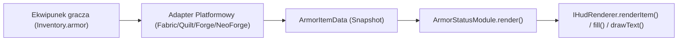

# Moduł Armor Status — Specyfikacja Techniczna i Architektura

## 1. Cel i Wymagania

Moduł `ArmorStatusModule` (`pl.zombek.client.core.modules.pvp.ArmorStatusModule`) odpowiada za prezentację w czasie rzeczywistym aktualnie założonych przez gracza elementów pancerza (Hełm, Napierśnik, Nogawice, Buty) bezpośrednio na ekranie gry (HUD).

Moduł:
- Prezentuje prawdziwe ikony przedmiotów renderowane natywnie przez silnik Minecrafta;
- Wyświetla rzeczywistą wytrzymałość (durability), wartości liczbowe oraz procentowe;
- Wyświetla opcjonalny pasek stanu uszkodzenia pod ikoną przedmiotu;
- Prezentuje nazwy przedmiotów oraz skróty poziomów aktywnych zaklęć (np. `Prot IV`, `Unb III`);
- Obsługuje przedmioty nieposiadające wskaźnika durability (np. dynia, głowy mobów) bez wyświetlania fałszywych wartości;
- Udostępnia opcję ukrywania pustych slotów;
- Zapewnia 5 stylów układu oraz 2 warianty kolejności slotów.

---

## 2. Architektura i Przepływ Danych

Zgodnie ze standardem ZombekClient, cała logika układu, formatowania etykiet, obliczeń matematycznych, progów kolorów i pozycjonowania znajduje się w 100% w module `core` (`pl.zombek.client.core.modules.pvp.ArmorStatusModule`).

Dane o założonym pancerzu dostarczane są przez interfejs `IArmorDataProvider`:

### Klasa Danych `ArmorItemData`:
- `ArmorSlot slot` — slot ekwipunku (`HELMET`, `CHESTPLATE`, `LEGGINGS`, `BOOTS`);
- `String itemId` — identyfikator przedmiotu (np. `diamond_chestplate`);
- `String displayName` — nazwa wyświetlana w grze;
- `int damage` — punkty uszkodzenia;
- `int maxDamage` — maksymalna wytrzymałość;
- `boolean hasDurability` — czy przedmiot zużywa się podczas walki/użytkowania;
- `boolean isEmpty` — czy slot jest pusty;
- `List<String> enchantments` — lista aktywnych enchantów;
- `Object itemHandle` — natywny `ItemStack` przekazywany do renderera.

---

## 3. Matematyka Wytrzymałości (Durability)

W grze Minecraft `damage` reprezentuje zużycie, natomiast `maxDamage` to całkowita wytrzymałość przedmiotu:
$$\text{remainingDurability} = \max(0, \text{maxDamage} - \text{damage})$$
$$\text{durabilityPercentage} = \frac{\text{remainingDurability}}{\text{maxDamage}} \times 100\%$$

Dla przedmiotów niezniszczalnych (`hasDurability == false`):
- `getRemainingDurability() == 0`
- `getDurabilityPercentage() == 100.0%`
- Moduł nie renderuje paska zużycia ani fałszywych liczb.

---

## 4. Progi Kolorystyczne i Kolory Trwałości

Kolor tekstu i paska zużycia zależy od konfigurowalnych progów procentowych:
- **Stan Dobry (`high_threshold`, domyślnie >60%):** zielony `#55FF55`;
- **Stan Średni / Ostrzegawczy (`low_threshold`, domyślnie 30–60%):** żółty `#FFFF55`;
- **Stan Niski (16–29%):** czerwony `#FF5555`;
- **Stan Krytyczny (<=15%):** ciemnoczerwony `#AA0000`.

---

## 5. Układy Prezentacji (Layout Styles)

1. **`VERTICAL` (Pionowy):** Elementy ułożone pionowo jeden pod drugim.
2. **`HORIZONTAL` (Poziomy):** Elementy ułożone obok siebie w jednej poziomej linii.
3. **`COMPACT` (Kompaktowy):** Zwarte ikony z małym napisem procentowym.
4. **`ICON_ONLY` (Tylko Ikony):** Czyste ikony z mini-paskiem trwałości, idealne dla minimalistycznych interfejsów.
5. **`DETAILED` (Szczegółowy):** Pełna nazwa, procenty, punkty durability i zaklęcia.

Kolejność slotów (`slot_order`):
- `HELMET_TO_BOOTS`: Hełm na górze/lewej, Buty na dole/prawej.
- `BOOTS_TO_HELMET`: Buty na górze/lewej, Hełm na dole/prawej.

---

## 6. Wydajność i Optymalizacja Renderowania

- Odczyt ekwipunku nie alokuje nowych obiektów ani nie wykonuje ciężkich operacji co klatkę.
- Podczas renderowania metoda `render()` korzysta z danych zebranych w `ArmorDataProviderRegistry`.
- Gdy gracz nie posiada założonego pancerza i włączone jest `hide_empty_slots`, moduł pomija cały proces renderowania, redukując narzut do 0.
