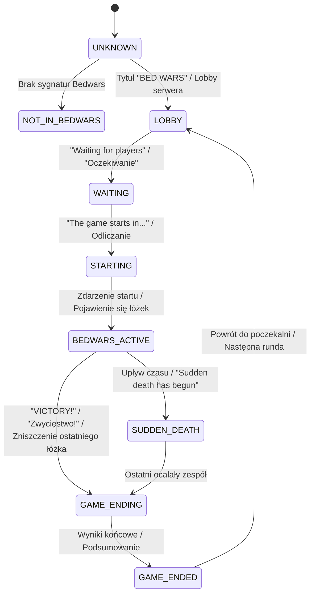

# Moduł Bedwars Game Detector — ZombekClient

## 1. Przegląd i przeznaczenie

`BedwarsGameDetector` to heurystyczny komponent w `pl.zombek.client.core.bedwars.BedwarsGameDetector`, odpowiedzialny za automatyczną identyfikację stanu meczu Bedwars oraz trybu i mapy bez konieczności jakiejkolwiek ręcznej konfiguracji przez gracza.

Moduł analizuje:
1. **Tytuł i linie Scoreboardu** (aktualizowane co sekundę z Minecraft GUI).
2. **Komunikaty systemowe na czacie** (odliczanie przedstartowe, start gry, nagła śmierć, zwycięstwo/porażka).
3. **Listę graczy TabList** (opcjonalna heurystyka weryfikująca liczbę graczy).

---

## 2. Maszyna stanów gry (GameState Machine)

`BedwarsGameState` definiuje stany cyklu życia meczu:

### Klasyfikacja stanów:
- `UNKNOWN`: Stan początkowy przed odebraniem pierwszego scoreboardu.
- `NOT_IN_BEDWARS`: Gracz znajduje się w innym trybie (np. Survival, SkyWars, UHC, Lobby Główne).
- `LOBBY`: Gracz jest w poczekalni Bedwars.
- `WAITING`: Poczekalnia z oczekiwaniem na brakujących graczy (`X/16`).
- `STARTING`: Odliczanie do startu (od 10 s do 1 s).
- `IN_GAME`: Ogólny stan gry w toku (heurystyka cząstkowa).
- `BEDWARS_ACTIVE`: Pełna rozgrywka z aktywnymi łóżkami drużyn.
- `SUDDEN_DEATH`: Ostateczna faza meczu ze spawnem smoków i brakiem możliwości odrodzenia.
- `GAME_ENDING`: Mecz rozstrzygnięty (wyświetlony komunikat zwycięstwa lub eliminacji).
- `GAME_ENDED`: Ekran podsumowania statystyk.

---

## 3. Poziomy pewności wykrywania (Detection Confidence)

Wiarygodność oceny stanu gry jest reprezentowana przez enum `DetectionConfidence`:

| Poziom | Warunek wyznaczenia | Akcja HUD |
| :--- | :--- | :--- |
| **HIGH** | Scoreboard zawiera oficjalny tytuł "BED WARS", odnaleziono co najmniej 2 linie łóżek drużyn oraz wykryto zdarzenie startu na czacie | Pełne wyświetlanie wszystkich sekcji HUD |
| **MEDIUM** | Scoreboard zawiera niestandardowy tytuł serwera (np. "BLOCKSMC", "MINEMEN"), lecz co najmniej 2 linie odpowiadają formatom statusu łóżek | Wyświetlanie HUD z oznaczeniem profilu uniwersalnego |
| **LOW** | Wykryto pojedynczą wzmiankę o Bedwars lub 1 linię łóżka | Wyświetlanie wskaźnika wstępnego |
| **UNKNOWN** | Brak danych meczowych | Opcjonalne ukrycie HUD (`hideWhenNotInBedwars`) |

---

## 4. Wykrywanie trybu gry (BedwarsMode)

Komponent dokonuje automatycznej kategoryzacji trybu rozgrywki na podstawie scoreboardu:

- `SOLO` (8 drużyn po 1 graczu: 8x1)
- `DOUBLES` (8 drużyn po 2 graczy: 8x2)
- `THREE_V_THREE_V_THREE_V_THREE` (4 drużyny po 3 graczy: 4x3)
- `FOUR_V_FOUR_V_FOUR_V_FOUR` (4 drużyny po 4 graczy: 4x4)
- `FOUR_V_FOUR` (2 drużyny po 4 graczy)
- `OTHER` / `CUSTOM` (niestandardowe konfiguracje serwerów prywatnych)

---

## 5. Wykrywanie mapy

Parser linii sprawdza prefiksy:
- `Map: <Nazwa>` (Hypixel, standard międzynarodowy)
- `Mapa: <Nazwa>` (serwery polskie)

Po wykryciu nazwa mapy jest buforowana i przekazywana do nagłówka panelu HUD oraz modułów statystyk sesji.

---

## 6. Bezpieczeństwo i zasady Fair Play

Algorytm opiera się wyłącznie na danych renderowanych w interfejsie użytkownika i buforze tekstowym czatu. Nie wysyła żadnych komend (typu `/whereami` czy `/locraw`) ani nie używa nieudokumentowanych kanałów sieciowych BungeeCord, co gwarantuje pełną niewykrywalność i brak ryzyka zablokowania konta gracza.
