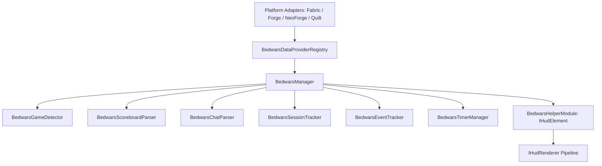

# Moduł Bedwars Helper — ZombekClient

## 1. Przegląd i przeznaczenie

Moduł **Bedwars Helper** (`bedwars_helper`) to rozbudowany, bezpieczny i w 100% zgodny z zasadami fair play moduł HUD w ZombekClient (kategoria `Category.HUD`). Zapewnia graczom czytelny, konfigurowalny i estetyczny interfejs prezentujący najważniejsze informacje o meczu Bedwars w czasie rzeczywistym.

Moduł został zaprojektowany z myślą o uniwersalności (obsługa trybów Hypixel, serwerów polskich oraz serwerów z niestandardowymi szablonami scoreboardu) oraz architekturze wieloplatformowej (Fabric, Forge, NeoForge, Quilt na Minecraft 1.20.4).

### Kluczowe zasady Fair Play
- **Brak automatyzacji**: Moduł nie podejmuje żadnych akcji za gracza (brak auto-bridgingu, auto-buy, auto-queue czy makr).
- **Tylko dane jawne**: Wszystkie prezentowane statystyki opierają się wyłącznie na danych widocznych dla każdego gracza na ekranie (Minecraft Scoreboard, wiadomości na czacie i publiczna lista graczy TabList).
- **Brak ESP i renderowania przez ściany**: Moduł nie lokalizuje łóżek w świecie 3D ani nie zdradza pozycji niewidzialnych przeciwników.
- **Bezpieczeństwo sieciowe**: Moduł działa w 100% lokalnie w kliencie — brak wysyłania podejrzanych pakietów lub zapytań do zewnętrznych API podczas meczu.

---

## 2. Architektura systemu Bedwars Helper

Moduł Bedwars Helper jest zorganizowany w pakiecie `pl.zombek.client.core.bedwars` i składa się z następujących komponentów:



### Podsystemy:
1. **BedwarsManager** — główny koordynator cyklu życia, odbierający pakiety czatu i aktualizacje scoreboardu od adapterów platformowych (`IBedwarsDataProvider`).
2. **BedwarsGameDetector** — heurystyczny automat stanów rozpoznający fazę gry (`LOBBY`, `WAITING`, `STARTING`, `IN_GAME`, `BEDWARS_ACTIVE`, `SUDDEN_DEATH`, `GAME_ENDING`, `GAME_ENDED`).
3. **BedwarsScoreboardParser** — wielowątkowy parser wydobywający nazwę mapy, tryb rozgrywki, stan łóżek drużyn oraz timery generatorów (Diamenty, Szmaragdy, Zniszczenie Łóżek, Nagła Śmierć).
4. **BedwarsChatParser** — bezpieczny analizator komunikatów czatu wychwytujący zniszczenia łóżek, eliminacje graczy i drużyn, zabójstwa ostateczne (Final Kills) oraz komunikaty zwycięstwa i porażki (zarówno w języku angielskim, jak i polskim).
5. **BedwarsTeamBoard** — komponent formatujący stan wszystkich 8 drużyn (Czerwoni, Niebiescy, Zieloni, Żółci, Błękitni, Biali, Różowi, Szarzy) w 6 układach: `COMPACT`, `DETAILED`, `HORIZONTAL`, `VERTICAL`, `ICON`, `TEXT`.
6. **BedwarsSessionTracker** — lokalny rejestr statystyk bieżącej sesji (Zabójstwa, Ostateczne zabójstwa, Zgony, Zniszczone łóżka, Wygrane, Przegrane, Czas trwania meczu) wyposażony w bufor deduplikacji zdarzeń.
7. **BedwarsEventTracker** — dynamiczna tablica powiadomień meczowych (Event Feed) z animacją zanikania, obsługą ikon i filtrowaniem starych zdarzeń.
8. **BedwarsTimerManager** — zegar meczowy odliczający czas do kolejnych poziomów generatorów oraz fazy Sudden Death.

---

## 3. Konfiguracja i grupy ustawień w menu Right Shift

Moduł udostępnia 9 niezależnych grup ustawień zarządzanych przez `Settings Framework` ZombekClient:

| Grupa ustawień | Liczba opcji | Kluczowe parametry |
| :--- | :--- | :--- |
| **Główne (General)** | 6 | Włącznik modułu, tryb ukrywania poza Bedwars (`hideWhenNotInBedwars`), kompaktowy nagłówek, obramowanie, zaokrąglone rogi, przezroczystość tła. |
| **Pozycja (Position)** | 5 | Kotwica HUD (`anchor`), pozycja X/Y, margines wewnętrzny (padding), odstęp między sekcjami (spacing). |
| **Wykrywanie (Detection)** | 4 | Czułość wykrywania (`AUTO`, `HYPIXEL`, `POLISH`, `CUSTOM`), minimalny próg pewności (`LOW`, `MEDIUM`, `HIGH`), automatyczny reset po meczu, powiadomienia o wykryciu. |
| **Tablica drużyn (Team Board)** | 7 | Wyświetlanie tablicy, układ (`COMPACT`, `DETAILED`, `HORIZONTAL`, `VERTICAL`, `ICON`, `TEXT`), ukrywanie wyeliminowanych, wyróżnienie własnej drużyny, styl ikon łóżka (`✓/✕`, `Bed/Cross`, `Letters`). |
| **Śledzenie graczy (Player Tracker)**| 5 | Licznik pozostałych żywych graczy, analiza TabListy, ostrzeżenie o małej liczbie graczy, styl formatowania. |
| **Statystyki sesji (Session Tracker)**| 6 | Wyświetlanie panelu sesji, licznik Kills, Final Kills, Beds Broken, W/L Ratio, format czasu sesji. |
| **Powiadomienia zdarzeń (Event Feed)**| 6 | Lista zdarzeń, maksymalna liczba zdarzeń (1–10), czas wyświetlania (1.0–15.0 s), animacja fade-in/fade-out, wyświetlanie znaczników czasu. |
| **Timery (Timers)** | 5 | Panel timerów, zegar meczu (elapsed time), timery diamentów i szmaragdów, alarm odliczania (< 10 s), kompaktowy pasek timerów. |
| **Parser & Kompatybilność** | 4 | Profil parsera (`HYPIXEL_ENGLISH`, `GENERIC_POLISH`, `CUSTOM`), niestandardowe wzorce regex, tryb debugowania parsera, priorytet Scoreboard vs Chat. |

---

## 4. Przykłady wizualne i układy HUD

Dzięki implementacji `IHudElement`, Bedwars Helper w pełni integruje się z systemem pozycjonowania ZombekClient. Poniżej przedstawiono przykładowe renderowanie panelu w trybie `DETAILED`:

```
+---------------------------------------------+
|  BEDWARS HELPER  -  Speedway [4v4v4v4]      |
|  Status: Mecz aktywny (Pewność: WYSOKA)    |
+---------------------------------------------+
|  DRUŻYNY:                                   |
|   [R] Czerwoni:   ✓ (Ty)   [4 żywych]       |
|   [B] Niebiescy:  ✕        [2 żywych]       |
|   [G] Zieloni:    [E]      [Wyeliminowani]  |
|   [Y] Żółci:      ✓        [3 żywych]       |
+---------------------------------------------+
|  TIMERY:                                    |
|   * Diamenty II:  01:15                     |
|   * Szmaragdy II: 02:40                     |
+---------------------------------------------+
|  SESJA: K: 4 | FK: 2 | Łóżka: 1 | W/L: 3/0 |
+---------------------------------------------+
|  ZDARZENIA:                                 |
|   [⚑] BLUE BED DESTROYED (przez Steve)      |
|   [⚔] FINAL KILL: Alex (przez Steve)        |
+---------------------------------------------+
```

---

## 5. Współistnienie z innymi modułami HUD

Bedwars Helper działa w pełnej harmonii z pozostałymi modułami ZombekClient:
- **Keystrokes & CPS Counter**: Niezależne kotwice renderowania bez nakładania się ramek.
- **Armor Status & Cooldowns**: Prawidłowo obliczane marginesy ekranu.
- **UHC Overlay & Team View**: Wykrywacz Bedwars automatycznie wygasza moduł gdy gracz przechodzi na tryb UHC lub survival, a Team View nie koliduje z listą drużyn Bedwars.
- **Freelook & 1.7 Visuals**: Brak jakiegokolwiek wpływu na animacje i ruch kamery.
