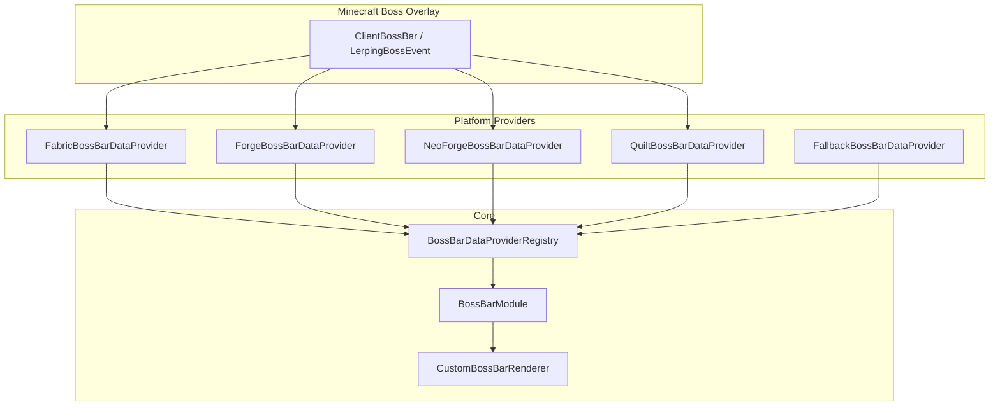

# Boss Bar Module — ZombekClient (Etap 8B2)

## 1. Przeznaczenie i Rola Modułu

Moduł `BossBarModule` (`"boss_bar"`) w ZombekClient zapewnia zaawansowaną personalizację, nowoczesne motywy graficzne oraz płynną interpolację animacji pasków bossów w grze Minecraft (Ender Dragon, Wither, Najazdy / Raids, oraz niestandardowe boss bary serwerowe z pluginów). Zastępuje domyślny interfejs boss bara vanilla ZombekClient Custom Boss Barem, eliminując zjawisko podwójnego renderowania.

Pliki źródłowe:
- Klasa modułu: [BossBarModule.java](file:///c:/Users/Admin/Desktop/jules_session_17875811770345124279/apps/minecraft-client/core/src/main/java/pl/zombek/client/core/modules/hud/bossbar/BossBarModule.java)
- Renderer niestandardowy: [CustomBossBarRenderer.java](file:///c:/Users/Admin/Desktop/jules_session_17875811770345124279/apps/minecraft-client/core/src/main/java/pl/zombek/client/core/hud/bossbar/CustomBossBarRenderer.java)
- Modele danych: [BossBarData.java](file:///c:/Users/Admin/Desktop/jules_session_17875811770345124279/apps/minecraft-client/core/src/main/java/pl/zombek/client/core/hud/bossbar/BossBarData.java), [BossBarStyle.java](file:///c:/Users/Admin/Desktop/jules_session_17875811770345124279/apps/minecraft-client/core/src/main/java/pl/zombek/client/core/hud/bossbar/BossBarStyle.java), [BossBarColor.java](file:///c:/Users/Admin/Desktop/jules_session_17875811770345124279/apps/minecraft-client/core/src/main/java/pl/zombek/client/core/hud/bossbar/BossBarColor.java)

---

## 2. Architektura i Integracja z Loaderami

1. **Przechwytywanie:** Adaptery pobierają aktywne instancje boss barów za pośrednictwem refleksji z wewnętrznej mapy `bossBars` w `BossBarHud` (Fabric/Quilt) lub `events` w `BossHealthOverlay` (Forge/NeoForge).
2. **Bezpieczne Wyłączanie Vanilla:**
   - W Fabric/Quilt: `BossBarHudMixin` sprawdza `BossBarModule.shouldOverrideVanilla()` i anuluje metodę `render(DrawContext)` za pomocą `@Inject(at = @At("HEAD"), cancellable = true)`.
   - W Forge/NeoForge: `ForgeClientEvents` i `NeoForgeClientEvents` przechwytują zdarzenie `RenderGuiOverlayEvent.Pre` dla typu `BOSS_EVENT_PROGRESS` i wywołują `event.setCanceled(true)`.
3. **Płynna Interpolacja Animacji:** Zamiast nagłych skoków paska przy zadawaniu obrażeń, `BossBarData` wspiera interpolację `animatedProgress` według wzoru:
   $$\text{animatedProgress}_{t} = \text{animatedProgress}_{t-1} + (\text{targetProgress} - \text{animatedProgress}_{t-1}) \times \text{speed}$$
   co gwarantuje gładkie, satysfakcjonujące ubywanie zdrowia bossa.

---

## 3. Style Wizualne (`BossBarStyle`)

1. `VANILLA` — klasyczny wygląd znany ze standardowego Minecrafta.
2. `CLASSIC` — elegancki, ciemny pasek z czytelnym podziałem segmentów.
3. `MODERN` — nowoczesny zaokrąglony pasek ze szklanym torem `#0F172A`, gradientowym wypełnieniem i jasnym obramowaniem `#38BDF8`.
4. `MINIMAL` — wąski, subtelny pasek o wysokości zaledwie 3–5px.
5. `SEGMENTED` — pasek z wyraźnymi nacięciami (6, 10, 12 lub 20 segmentów) odpowiadającymi overlayowi z gry.
6. `CUSTOM` — pełna konfiguracja wymiarów, zaokrągleń, kolorów i grubości krawędzi.

---

## 4. Obsługa Wielu Bossów

Gdy na ekranie pojawia się kilka boss barów (np. Smok Kresu oraz Wither, lub wielu najeźdźców):
- `max_boss_bars` ogranicza liczbę jednocześnie renderowanych pasków (1–6).
- `stack_direction` (`DOWN` lub `UP`) określa kierunek układania kolejnych pasków.
- `spacing` reguluje odstęp w pikselach między paskami.
- `use_boss_color` zachowuje oryginalne kolory z gry (różowy dla Smoka, fioletowy dla Withera, czerwony dla rajdu) lub wymusza jednolity kolor wybrany przez gracza.

---

## 5. Konfiguracja w Menu Right Shift

- **`general`:** `use_custom_renderer`, `show_boss_bar`, `show_boss_name`, `show_progress_bar`, `show_percentage`, `max_boss_bars`, `preview_mode`.
- **`style`:** `boss_bar_style`, `bar_width` ($100-350$px), `bar_height` ($3-16$px), `corner_radius`, `border_thickness`.
- **`colors`:** `use_boss_color`, `custom_bar_color`, `text_color`, `bg_color`, `border_color`.
- **`behavior`:** `smooth_animation`, `animation_speed` ($0.05-1.0$), `hide_in_spectator`, `stack_direction`, `spacing`.
- **`layout`:** `anchor` (`TOP_CENTER` domyślnie), `pos_x`, `pos_y`, `scale`.
