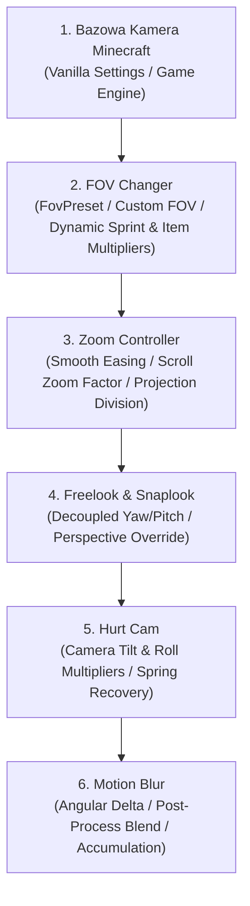

# Priorytet i Sekwencja Efektów Kamery — Dokumentacja Architektoniczna

## 1. Wprowadzenie

Wielomodułowy system modyfikacji kamery wymaga ścisłego porządku obliczeń, aby zapobiec konfliktom renderowania, zniekształceniom obrazu lub wzajemnemu nadpisywaniu stanów.

Poniższy dokument opisuje deterministyczną, 6-stopniową sekwencję potoku kamery (Camera Pipeline) w ZombekClient.

---

## 2. Kolejność Wykonywania w Potoku Renderowania

### Stopień 1: Bazowa Kamera Minecraft (Base Camera)
- Odczyt podstawowych parametrów kamery z opcji Minecraft (Vanilla Options FOV) oraz pozycji postaci gracza.

### Stopień 2: FOV Changer (`CameraFovController`)
- Zastosowanie wybranego profilu pola widzenia (`FovPreset` lub wartość niestandardowa z zakresu $[30^\circ, 150^\circ]$).
- Aplikacja dynamicznych mnożników ruchu gracza (sprint: 1.15x, ruch: 1.05x, użycie przedmiotu/łuk: 0.85x) lub ich zablokowanie (`disable_dynamic_fov`).

### Stopień 3: Zoom Controller (`ZoomController`)
- Obliczenie współczynnika przybliżenia na podstawie krzywej interpolacji czasowej (`ZoomEasing`).
- Dzielenie pola widzenia przez współczynnik zoomu:
  $$\text{FOV} \leftarrow \frac{\text{FOV}}{\text{ZoomFactor}}$$
- Ograniczenie wartości końcowej do bezpiecznego przedziału projekcji $[5.0^\circ, 170.0^\circ]$.

### Stopień 4: Freelook & Snaplook
- Nadpisanie kątów obrotu głowy ($\text{Yaw}, \text{Pitch}$) w celach inspekcji otoczenia bez zmiany faktycznego kierunku patrzenia postaci na serwerze.

### Stopień 5: Hurt Cam (`HurtCamController`)
- Modyfikacja kąta przechyłu ($\text{Roll}$) oraz przesunięć wstrząsu kamery przy otrzymaniu obrażeń (`VANILLA`, `DISABLED`, `REDUCED`, `CUSTOM`).

### Stopień 6: Motion Blur (`MotionBlurController`)
- Obliczenie dynamicznej delty obrotu kamery ($\Delta\text{Yaw}, \Delta\text{Pitch}$) z obsługą zawijania $360^\circ$.
- Sterowanie buforem akumulacji klatek / shaderem post-processingu z uwzględnieniem filtrów wyłączenia (GUI, Pauza, Spectator).

---

## 3. Zapewnienie Integralności i Niezawodności

1. **Brak pętli sprzężenia zwrotnego:** Żaden krok potoku nie modyfikuje wejścia kroku poprzedzającego.
2. **Zachowanie stanu użytkownika:** Użytkownik może zmienić suwak bazowego FOV podczas aktywnego Zoomu — zmiana ta zostaje zapamiętana i poprawnie przeliczona w kolejnej klatce.
3. **Izolacja klatka-do-klatki:** Wszystkie interpolacje operują na czasie monotonicznym `System.nanoTime()` lub `partialTicks`, zapobiegając desynchronizacji przy spadkach liczby klatek na sekundę.
