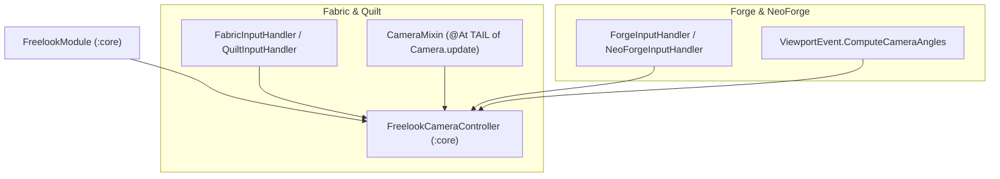

# ZombekClient — Camera Integration Architecture

## 1. Cel i Założenia Projektowe

Integracja kamery w ZombekClient ma na celu umożliwienie pełnej kontroli perspektywy i kąta rzutowania widoku gracza (`FreelookModule`) z zachowaniem stuprocentowej zgodności z mechaniką gry oraz protokołem sieciowym serwerów Minecraft.

Główne zasady architektury:
1. **Zero-Packet Manipulation**: Kąt patrzenia gracza zarejestrowany na serwerze nie jest zmieniany. Pakiety `PlayerMoveC2SPacket.LookAndOnGround` odzwierciedlają prawdziwy wektor ciała gracza.
2. **Kierunek ruchu zgodny z ciałem**: Naciśnięcie klawisza `W` powoduje ruch postaci do przodu względem jej ciała, a nie względem kamery freelooka.
3. **Multi-loader Unification**: Wspólna logika stanu znajduje się w `FreelookCameraController` w module `:core`. Adaptery poszczególnych loaderów implementują jedynie minimalny punkt styku (hook) z silnikiem renderowania perspektywy.

---

## 2. Implementacja w Poszczególnych Loaderach



### 2.1 Fabric & Quilt
- **Punkt zaczepienia renderowania**: `CameraMixin.java` wstrzykuje się do metody `Camera.update(BlockView, Entity, boolean, boolean, float)`:
  ```java
  @Inject(method = "update", at = @At("TAIL"))
  private void onUpdateTail(BlockView area, Entity focusedEntity, boolean thirdPerson, boolean inverseView, float tickDelta, CallbackInfo ci) {
      FreelookCameraController controller = FreelookCameraController.getInstance();
      if (controller.isControllingCamera()) {
          this.setRotation(controller.getCameraYaw(), controller.getCameraPitch());
      }
  }
  ```
- **Zabezpieczenie wejścia**: W pętli `ClientTickEvents.END_CLIENT_TICK` wejściowe delty myszy są aplikowane do rotacji kamery, podczas gdy właściwości ciała gracza (`player.setYaw()`, `player.headYaw`, `player.bodyYaw`) są przywracane do oryginalnych wartości.

### 2.2 Forge & NeoForge
- **Punkt zaczepienia renderowania**: Moduł subskrybuje zdarzenie `ViewportEvent.ComputeCameraAngles`:
  ```java
  @SubscribeEvent
  public static void onComputeCameraAngles(ViewportEvent.ComputeCameraAngles event) {
      FreelookCameraController controller = FreelookCameraController.getInstance();
      if (controller.isControllingCamera()) {
          event.setYaw(controller.getCameraYaw());
          event.setPitch(controller.getCameraPitch());
      }
  }
  ```
- Zmiana kątów następuje w fazie obliczeń matrycy kamery widoku klienta, bez dotykania encji gracza.

---

## 3. Matematyka Interpolacji i Snapback

Podczas zwalniania przycisku Freelooka (w trybie Snapback), kamera płynnie powraca do kąta rotacji gracza.
Współczynnik postępu animacji:
$$t = \text{clamp}\left(\frac{T_{now} - T_{start}}{\text{duration}}, 0.0, 1.0\right)$$

Obsługiwane funkcje przejścia:
- **`LINEAR`**: $f(t) = t$
- **`EASE_OUT`**: $f(t) = 1.0 - (1.0 - t)^2$
- **`SMOOTH_STEP`**: $f(t) = t \cdot t \cdot (3.0 - 2.0 \cdot t)$

Interpolacja kąta `yaw` wykorzystuje najkrótszą drogę po okręgu:
$$\Delta_{yaw} = \text{wrapDegrees}(yaw_{target} - yaw_{start})$$
$$yaw_{current} = yaw_{start} + \Delta_{yaw} \cdot f(t)$$
