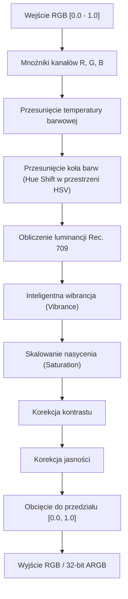

# Matematyczny potok gradacji barw (ColorAdjustmentPipeline)

## 1. Architektura potoku

Klasa [ColorAdjustmentPipeline](file:///c:/Users/Admin/Desktop/jules_session_17875811770345124279/apps/minecraft-client/core/src/main/java/pl/zombek/client/core/rendereffect/color/ColorAdjustmentPipeline.java) przetwarza wartości barwne RGB w ściśle określonym porządku:

## 2. Równania matematyczne

### Luminancja Rec. 709
$$L = 0.2126 \cdot R + 0.7152 \cdot G + 0.0722 \cdot B$$

### Wibrancja
$$factor = (1.0 - (\max(R,G,B) - \min(R,G,B))) \cdot vibrance$$
$$C' = C + (C - L) \cdot factor$$

### Nasycenie
$$C'' = L + (C' - L) \cdot saturation$$

### Kontrast
$$C''' = (C'' - 0.5) \cdot contrast + 0.5$$

### Ochrona HUD
Gdy renderowany jest element docelowy `TargetType.HUD` i włączona jest flaga `preserveHud`, kontroler natychmiast omija potok obliczeniowy i zwraca nienaruszoną waniliową barwę.
