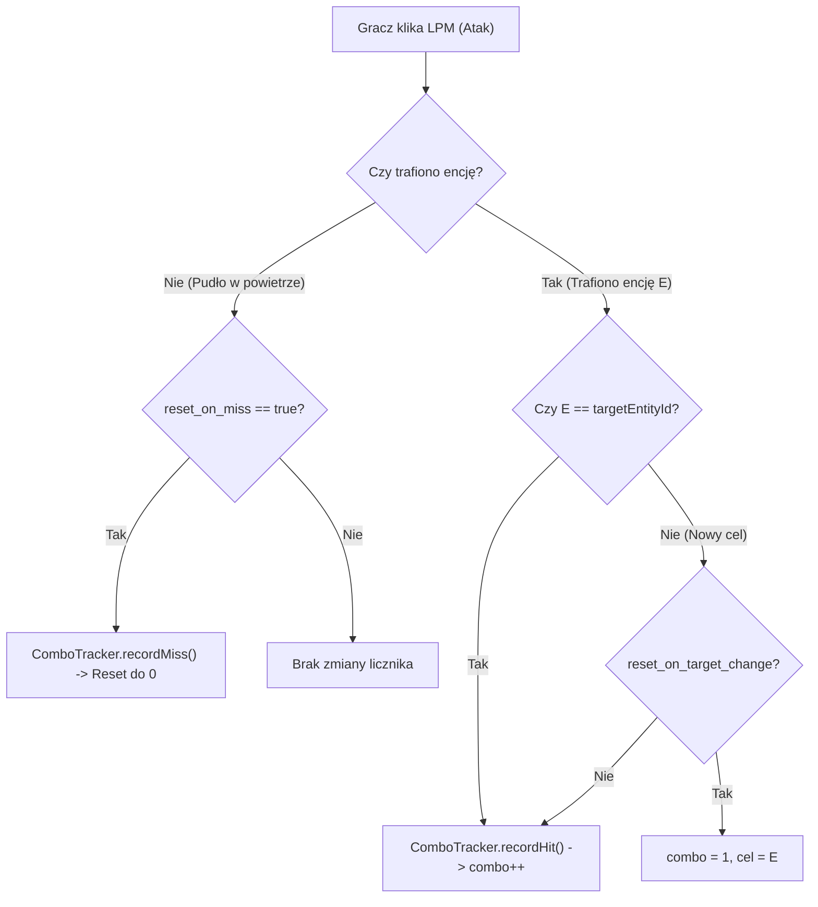

# Moduł Combo Counter — Specyfikacja Techniczna i Architektura

## 1. Cel i Wymagania

Moduł `ComboCounterModule` (`pl.zombek.client.core.modules.pvp.ComboCounterModule`) odpowiada za precyzyjne śledzenie i wyświetlanie liczby kolejnych skutecznych uderzeń zadanych przeciwnikowi w walce PvP (serii trafień — Combo).

Moduł:
- Wykrywa rzeczywiste trafienia w encje na podstawie legalnych sygnałów klienta gry;
- **Nie jest licznikiem samych kliknięć myszy**;
- Rozróżnia próby ataku, uderzenia w powietrze (pudła), zarejestrowane trafienia oraz zmiany przeciwnika;
- Obsługuje 4 poziomy wyróżnień kolorystycznych (Tiers 1–4) zależne od wielkości serii;
- Posiada animację pulsowania skali przy trafieniu;
- Prezentuje rekord sesji (Best Combo) oraz czas trwania serii;
- Nie modyfikuje pakietów sieciowych, nie obchodzi mechanik serwerowych i nie ułatwia celowania.

---

## 2. Architektura Śledzenia Trafień (`ComboTracker`)

Silnik śledzenia serii zaimplementowano w klasie `pl.zombek.client.core.tracking.ComboTracker`:
- **Identyfikacja Celu (`targetEntityId`):** Każde trafienie wiąże się z ID atakowanej encji.
- **Tłumienie Duplikatów (Deduplication):** Minimalny odstęp między zaliczeniem trafień wynosi 50 ms (`MIN_HIT_INTERVAL_NANOS`), co zabezpiecza przed wielokrotnym naliczeniem tego samego ataku w obrębie jednego ticka.
- **Przesuwny Czas Wygaśnięcia (Timeout Expiration):** Jeśli gracz nie zada kolejnego ciosu w czasie określonym przez `reset_timeout_ms` (domyślnie 2000 ms), seria automatycznie wygasa.
- **Konfigurowalna Zmiana Celu (`reset_on_target_change`):** Domyślnie uderzenie innej encji rozpoczyna nową serię od 1 na nowym celu.

---

## 3. Ograniczenia Klientowego Śledzenia Hit Registration

Minecraft jest grą sieciową z autorytatywnym serwerem (Server-Authoritative Combat). Oznacza to, że:
1. Klient gry generuje zdarzenie ataku lokalnie (`AttackEntityCallback` na Fabric/Quilt, `AttackEntityEvent` na Forge/NeoForge).
2. Serwer weryfikuje dystans, opóźnienie (ping), pozycję przeciwnika i hitboxy, decydując o ostatecznym zadaniu obrażeń.
3. Klient ZombekClient opiera rejestrację trafień na potwierdzonych sygnałach zdarzeń ataku encji w zasięgu wzroku gracza oraz stanie hurtTime celu.
4. ZombekClient **nie oszukuje** i nie gwarantuje akceptacji każdego ciosu przez restrykcyjne antycheaty serwerowe (np. przy dużym pingu gracza), lecz precyzyjnie mierzy serię ciosów wyprowadzonych i potwierdzonych w warstwie klienta.

---

## 4. Wyróżnienia Kolorystyczne (Milestones)

Licznik automatycznie zmienia kolor w miarę wzrostu serii ciosów:
- **Tier 1 (1–3 uderzenia):** Biały `#FFFFFF` (seria bazowa);
- **Tier 2 (4–6 uderzeń):** Jasnoniebieski `#38BDF8` (dobra seria);
- **Tier 3 (7–9 uderzeń):** Złoty / Bursztynowy `#F59E0B` (wysoka seria);
- **Tier 4 (10+ uderzeń):** Ognisty Czerwony `#EF4444` (mistrzowska seria).

Wszystkie progi oraz barwy są w pełni modyfikowalne w ustawieniach modułu.

---

## 5. Style Prezentacji

- `STANDARD`: `COMBO: 3 Hits`
- `COMPACT`: `3`
- `BOXED`: Wartość w wycentrowanej ramce z tłem
- `DETAILED`: Wartość bieżąca, rekord sesji (`Best: 12`) oraz stoper (`2.4s`).
