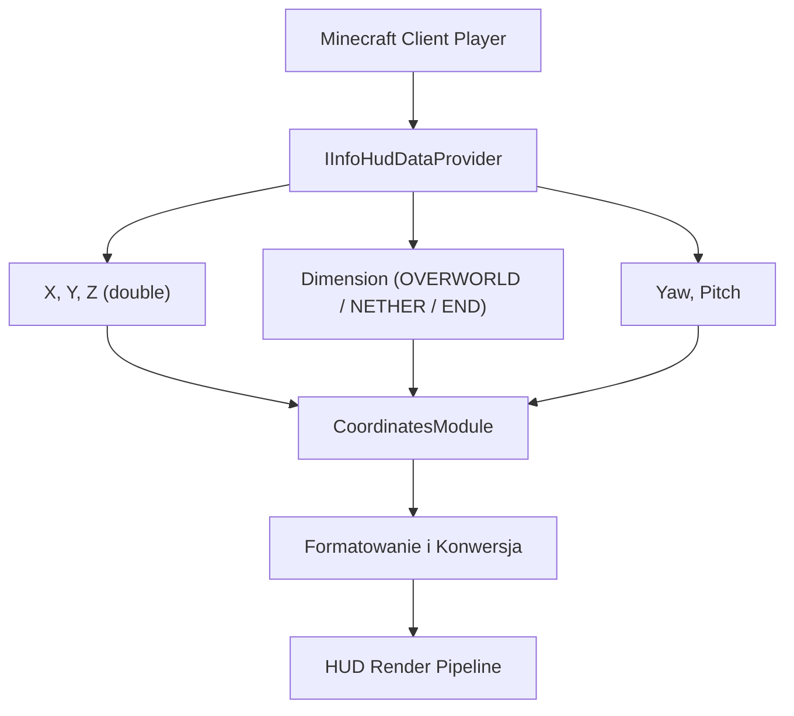

# Coordinates Module — Specyfikacja Techniczna i Architektura

## 1. Cel i Założenia

Moduł `CoordinatesModule` (`pl.zombek.client.core.modules.hud.info.CoordinatesModule`, ID: `"coordinates"`) odpowiada za uniwersalne, czytelne i konfigurowalne wyświetlanie współrzędnych przestrzennych gracza w świecie Minecraft.

Moduł:
- Pobiera rzeczywiste dane z silnika gry za pośrednictwem interfejsu `IInfoHudDataProvider`;
- Działa w trybie jednoosobowym (Singleplayer) oraz wieloosobowym (Multiplayer);
- Wspiera wszystkie wspierane loadery: Fabric, Forge, NeoForge i Quilt;
- Oferuje elastyczne formatowanie (pełne, całkowitoliczbowe, kompaktowe, wieloliniowe);
- Umożliwia automatyczną konwersję współrzędnych pomiędzy Overworld a Netherem;
- Prezentuje dodatkowe dane nawigacyjne: kierunek patrzenia (Facing), koordynaty chunka oraz plik regionu Anvil (`.mca`);
- Jest w pełni przygotowany do integracji z edytorem HUD i Right Shift GUI.

---

## 2. Źródło Danych i Przeliczanie Współrzędnych

Dostęp do współrzędnych gracza realizowany jest przez abstrakcję `IInfoHudDataProvider`:



### 2.1 Konwersja Nether <-> Overworld

Minecraft stosuje stałe skalowanie horyzontalne $8:1$ pomiędzy wymiarami Overworld i Nether:
- Gdy gracz znajduje się w **Overworld**: moduł wylicza odpowiednik współrzędnych w Netherze jako:
  $$X_{\text{nether}} = \lfloor X / 8 \rfloor, \quad Z_{\text{nether}} = \lfloor Z / 8 \rfloor$$
- Gdy gracz znajduje się w **Netherze**: moduł wylicza odpowiednik współrzędnych w Overworld jako:
  $$X_{\text{overworld}} = \lfloor X \times 8 \rfloor, \quad Z_{\text{overworld}} = \lfloor Z \times 8 \rfloor$$
- W wymiarze **End** lub wymiarach niestandardowych (custom dimensions) konwersja jest automatycznie pomijana.

### 2.2 Precyzja Miejsc po Przecinku

Współrzędne $X$, $Y$, $Z$ mogą być formatowane z precyzją od 0 do 3 miejsc po przecinku (ustawienie `decimal_precision`):
- `0`: zaokrąglenie do pełnych bloków (`Math.floor`);
- `1`: format `%.1f`;
- `2`: format `%.2f`;
- `3`: format `%.3f`.

### 2.3 Koordynaty Chunka i Regionu

- **Koordynaty chunka:**
  $$ChunkX = \lfloor X / 16 \rfloor, \quad ChunkZ = \lfloor Z / 16 \rfloor$$
  Relatywne położenie wewnątrz chunka: $[X \pmod{16}, Z \pmod{16}]$.
- **Plik regionu Anvil:**
  $$RegionX = \lfloor ChunkX / 32 \rfloor = \lfloor X / 512 \rfloor, \quad RegionZ = \lfloor ChunkZ / 32 \rfloor = \lfloor Z / 512 \rfloor$$
  Format nazwy pliku na dysku: `r.RegionX.RegionZ.mca`.

---

## 3. Formaty Wyświetlania (`CoordinateFormat`)

Moduł udostępnia 4 gotowe formaty prezentacji:

1. **`FULL`:**
   Pełna linia z prefiksami osi:
   `XYZ: 124.5 / 64.0 / -312.8`
2. **`BLOCK`:**
   Współrzędne całkowite (blokowe):
   `X: 124 Y: 64 Z: -312`
3. **`COMPACT`:**
   Skrócona, minimalistyczna forma bez zbędnych etykiet:
   `124, 64, -312`
4. **`SEPARATE`:**
   Wieloliniowy układ blokowy (każda oś w osobnej linijce):
   ```text
   X: 124.5
   Y: 64.0
   Z: -312.8
   Nether: [15, -39]
   Facing: South (+Z)
   ```

---

## 4. Typowane Ustawienia Modułu

| Grupa | Klucz | Typ | Domyślnie | Opis |
| :--- | :--- | :--- | :--- | :--- |
| `general` | `enabled` | `Boolean` | `false` | Główny przełącznik modułu Coordinates |
| `display` | `format` | `Enum<CoordinateFormat>` | `BLOCK` | Wybór formatu: `FULL`, `BLOCK`, `COMPACT`, `SEPARATE` |
| `display` | `decimal_precision` | `Number` (0–3) | `1` | Liczba miejsc po przecinku współrzędnych |
| `display` | `show_nether_conversion`| `Boolean` | `true` | Wyświetlanie przeliczonych koordynatów Nether / Overworld |
| `display` | `show_facing` | `Boolean` | `true` | Wyświetlanie kierunku patrzenia (np. `South (+Z)`) |
| `display` | `show_biome` | `Boolean` | `false` | Wyświetlanie nazwy aktualnego biomu |
| `display` | `show_chunk` | `Boolean` | `false` | Wyświetlanie koordynatów chunka i pliku `.mca` |
| `colors` | `style` | `Enum<HudComponentStyle>`| `CLASSIC` | Styl elementu: `MINIMAL`, `CLASSIC`, `MODERN`, `CUSTOM` |
| `colors` | `text_color` | `Color` | `0xFFFFFFFF` | Kolor tekstu współrzędnych |
| `colors` | `label_color` | `Color` | `0xFFAAAAAA` | Kolor etykiet osi (X, Y, Z) |
| `colors` | `secondary_color`| `Color` | `0xFFFF5555` | Kolor dodatkowy (Nether coords, facing) |
| `colors` | `bg_color` | `Color` | `0x80000000` | Kolor i przezroczystość tła |
| `layout` | `anchor` | `Enum<HudAnchor>` | `TOP_LEFT` | Punkt zakotwiczenia na ekranie |
| `layout` | `pos_x` | `Number` (0–4000) | `4` | Pozycja pozioma X |
| `layout` | `pos_y` | `Number` (0–4000) | `4` | Pozycja pionowa Y |
| `layout` | `scale` | `Number` (0.5–2.0) | `1.0` | Skala renderowania |

---

## 5. Style Prezentacji (`HudComponentStyle`)

- **`MINIMAL`:** Czysty tekst bez tła i ramek.
- **`CLASSIC`:** Ciemne, półprzezroczyste tło z subtelną ramką (klasyczny wygląd PvP klientów).
- **`MODERN`:** Nowoczesna stylistyka z zaokrąglonymi rogami, akcentem kolorystycznym i miękkim cieniem.
- **`CUSTOM`:** Użytkownik ma pełną kontrolę nad kolorami tekstu, tła i obramowania.
