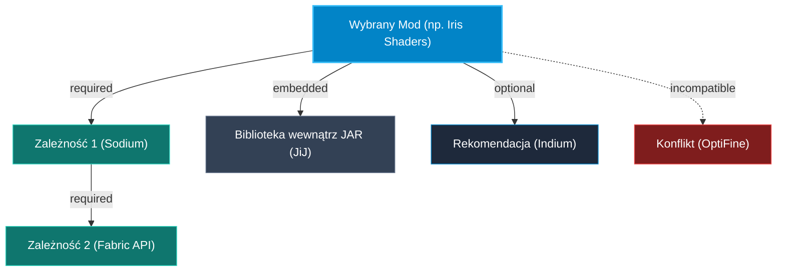

# Rekurencyjne Rozwiązywanie Zależności (Dependency Resolution)

Dokumentacja techniczna silnika analizy i rekurencyjnego rozwiązywania zależności modyfikacji Minecraft Java Edition w launcherze **ZombekClient**.

---

## 1. Architektura i Kontekst

Modyfikacje w ekosystemie Minecraft (Fabric, Forge, NeoForge, Quilt) rzadko funkcjonują jako odizolowane jednostki. W praktyce tworzą one grafy zależności (np. mod wizualny wymaga silnika renderującego, który wymaga wspólnej biblioteki API).

Silnik `ModDependencyResolver` odpowiada za:
1. Rekurencyjną analizę powiązań od korzenia do liści grafu ($A \rightarrow B \rightarrow C \rightarrow D$).
2. Zgodność ze specyfikacją relacji Modrinth API v2.
3. Wykrywanie zależności zagnieżdżonych (Jar-in-Jar / `embedded`).
4. Eliminację cykli zależności bez przepełnienia stosu.
5. Dobór optymalnego wydania spełniającego kryteria środowiska (loader, wersja gry, kanał stabilności).



---

## 2. Typy Zależności w Modrinth API

Każde wydanie (`ModrinthVersion`) w Modrinth API posiada tablicę obiektów `dependencies`:

| Typ Zależności | Wartość API | Działanie Silnika ZombekClient |
| :--- | :--- | :--- |
| **Wymagana** | `required` | Bezwzględnie konieczna. Silnik wyszukuje kompatybilne wydanie i dodaje je do listy `toInstall`. |
| **Opcjonalna** | `optional` | Rekomendowane rozszerzenie. Prezentowane w UI jako sugestia (`optionalRecommendations`) — gracz decyduje. |
| **Niekompatybilna** | `incompatible` | Zdeklarowany konflikt. Jeśli kolidujący mod jest zainstalowany w instancji, transakcja zostaje zablokowana. |
| **Zagnieżdżona** | `embedded` | Biblioteka spakowana wewnątrz pliku JAR (JiJ). Rejestrowana w `alreadySatisfied` z flagą `isEmbedded: true` — **brak pobierania duplikatu**. |

---

## 3. Algorytm Rozwiązywania Zależności

Procedura realizowana w `ModDependencyResolver.resolvePlan`:

1. **Inicjalizacja struktur:**
   - `visitedProjects: Set<string>` — zbiór przetworzonych identyfikatorów projektów.
   - `visitedVersions: Set<string>` — zbiór sprawdzonych identyfikatorów wydań.
   - `toInstallMap: Map<string, ModDependencyPlanItem>` — plan instalacji.
   - `alreadySatisfied: Array<...>` — zależności spełnione lokalnie lub wkomponowane w JAR.

2. **Detekcja cykli:**
   Przed wykonaniem zapytania sprawdzany jest warunek:
   ```ts
   if (visitedProjects.has(depProjectId) || visitedVersions.has(depVersionId)) {
     return; // Ochrona przed cyklem (np. Mod A <-> Mod B)
   }
   ```

3. **Weryfikacja lokalna (Local Satisfaction):**
   Sprawdzenie czy mod o danym identyfikatorze projektu lub nazwie jest już zainstalowany i włączony w instancji gry. Jeśli tak, zależność jest uznawana za spełnioną i nie jest duplikowana w kolejce pobierania.

4. **Selekcja wydania (Candidate Selection):**
   Jeśli zależność wskazuje konkretne `version_id`, pobierana jest ta wersja. Jeśli wskazuje jedynie `project_id`, silnik odpytuje Modrinth API o listę wydań projektu i filtruje:
   - Wersja gry: musi zawierać `targetInstance.minecraftVersion`.
   - Modloader: musi zawierać `targetInstance.loader` (lub `fabric` przy instancji `quilt`).
   - Typ wydania: preferencja `release` (zgodnie z polityką instancji).

5. **Rekurencja:**
   Dla każdego znalezionego wydania zależności algorytm rekurencyjnie analizuje jego własną tablicę `dependencies`.

---

## 4. Obsługa Konfliktów Środowiskowych

Moduł `ModConflictResolver` przeprowadza audyt przedzatwierdzeniowy:

1. **Loader Mismatch:**
   - Wykrywa próby uruchomienia modów stworzonych dla Forge na silniku Fabric lub odwrotnie.
   - Uwzględnia kompatybilność wsteczną Quilt (Quilt uruchamia mody Fabric).
2. **Minecraft Version Mismatch:**
   - Blokuje instalację modów z innych wersji głównych gry (np. mod dla 1.19.2 w instancji 1.20.1).
3. **Pinned Version Collision:**
   - Jeśli zależność wymaga aktualizacji modu, który w pliku `modpack.lock.json` ma ustawioną flagę `pinned: true`, silnik generuje ostrzeżenie o kolizji i wstrzymuje automatyczną nadpisanie wersji.
