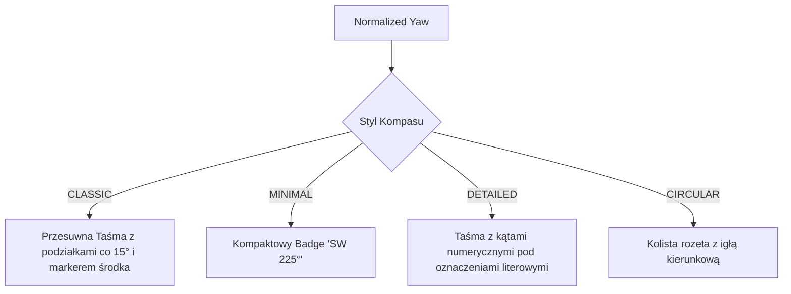

# Direction HUD Module — Specyfikacja Techniczna i Architektura

## 1. Cel i Założenia

Moduł `DirectionHudModule` (`pl.zombek.client.core.modules.hud.info.DirectionHudModule`, ID: `"direction_hud"`) odpowiada za graficzną i tekstową prezentację kierunku geograficznego, w który spogląda gracz w świecie gry.

Moduł:
- Pobiera kąt obrotu kamery (Yaw) za pośrednictwem `IInfoHudDataProvider`;
- Posiada precyzyjną normalizację kątów w zakresie $[0^\circ, 360^\circ)$ oraz bezszwową interpolację na granicy $359^\circ \leftrightarrow 0^\circ$;
- Udostępnia 4 zróżnicowane style kompasu (w tym przesuwną taśmę kompasową, minimalistyczny badge i rozetę);
- Integruje się z systemem drużynowym (`ITeamDirectionProvider`), nanosząc znaczniki sojuszników bezpośrednio na taśmę kompasu;
- Działa we wszystkich loaderach (Fabric, Forge, NeoForge, Quilt) bez użycia ciężkich zasobów graficznych.

---

## 2. Algorytm Mapowania Kątów i Kierunków

Minecraft podaje kąt `yaw` gracza w stopniach, gdzie wartości mogą być ujemne lub przekraczać $360^\circ$. Moduł dokonuje matematycznej normalizacji:

$$\text{normalizedYaw} = ((\text{rawYaw} \pmod{360}) + 360) \pmod{360}$$

### 2.1 Podział na 8 Kierunków Świata (`CompassDirection`)

Kąt $\text{normalizedYaw}$ zostaje zmapowany na 8 sektorów o szerokości $45^\circ$ każdy:

| Kierunek | Oznaczenie | Zakres Kątowy | Oś w Świecie Gry |
| :--- | :--- | :--- | :--- |
| **South** | `S` | $[337.5^\circ, 360^\circ) \cup [0^\circ, 22.5^\circ)$ | $+Z$ |
| **South-West** | `SW` | $[22.5^\circ, 67.5^\circ)$ | $-X, +Z$ |
| **West** | `W` | $[67.5^\circ, 112.5^\circ)$ | $-X$ |
| **North-West** | `NW` | $[112.5^\circ, 157.5^\circ)$ | $-X, -Z$ |
| **North** | `N` | $[157.5^\circ, 202.5^\circ)$ | $-Z$ |
| **North-East** | `NE` | $[202.5^\circ, 247.5^\circ)$ | $+X, -Z$ |
| **East** | `E` | $[247.5^\circ, 292.5^\circ)$ | $+X$ |
| **South-East** | `SE` | $[292.5^\circ, 337.5^\circ)$ | $+X, +Z$ |

*Uwaga: W standardowej konwencji współrzędnych Minecrafta kąt $0^\circ$ odpowiada kierunkowi Południowemu ($+Z$), a kąt $180^\circ$ kierunkowi Północnemu ($-Z$).*

---

## 3. Style Kompasu (`CompassStyle`)

1. **`CLASSIC`:**
   Horyzontalna taśma kompasowa wycentrowana na środku ekranu lub w zadanym punkcie HUD. Wraz z obrotem gracza taśma płynnie przesuwa oznaczenia kierunków (N, NE, E, SE, S, SW, W, NW) oraz podziałki co $15^\circ$. Centralny wskaźnik (marker) wskazuje precyzyjnie aktualny kurs.
2. **`MINIMAL`:**
   Prosty, lekki wskaźnik tekstowy wyświetlający skrót kierunku oraz wartość w stopniach, np. `[S 12°]`.
3. **`DETAILED`:**
   Podwójna taśma kompasowa: na górnym poziomie wyświetlane są symbole kierunków, a na dolnym precyzyjne wartości liczbowe kątów.
4. **`CIRCULAR`:**
   Okrągły mini-kompas ze statyczną lub obracającą się różą wiatrów.

---

## 4. Integracja z Systemem Drużynowym (Team View)

W trybie taśmy (`CLASSIC` i `DETAILED`), moduł komunikuje się z interfejsem `ITeamDirectionProvider`:
- Wylicza kąt azymutu do każdego aktywnego sojusznika w świecie gry:
  $$\Delta X = X_{\text{member}} - X_{\text{player}}, \quad \Delta Z = Z_{\text{member}} - Z_{\text{player}}$$
  $$\text{targetYaw} = ((\text{toDegrees}(\operatorname{atan2}(-\Delta X, \Delta Z)) \pmod{360}) + 360) \pmod{360}$$
- Jeśli sojusznik znajduje się w polu widzenia taśmy kompasowej (zazwyczaj $\pm 45^\circ$ od środka), na taśmie renderowana jest mała ikona/trójkąt w kolorze przypisanym do danego członka drużyny wraz ze wskaźnikiem dystansu.

---

## 5. Typowane Ustawienia Modułu

| Grupa | Klucz | Typ | Domyślnie | Opis |
| :--- | :--- | :--- | :--- | :--- |
| `general` | `enabled` | `Boolean` | `false` | Włączenie modułu Direction HUD |
| `display` | `compass_style` | `Enum<CompassStyle>` | `CLASSIC` | Styl kompasu: `CLASSIC`, `MINIMAL`, `DETAILED`, `CIRCULAR` |
| `display` | `tape_width` | `Number` (60–300) | `160` | Szerokość taśmy kompasowej w pikselach |
| `display` | `tape_fov` | `Number` (30–120) | `90` | Widoczne pole kątowe na taśmie (w stopniach) |
| `display` | `show_degrees` | `Boolean` | `true` | Wyświetlanie wartości kątowej w stopniach |
| `display` | `show_team_markers` | `Boolean` | `true` | Rysowanie pozycji członków drużyny na taśmie |
| `colors` | `marker_color` | `Color` | `0xFFFF3333` | Kolor centralnego znacznika taśmy |
| `colors` | `cardinal_color` | `Color` | `0xFF55FFFF` | Kolor głównych kierunków świata (N, S, E, W) |
| `colors` | `ordinal_color` | `Color` | `0xFFFFFFFF` | Kolor kierunków pośrednich (NE, NW, SE, SW) |
| `colors` | `bg_color` | `Color` | `0x60000000` | Kolor i przezroczystość tła taśmy |
| `layout` | `anchor` | `Enum<HudAnchor>` | `TOP_CENTER` | Zakotwiczenie modułu na ekranie |
| `layout` | `pos_x` | `Number` | `0` | Pozycja pozioma |
| `layout` | `pos_y` | `Number` | `18` | Pozycja pionowa (tuż pod górną krawędzią ekranu) |
| `layout` | `scale` | `Number` | `1.0` | Skalowanie elementu HUD |
