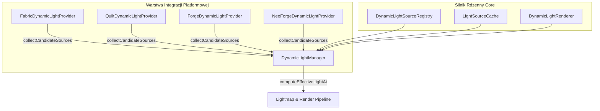

# Menedżer Dynamicznego Oświetlenia (DynamicLightManager)

## 1. Architektura i Rola
`DynamicLightManager` stanowi centralny silnik koordynujący zbieranie, klasyfikację, sortowanie dystansowe oraz obliczanie intensywności dynamicznych źródeł światła w ZombekClient.

Moduł wykorzystuje wzorzec dostawcy platformowego (`IDynamicLightProvider`), dzięki czemu wspólny kod w `core` jest całkowicie odseparowany od specyfiki poszczególnych loaderów (Fabric Yarn vs Forge/NeoForge Mojang Mappings).

## 2. Klasyfikacja Źródeł Światła
Komponent `LightSourceClassifier` oraz rejestr `DynamicLightSourceRegistry` automatycznie rozpoznają przedmioty i encje:
- Pochodnie i latarnie: `minecraft:torch` (14), `minecraft:lantern` (15), `minecraft:soul_torch` (10), `minecraft:soul_lantern` (10), `minecraft:campfire` (15).
- Bloki świecące: `minecraft:glowstone` (15), `minecraft:sea_lantern` (15), `minecraft:shroomlight` (15), `minecraft:beacon` (15), `minecraft:froglight` (15).
- Przedmioty użytkowe i płyny: `minecraft:lava_bucket` (15), `minecraft:glowstone_dust` (8), `minecraft:glow_berries` (12).
- Moby i byty: `blaze` (12), `magma_cube` (8), `glow_squid` (11), `allay` (7), `spectral_arrow` (6), zapalony `tnt` (8), kule ognia (8-10), płonące byty (12).

## 3. Zarządzanie Pamięcią i Wydajność (LightSourceCache)
1. **Ograniczenie pojemności:** `LightSourceCache` przyjmuje limit maksymalnych źródeł (domyślnie 16), sortując kandydatów wg kwadratu odległości od kamery ($d^2$). Źródła najbardziej odległe są odrzucane.
2. **Throttling czasowy:** Odpytywanie świata przez dostawcę platformowego odbywa się nie częściej niż zadany interwał (`updateIntervalMs = 30 ms`), chroniąc wątek renderowania przed spadkiem klatek.
3. **Płynny zanik światła:** `DynamicLightRenderer.computeLightContribution` stosuje model fizycznego spadku natężenia oświetlenia:
$$I(d) = I_0 \cdot \left(1.0 - \frac{d}{R}\right)^{\gamma}$$
gdzie $R$ to efektywny promień zasięgu, a $\gamma$ to współczynnik `lightFalloff`.
4. **Czyszczenie przy zmianie wymiaru:** Przy zmianie świata lub wyjściu z serwera (`onWorldChange()`), pamięć podręczna jest natychmiast zerowana.
