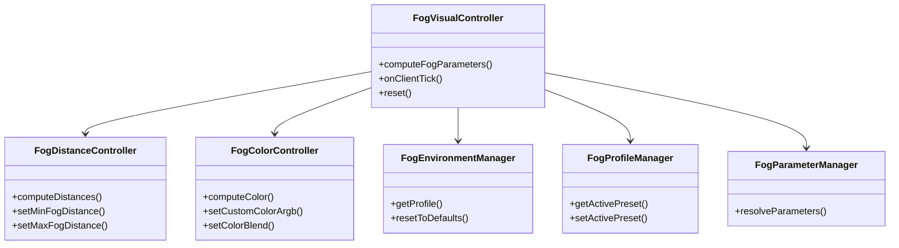

# Architektura kontrolera FogVisualController

## 1. Struktura komponentów mgły

Pakiet `pl.zombek.client.core.rendereffect.fog` dzieli odpowiedzialności za mgłę na wyspecjalizowane komponenty:

## 2. Płynne tranzycje i krzywe interpolacji

Zmiany dystansu mgły (np. przy wchodzeniu do jaskiń lub przełączaniu profili) animowane są krzywą **Ease-In-Out quadratic**:
$$f(t) = \begin{cases} 2t^2 & t < 0.5 \\ 1 - \frac{(-2t + 2)^2}{2} & t \ge 0.5 \end{cases}$$

Zabezpiecza to przed gwałtownymi przeskokami obrazu i migotaniem bufora głębi.

## 3. Zabezpieczenia Fair Play

1. `FogDistanceController` zawsze ogranicza `endDistance` do wartości mniejszej bądź równej `vanillaEnd` (zasięgowi renderowania chunków).
2. `startDistance` jest zawsze mniejsze niż `endDistance` o co najmniej 1.0 jednostkę.
3. Gdy gracz znajduje się pod wodą lub w lawie, stosowane są specjalne profile środowiskowe zapobiegające oszukańczej przezroczystości cieczy.
