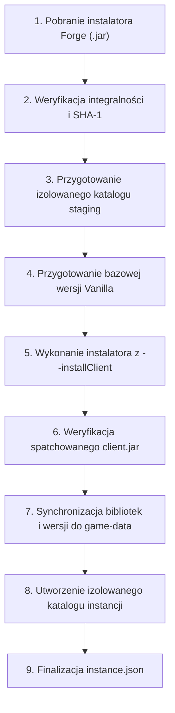

# Integracja z Minecraft Forge — ZombekClient

Niniejszy dokument szczegółowo opisuje architekturę, mechanizm pobierania, instalacji, potok procesorów oraz uruchamianie modloadera Minecraft Forge w launcherze ZombekClient (Etap 5B).

---

## 1. Źródła Metadanych Forge

Wszystkie dane dotyczące wersji i instalatorów Forge pobierane są wyłącznie z oficjalnych źródeł projektu MinecraftForge:

1. **Promocje wersji (Recommended & Latest):**
   - URL: `https://files.minecraftforge.net/net/minecraftforge/forge/promotions_slim.json`
   - Format: JSON mapujący klucze typu `{mcVersion}-recommended` i `{mcVersion}-latest` na konkretne numery kompilacji Forge (np. `1.20.4-recommended: "49.2.13"`).
2. **Pełna lista wersji w repozytorium Maven:**
   - URL: `https://maven.minecraftforge.net/net/minecraftforge/forge/maven-metadata.xml`
   - Format: XML zawierający tagi `<version>` ze wszystkimi kiedykolwiek wydanymi wersjami Forge (np. `1.20.4-49.2.13`, `1.20.1-47.3.0`, `1.16.5-36.2.39`, `1.12.2-14.23.5.2860`).
3. **Pliki instalatorów JAR:**
   - URL: `https://maven.minecraftforge.net/net/minecraftforge/forge/{version}/forge-{version}-installer.jar`
4. **Lokalny bufor dyskowy (Offline Support):**
   - Ścieżka: `%APPDATA%/ZombekClient/game-data/forge_meta_cache.json`
   - Mechanizm: Zapis pobranych metadanych na dysku. W przypadku braku połączenia internetowego, awarii serwerów Maven lub timeoutu, launcher odczytuje ostatnio zapisany stan z dysku, umożliwiając pracę offline.

---

## 2. Architektura i 9-Etapowy Proces Instalacji

W przeciwieństwie do Minecraft Fabric (gdzie metadane JSON oraz prekompilowane biblioteki pobierane są bezpośrednio z serwerów Meta), Minecraft Forge stosuje instalator wykonujący binarne modyfikacje i patche na bazowym pliku `client.jar` gry.

Aby chronić środowisko użytkownika, ZombekClient realizuje instalację w **9 ściśle określonych etapach**:



### Szczegółowy opis kroków:

1. **Pobranie instalatora:**
   - `ForgeLoaderAdapter` pobiera oficjalny instalator `forge-{version}-installer.jar` do `game-data/libraries/net/minecraftforge/forge/{version}/`.
2. **Weryfikacja integralności:**
   - Sprawdzenie rozmiaru i poprawności struktury ZIP archiwum instalatora.
3. **Izolowany katalog staging (`game-data/forge-staging/`):**
   - Oficjalny instalator Forge domyślnie modyfikuje katalog `%APPDATA%/.minecraft`.
   - ZombekClient izoluje proces instalatora, kierując flagę `--installClient` do dedykowanego podkatalogu pośredniego `forge-staging/`. Dzięki temu środowisko systemowe użytkownika pozostaje w 100% nienaruszone.
4. **Przygotowanie bazowej wersji Vanilla:**
   - Upewnienie się, że plik `versions/{mcVersion}/{mcVersion}.jar` oraz manifest `{mcVersion}.json` zostały pobrane z serwerów Mojang i zweryfikowane sumami SHA-1.
5. **Uruchomienie instalatora Forge:**
   - Uruchomienie procesu: `java -Djavax.net.ssl.trustStoreType=WINDOWS-ROOT -jar <installer.jar> --installClient <stagingDir>`.
   - Monitorowanie wyjścia procesu linijka po linijce za pośrednictwem callbacków `onStage` oraz `onLog`.
6. **Weryfikacja artefaktów:**
   - Sprawdzenie obecności wygenerowanego profilu `versions/{forgeVersionId}/{forgeVersionId}.json` oraz spatchowanego pliku biblioteki klienta `libraries/.../forge-{version}-client.jar`.
7. **Synchronizacja bibliotek:**
   - Skopiowanie wygenerowanych bibliotek i profilu ze stagingu do globalnych katalogów `game-data/libraries/` i `game-data/versions/`.
8. **Inicjalizacja katalogu instancji (`instances/{instanceId}/`):**
   - Utworzenie dedykowanych folderów `mods/`, `config/`, `saves/`, `resourcepacks/`, `screenshots/`, `natives/` oraz `logs/`.
9. **Zapis metadanych profilu:**
   - Zapis pliku `instance.json` z konfiguracją: `loader: "forge"`, `loaderVersion: "{version}"`, przydziałem RAM i argumentami JVM.

---

## 3. Architektura Procesorów Forge (`install_profile.json`)

W nowożytnych wersjach Forge (od 1.13+) instalator zawiera plik `install_profile.json` definiujący listę tzw. procesorów narzędziowych (`processors`).

Do ich obsługi dedykowany jest moduł `ForgeProcessorManager`.

### Podstawianie zmiennych i tokenów:

| Token / Notacja | Opis i Przekształcenie | Przykład |
| :--- | :--- | :--- |
| `{MINECRAFT_JAR}` | Pełna ścieżka do bazowego pliku JAR klienta Vanilla | `.../versions/1.20.4/1.20.4.jar` |
| `{INSTALLER}` | Ścieżka do pobranego pliku instalatora Forge | `.../forge-1.20.4-49.2.13-installer.jar` |
| `{ROOT}` | Katalog główny środowiska staging gry | `.../game-data/forge-staging` |
| `{LIBRARY_DIR}` | Katalog bibliotek Maven | `.../game-data/libraries` |
| `{KEY}` | Odwołanie do klucza ze słownika `data` w `install_profile.json` | `{BINPATCH}` -> ścieżka do pliku binarnego patcha |
| `[group:artifact:version:classifier@ext]` | Koordynat Maven w nawiasach kwadratowych rozwijany na ścieżkę dyskową w `libraries/` | `[net.minecraftforge:binarypatcher:1.1.1:fat]` |
| `'wartość'` | Literał tekstowy (usuwane są pojedyncze apostrofy) | `'client'` -> `client` |
| `/data/...` | Ścieżka do zasobu wewnętrznego archiwum instalatora | `/data/client.lzma` |

### Filtracja po stronie klienta (`sides: ['client']`):
Procesory posiadają pole `sides` określające środowisko wykonania (np. `["client"]`, `["server"]` lub oba).
`ForgeProcessorManager` odrzuca procesory zdefiniowane wyłącznie dla serwera (`sides: ['server']`), wykonując tylko zadania niezbędne do przygotowania klienta gry.

---

## 4. Wymagania Środowiska Java i Rozwiązanie Certyfikatów SSL

### Wymagane wersje Javy:
- **Minecraft 1.20.5+:** Java 21 (`java-runtime-delta`)
- **Minecraft 1.18 - 1.20.4:** Java 17 (`java-runtime-gamma`)
- **Minecraft 1.16.5 - 1.17:** Java 16 / Java 11 / Java 8
- **Minecraft 1.12.2 i starsze:** Java 8 (`jre-legacy`)

### Kluczowa poprawka SSL w systemie Windows:
W środowiskach korporacyjnych, edukacyjnych lub przy korzystaniu z antywirusów z inspekcją HTTPS (np. ESET, Kaspersky, proxy firmowe), instalator Forge uruchamiany w czystej Javie zwracał błąd:
`sun.security.validator.ValidatorException: PKIX path building failed: unable to find valid certification path to requested target`.

**Rozwiązanie wdrożone w ZombekClient:**
Do każdego wywołania procesu Javy instalatora przekazywana jest flaga:
```
-Djavax.net.ssl.trustStoreType=WINDOWS-ROOT
```
Powoduje to, że wirtualna maszyna Javy na systemie Windows automatycznie ufa głównemu systemowemu magazynowi certyfikatów Windows (w tym certyfikatom korporacyjnym i proxy), eliminując błędy SSL bez konieczności niebezpiecznej edycji pliku `cacerts`.

---

## 5. Struktura Katalogów i Izolacja Instancji

Wszystkie dane przechowywane są w `%APPDATA%/ZombekClient/` z zachowaniem pełnej separacji:

```
%APPDATA%/ZombekClient/
├── game-data/
│   ├── assets/                # Indeksy i współdzielone obiekty Mojang (hash-addressed)
│   ├── libraries/             # Współdzielone biblioteki Maven (Mojang, Fabric, Forge)
│   │   └── net/minecraftforge/
│   │       ├── forge/
│   │       └── ...
│   ├── versions/              # Manifesty JSON wersji Vanilla i wygenerowane profile Forge
│   │   ├── 1.20.4/
│   │   └── 1.20.4-forge-49.2.13/
│   │       └── 1.20.4-forge-49.2.13.json
│   ├── forge-staging/         # Izolowany bufor instalatora (czyszczony po instalacji)
│   └── forge_meta_cache.json  # Lokalny bufor metadanych Forge (offline)
└── instances/
    └── {instance-id}/         # Izolowana instancja gry
        ├── instance.json      # Metadane konfiguracji (loader: "forge", wersje, pamięć RAM)
        ├── mods/              # Modyfikacje .jar wyłącznie dla tego profilu Forge
        ├── config/            # Pliki konfiguracyjne modów Forge (np. fml.toml)
        ├── saves/             # Światy trybu jednoosobowego
        ├── resourcepacks/     # Paczki zasobów
        ├── screenshots/       # Zrzuty ekranu F2
        ├── natives/           # Wyodrębnione biblioteki natywne DLL
        └── logs/
            └── latest.log     # Logi gry z zamaskowanymi tokenami
```

---

## 6. Generowanie Profili i Budowanie Classpath

### Mechanizm `inheritsFrom`:
Wygenerowany plik `versions/{id}/{id}.json` posiada właściwość:
```json
{
  "id": "1.20.4-forge-49.2.13",
  "inheritsFrom": "1.20.4",
  "mainClass": "net.minecraftforge.bootstrap.ForgeBootstrap"
}
```

Podczas przygotowywania uruchomienia `GameLauncher`:
1. Pobiera bazowy pakiet wersji Vanilla (`1.20.4.json`).
2. Nakłada na niego biblioteki i argumenty z profilu Forge.
3. Do Classpath dołącza:
   - Wszystkie biblioteki Mojang spełniające reguły OS,
   - Wszystkie biblioteki Forge (w tym `forge-*-client.jar`),
   - Bazowy plik JAR klienta gry `versions/1.20.4/1.20.4.jar`.
4. Ustawia klasę główną na wskazaną w profilu (nowoczesne Forge: `net.minecraftforge.bootstrap.ForgeBootstrap`; wersje starsze: `net.minecraft.launchwrapper.Launch` lub `cpw.mods.fml.relauncher.FMLClientHandler`).
5. Dodaje argumenty specyficzne dla Forge (np. `--fml.forgeVersion`, `--launchTarget forgeclient`, konfigurację modułów logowania).

---

## 7. Porównanie Silników: Vanilla vs Fabric vs Forge

| Cecha | Vanilla Minecraft | Fabric Loader | Minecraft Forge |
| :--- | :--- | :--- | :--- |
| **Źródło metadanych** | Piston Meta v2 (Mojang) | Fabric Meta API (v2) | `files.minecraftforge.net` + Maven |
| **Sposób instalacji** | Bezpośrednie pobranie JAR | Dynamiczny profil JSON | Oficjalny instalator + potok procesorów |
| **Konieczność patchowania JAR** | Nie (oryginalny client.jar) | Nie (runtime bytecode manipulation) | Tak (generowany `forge-*-client.jar`) |
| **Klasa główna (Main-Class)** | `net.minecraft.client.main.Main` | `net.fabricmc.loader.impl.launch.knot.KnotClient` | `net.minecraftforge.bootstrap.ForgeBootstrap` |
| **Współdzielenie bibliotek** | Globalne w `libraries/` | Globalne w `libraries/` | Globalne w `libraries/` |
| **Izolacja modów** | Brak (`mods/` niewykorzystywany) | Ścisła (`instances/<id>/mods/`) | Ścisła (`instances/<id>/mods/`) |
| **Czas instalacji** | ~5-15 sekund | ~2-5 sekund | ~20-60 sekund (uruchomienie procesorów) |
| **Obsługiwane konta** | Microsoft (PKCE) + Offline | Microsoft (PKCE) + Offline | Microsoft (PKCE) + Offline |

---

## 8. Obsługa Błędów, Odporność i Procedury Recovery

1. **Brak połączenia sieciowego podczas tworzenia instalacji:**
   - Jeśli sieć jest niedostępna, `ForgeMetaService` automatycznie sięga po dane z lokalnego bufora `forge_meta_cache.json`.
   - Użytkownik może wybrać pobraną wcześniej wersję Forge i utworzyć nową instalację w trybie offline.
2. **Przerwanie pobierania instalatora Forge:**
   - Pliki są pobierane ze stemplem tymczasowym `.tmp.<timestamp>`.
   - ZombekClient nigdy nie pozostawia na dysku uszkodzonych plików o docelowej nazwie.
3. **Niepowodzenie procesu instalatora Forge:**
   - Wyjście procesu jest przechwytywane i analizowane. W przypadku kodu wyjścia różnego od zera, szczegółowy błąd jest logowany, a użytkownik otrzymuje czytelne powiadomienie Toast o przyczynie.
   - Katalog staging `game-data/forge-staging/` jest czyszczony, nie pozostawiając śmieciowych plików.
4. **Weryfikacja istnienia kluczowych artefaktów:**
   - Przed oznaczeniem instalacji jako gotowej do uruchomienia, `ForgeLoaderAdapter` weryfikuje istnienie wygenerowanego profilu JSON oraz biblioteki klienta `forge-*-client.jar`. Jeśli pliki nie powstały, etap instalacji zostaje cofnięty ze statusem błędu.
5. **Niezależność od Vanilla i Fabric:**
   - Żadna operacja wykonywana przez instalator Forge nie wpływa na pliki instalacji Fabric ani Vanilla. Wszelkie modyfikacje są hermetyczne.
