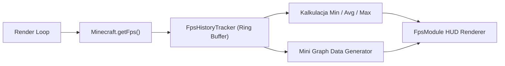

# FPS Module — Specyfikacja Techniczna i Architektura

## 1. Cel i Założenia

Moduł `FpsModule` (`pl.zombek.client.core.modules.hud.info.FpsModule`, ID: `"fps"`) odpowiada za monitorowanie wydajności klatkowej gry (Frames Per Second) w czasie rzeczywistym oraz prezentację statystyk i wykresu stabilności renderingu.

Główne cechy:
- Odczytuje rzeczywistą liczbę klatek z silnika gry przez `IInfoHudDataProvider`;
- Posiada dedykowany bufor kołowy (`FpsHistoryTracker`), przechowujący do kilkuset ostatnich próbek bez alokacji obiektów w pętli gry;
- Kalkuluje statystyki bieżące: FPS aktualny, średni (Average FPS), minimalny (1% low drops) oraz maksymalny;
- Umożliwia włączenie dynamicznego mini-wykresu słupkowego z naniesioną linią średniej i minimum;
- Posiada opcję zerowania statystyk sesji (przycisk/przełącznik Reset Statistics).

---

## 2. Architektura Śledzenia Klatek (`FpsHistoryTracker`)

Wysoka częstotliwość odświeżania ekranu (często 144–360+ FPS) wymaga całkowitej eliminacji alokacji pamięci (`zero GC pressure`).

Struktura bufora kołowego:
- Wewnętrzna tablica prymitywna `int[] samples` o ustalonej pojemności (domyślnie 120 próbek);
- Wskaźnik głowicy zapisu `head` i licznik zarejestrowanych próbek `size`;
- Pomiary agregowane:
  - **Suma próbek:** Aktualizowana inkrementalnie ($O(1)$) przy dodawaniu nowej i usuwaniu najstarszej próbki:
    $$\text{sum} \leftarrow \text{sum} + \text{newVal} - \text{oldVal}$$
  - **Średnia arytmetyczna:**
    $$\text{avg} = \frac{\text{sum}}{\text{size}}$$
  - **Wartości skrajne:** Precyzyjne przeszukiwanie bez alokacji strumieni czy iteratorów.

---

## 3. Prezentacja Danych i Wykres Stabilności

### 3.1 Statystyki Tekstowe
Użytkownik może niezależnie włączać wyświetlanie:
- **Current FPS:** Chwilowy FPS (np. `144 FPS`);
- **Average FPS:** Średnia z ostatnich $N$ sekund (np. `Avg: 138`);
- **Minimum FPS:** Minimalna zanotowana wartość (przydatna przy wykrywaniu mikro-przycięć, np. `Min: 85`);
- **Maximum FPS:** Maksymalna zanotowana wartość (np. `Max: 165`).

### 3.2 Dynamiczny Wykres (Mini-Graph)
Gdy opcja `show_graph` jest aktywna, moduł renderuje pod wartościami liczbowymi kompaktowy wykres:
- Słupki reprezentujące poszczególne klatki/próbki z bufora kołowego;
- Adaptacyjna skala pionowa dostosowująca się do przedziału $[ \min(FPS), \max(FPS) ]$;
- Pozioma linia średniej (kolor żółty/błękitny);
- Pozioma linia minimum (kolor czerwony), wskazująca spadki płynności.

---

## 4. Typowane Ustawienia Modułu

| Grupa | Klucz | Typ | Domyślnie | Opis |
| :--- | :--- | :--- | :--- | :--- |
| `general` | `enabled` | `Boolean` | `false` | Włączenie modułu FPS |
| `metrics` | `show_current` | `Boolean` | `true` | Wyświetlanie bieżącego FPS |
| `metrics` | `show_average` | `Boolean` | `false` | Wyświetlanie średniego FPS z bufora |
| `metrics` | `show_min` | `Boolean` | `false` | Wyświetlanie minimalnego FPS |
| `metrics` | `show_max` | `Boolean` | `false` | Wyświetlanie maksymalnego FPS |
| `metrics` | `reset_stats` | `Boolean` | `false` | Przełącznik zerujący zgromadzone statystyki |
| `graph` | `show_graph` | `Boolean` | `false` | Rysowanie dynamicznego mini-wykresu |
| `graph` | `graph_width` | `Number` (40–200) | `80` | Szerokość wykresu w pikselach |
| `graph` | `graph_height` | `Number` (15–60) | `25` | Wysokość wykresu w pikselach |
| `colors` | `style` | `Enum<HudComponentStyle>` | `CLASSIC` | Styl tła: `MINIMAL`, `CLASSIC`, `MODERN`, `CUSTOM` |
| `colors` | `text_color` | `Color` | `0xFF00FF00` | Kolor tekstu (domyślnie zielony) |
| `colors` | `graph_color` | `Color` | `0x8000FF00` | Kolor wypełnienia słupków wykresu |
| `layout` | `anchor` | `Enum<HudAnchor>` | `TOP_LEFT` | Zakotwiczenie na ekranie |
| `layout` | `pos_x` | `Number` | `4` | Pozycja pozioma |
| `layout` | `pos_y` | `Number` | `40` | Pozycja pionowa |
| `layout` | `scale` | `Number` | `1.0` | Skala renderowania |
