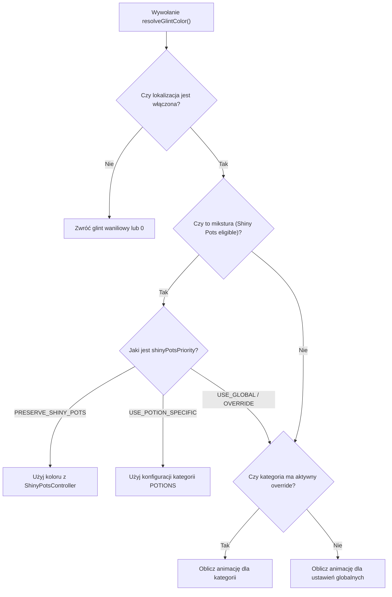

# Architektura GlintRenderController i integracja Shiny Pots

## 1. Zasada działania kontrolera

Klasa [GlintRenderController](file:///c:/Users/Admin/Desktop/jules_session_17875811770345124279/apps/minecraft-client/core/src/main/java/pl/zombek/client/core/rendereffect/glint/GlintRenderController.java) odpowiada za wyliczanie koloru glintu podczas każdego wywołania renderowania przedmiotu.

Kolor jest wyliczany w czasie rzeczywistym i przekazywany bezpośrednio jako modyfikator koloru wierzchołków lub parametru shadera bez tworzenia nowych obiektów `RenderType`.

## 2. Hierarchia priorytetów (z modułem Shiny Pots)

Gdy renderowany przedmiot to mikstura lub strzała z miksturą, zachodzi rozstrzyganie priorytetów według ustawienia `shiny_pots_priority`:

## 3. Brak modyfikacji NBT

Moduł nigdy nie dodaje tagu `Enchantments` ani nie zmienia właściwości `ItemStack`. Wstrzykiwanie w kod gry odbywa się w warstwie renderera modeli przedmiotów i `ItemStack.hasGlint()`.
