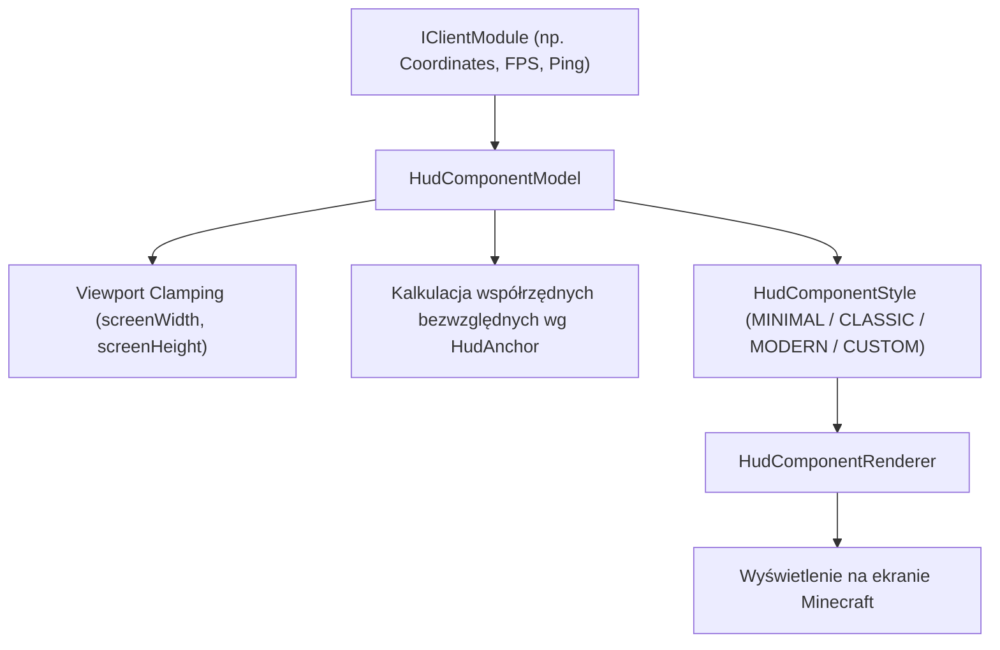

# HUD Component System — Ujednolicony Model Komponentów HUD

## 1. Cel i Architektura

W ramach etapu **Etap 8B1: Universal HUD Information**, w ZombekClient Core wprowadzono ujednolicony system modelowania komponentów HUD (`pl.zombek.client.core.hud.component`). 

Celem tego podsystemu jest:
1. Zapewnienie wspólnej reprezentacji geometrii, zakotwiczenia, stylistyki i z-indexu dla wszystkich elementów interfejsu w grze;
2. Odizolowanie logiki danych modułu od kalkulacji responsywnych wymiarów ekranu i ograniczeń okna (clamping);
3. Pełne przygotowanie architektury pod przyszły wizualny edytor HUD (przeciąganie myszą typu drag-and-drop, snapping do siatki i krawędzi, zaznaczanie aktywnych komponentów).

---

## 2. Model Komponentu (`HudComponentModel`)

Klasa `HudComponentModel` przechowuje kompletny stan geometryczny i wizualny pojedynczego elementu HUD:

### 2.1 Pola i Atrybuty
- `moduleId` (`String`): Unikalny identyfikator modułu (np. `"coordinates"`, `"fps"`, `"ping"`);
- `posX` (`int`), `posY` (`int`): Współrzędne elementu względem punktu zakotwiczenia;
- `width` (`int`), `height` (`int`): Rzeczywiste wymiary prostokąta otaczającego (bounding box) komponentu w nieskalowanych pikselach;
- `scale` (`float`): Skala elementu (0.5 do 2.0);
- `visible` (`boolean`): Flaga widoczności;
- `anchor` (`HudAnchor`): Punkt odniesienia ekranu (`TOP_LEFT`, `TOP_RIGHT`, `BOTTOM_LEFT`, `BOTTOM_RIGHT`, `TOP_CENTER`, `BOTTOM_CENTER`, `CENTER`);
- `zIndex` (`int`): Kolejność warstwowania (renderowania);
- `style` (`HudComponentStyle`): Styl wizualny tła i obramowania;
- `padding` (`int`): Wewnętrzny odstęp od krawędzi tła do zawartości.

### 2.2 Obliczanie Pozycji Bezwzględnej na Ekranie
W oparciu o aktualne wymiary okna gry (`screenWidth`, `screenHeight`), `HudComponentModel` dokonuje konwersji ze współrzędnych relatywnych do absolutnych:

| Punkt Zakotwiczenia (`HudAnchor`) | Pozycja Ekranowa X ($X_{\text{screen}}$) | Pozycja Ekranowa Y ($Y_{\text{screen}}$) |
| :--- | :--- | :--- |
| `TOP_LEFT` | $\text{posX}$ | $\text{posY}$ |
| `TOP_RIGHT` | $\text{screenWidth} - \text{scaledWidth} - \text{posX}$ | $\text{posY}$ |
| `BOTTOM_LEFT` | $\text{posX}$ | $\text{screenHeight} - \text{scaledHeight} - \text{posY}$ |
| `BOTTOM_RIGHT` | $\text{screenWidth} - \text{scaledWidth} - \text{posX}$ | $\text{screenHeight} - \text{scaledHeight} - \text{posY}$ |
| `TOP_CENTER` | $\frac{\text{screenWidth} - \text{scaledWidth}}{2} + \text{posX}$ | $\text{posY}$ |
| `BOTTOM_CENTER`| $\frac{\text{screenWidth} - \text{scaledWidth}}{2} + \text{posX}$ | $\text{screenHeight} - \text{scaledHeight} - \text{posY}$ |
| `CENTER` | $\frac{\text{screenWidth} - \text{scaledWidth}}{2} + \text{posX}$ | $\frac{\text{screenHeight} - \text{scaledHeight}}{2} + \text{posY}$ |

gdzie $\text{scaledWidth} = \text{width} \times \text{scale}$ oraz $\text{scaledHeight} = \text{height} \times \text{scale}$.

### 2.3 Responsywny Clamping do Krawędzi Ekranu
Aby żaden element nie wystawał poza ekran po zmianie rozdzielczości lub współczynnika GUI Scale w ustawieniach wideo Minecrafta, metoda `clampToViewport(screenWidth, screenHeight)` ogranicza współrzędne bezwzględne do przedziału $[0, \text{screenWidth} - \text{scaledWidth}]$ i $[0, \text{screenHeight} - \text{scaledHeight}]$.

---

## 3. Style Komponentów (`HudComponentStyle`)

System definiuje 4 standardowe style prezentacji:

1. **`MINIMAL`:**
   - Brak tła (pełna przezroczystość);
   - Brak ramki;
   - Bezpośrednie renderowanie tekstu i ikon z domyślnym cieniem czcionki Minecraft.
2. **`CLASSIC`:**
   - Półprzezroczyste, ciemne tło prostokątne (`0x80000000`);
   - Subtelna, półprzezroczysta ramka (`0x40FFFFFF`);
   - Tradycyjny styl znany z klasycznych klientów PvP.
3. **`MODERN`:**
   - Nowoczesne tło z ciemnym gradientem lub zaokrąglonymi rogami;
   - Delikatny lewy/górny pasek akcentujący;
   - Podwyższona czytelność dzięki zmiękczonemu cieniowi.
4. **`CUSTOM`:**
   - Pełna swoboda konfiguracji kolorów tła, obramowania i tekstu z poziomu GUI Right Shift.

---

## 4. Przygotowanie pod Edytor HUD (HUD Editor Readiness)

Architektura `HudComponentModel` została zaprojektowana bezpośrednio z myślą o planowanym w kolejnych etapach interaktywnym edytorze HUD:
- **Hit-testing myszy:** Metoda `contains(mouseX, mouseY)` pozwala na błyskawiczne wykrywanie kliknięcia i rozpoczęcia operacji przeciągania (drag);
- **Wymiary graniczne (Bounding Box):** Każdy moduł na bieżąco raportuje swój aktualny rozmiar `width` i `height`, co umożliwia rysowanie obwódek zaznaczenia i uchwytów zmiany rozmiaru (resize handles);
- **Sortowanie warstw (Z-Index):** Moduły mogą być sortowane i renderowane w ściśle określonym porządku, zapobiegając niepożądanemu nakładaniu się elementów.
