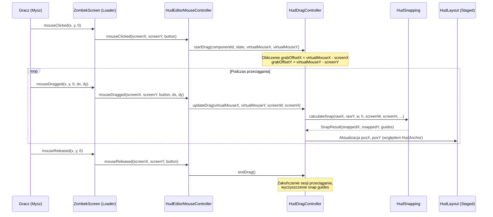

# System Przeciągania Komponentów (Drag & Drop) — ZombekClient (Etap 9B)

## 1. Wprowadzenie i Cel Modułu

System **Drag & Drop** (`HudDragController`) odpowiada za płynne i intuicyjne przemieszczanie elementów HUD po wirtualnym obszarze roboczym (*Canvas*) edytora ZombekClient.
Projekt zrealizowano zgodnie z wymaganiami uniwersalności dla platform Minecraft 1.20.4 (Vanilla, Fabric, Quilt, Forge, NeoForge).

Główne założenia systemu:
- **Brak efektu "skakania" (Jump Glitch):** Zachowanie dokładnego punktu chwytu myszką (*grab offset*) od momentu naciśnięcia lewego przycisku.
- **Odporność na Zoom i Pan:** Poprawne przeliczanie współrzędnych ekranowych myszy na wirtualne piksele kanwy o zmiennej skali (`HudCanvasViewport`).
- **Wielopoziomowe przyciąganie (Snapping):** Integracja w czasie rzeczywistym z przyciąganiem do siatki (*Grid*), krawędzi ekranu (*Screen Edges*) oraz osi symetrii (*Center Axes*).
- **Zachowanie bezpiecznych granic:** Ograniczenie przemieszczania komponentu do wymiarów ekranu gry (`0` do `screenWidth - componentWidth`).
- **Ochrona elementów zablokowanych:** Elementy oznaczone jako `locked` lub z kotwicą `HudAnchor.WORLD_SPACE` są zabezpieczone przed przypadkowym przesunięciem.
- **Bezpieczeństwo persystencji:** Każde przesunięcie modyfikuje wyłącznie bufor roboczy (*staged layout*). Żadna klatka pośrednia przeciągania nie wykonuje operacji wejścia/wyjścia na dysku.

---

## 2. Architektura i Przepływ Zdarzeń



---

## 3. Matematyka Przeliczania Kotwic (HudAnchor Inverses)

Elementy HUD mogą być zakotwiczone w 10 różnych konfiguracjach (`TOP_LEFT`, `TOP_CENTER`, `TOP_RIGHT`, `CENTER_LEFT`, `CENTER`, `CENTER_RIGHT`, `BOTTOM_LEFT`, `BOTTOM_CENTER`, `BOTTOM_RIGHT`, `WORLD_SPACE`).

Aby uniknąć "pływania" współrzędnych podczas przeciągania elementu o innej kotwicy niż `TOP_LEFT`, klasa `HudAnchor` dostarcza odwrotne transformacje:

```java
// Z ekranowych współrzędnych po przyciągnięciu do relatywnych offsetów kotwicy:
int newOffsetX = anchor.screenXToOffsetX(snappedScreenX, componentWidth, screenWidth);
int newOffsetY = anchor.screenYToOffsetY(snappedScreenY, componentHeight, screenHeight);

state.setPosX(newOffsetX);
state.setPosY(newOffsetY);
```

Dzięki temu przeciągany element zachowuje swoją logiczną kotwicę (np. `BOTTOM_RIGHT`), a jego offsety `posX` i `posY` są aktualizowane tak, że na ekranie znajduje się dokładnie pod kursorem użytkownika.

---

## 4. Ochrona i Reguły Biznesowe

1. **Komponenty Zablokowane (`locked == true`):**
   Jeśli `state.isLocked()`, wywołanie `startDrag()` natychmiast zwraca `false`, a kursor przyjmuje postać `CursorMode.FORBIDDEN`.
2. **Komponenty Przestrzeni Świata (`WORLD_SPACE`):**
   Elementy renderowane w świecie gry (np. `nametags`) posiadają kotwicę `HudAnchor.WORLD_SPACE` i nie posiadają stałych współrzędnych 2D ekranu. Próba ich przeciągania jest ignorowana.
3. **Anulowanie operacji klawiszem ESC:**
   Wciśnięcie klawisza ESC w trakcie przeciągania natychmiast przywraca współrzędne początkowe z momentu `startDrag()` bez wpływu na pozostałe elementy.
