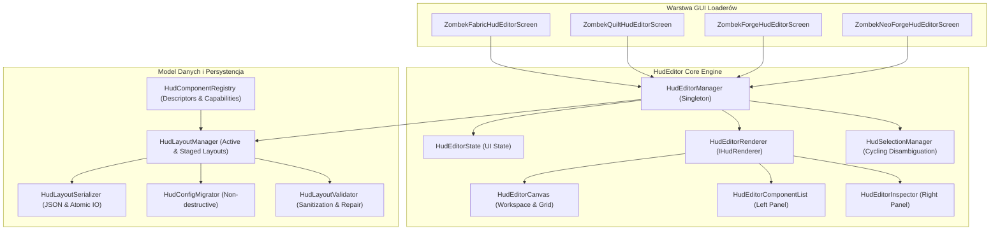

# Architektura HUD Editora — ZombekClient (Etap 9A)

## 1. Wprowadzenie i Cele

Etap 9A wprowadza fundamenty architektoniczne wizualnego **HUD Editora** w ZombekClient.
Celem systemu jest umożliwienie graczom swobodnej personalizacji rozmieszczenia elementów interfejsu (HUD) Minecrafta w sposób intuicyjny, przypominający profesjonalne edytory GUI (Lunar Client, Badlion Client), zachowując 100% kompatybilności z Vanilla, Fabric, Quilt, Forge i NeoForge.

W Etapie 9A zaimplementowano warstwę fundamentów:
- rejestr komponentów HUD (`HudComponentRegistry`),
- uniwersalny model układu (`HudLayout` i `HudComponentState`),
- mechanizm bezpiecznej, niedestrukcyjnej migracji dotychczasowych ustawień pozycji modułów (`HudConfigMigrator`),
- buforowanie zmian sesyjnych (staging workflow),
- platformowo-niezależny silnik renderujący edytor (`HudEditorRenderer`),
- menedżer cyklu życia i obsługi wejścia (`HudEditorManager`),
- disambiguację kliknięć nakładających się elementów (`HudSelectionManager`),
- ekrany integracyjne dla 4 loaderów oraz przycisk w menu Right Shift.

---

## 2. Podział Odpowiedzialności (Separation of Concerns)

---

## 3. Kluczowe Komponenty Architektury

### 3.1. `HudComponentRegistry`
Centralny, dynamiczny rejestr opisujący metadane wszystkich dostępnych elementów HUD:
- Przechowuje `HudComponentDescriptor` opisujący ID, nazwę, kategorię (`PvP`, `HUD`, `Survival`, `Visual`, `Other`), typ (`SCREEN_SPACE`, `CENTER_SCREEN`, `WORLD_SPACE`, `GUI_OVERLAY`), flagi możliwości (`POSITION`, `SCALE`, `SIZE`, `VISIBILITY`, `Z_INDEX`, `ANCHOR`) oraz dostawcę podglądu (`HudComponentPreviewProvider`).
- Zapewnia bezpieczne wyszukiwanie bez względu na wielkość znaków.

### 3.2. `HudLayout` i `HudComponentState`
Czysty model danych konfiguracji układu:
- Zapisany w formacie JSON (`config/zombekclient/hud_layout.json`).
- Każdy element posiada pozycję `(posX, posY)`, wymiary `(width, height)`, współczynnik skali `scale`, kotwicę ekranową `anchor`, poziom warstwy `zIndex` oraz flagi widoczności/włączenia.
- Obsługuje głębokie klonowanie (`cloneLayout()`) na potrzeby buforu edycji.

### 3.3. Staging Workflow (Zarządzanie Zmianami)
Wprowadzone w edytorze modyfikacje nie są natychmiast zapisywane do konfiguracji trwałej:
1. Podczas otwarcia edytora (`openEditor()`) bieżący układ aktywny jest kopiowany do bufora `stagedLayout`.
2. Wszystkie operacje użytkownika (zmiana pozycji, skali, kotwicy, widoczności) modyfikują wyłącznie `stagedLayout`.
3. Wyjście klawiszem ESC lub przyciskiem `Anuluj` przy wykryciu niezapisanych zmian (`hasUnsavedChanges()`) wyświetla modal potwierdzenia z opcjami:
   - **Zapisz** — zatwierdza i atomowo zapisuje układ na dysk.
   - **Odrzuć** — przywraca stan sprzed rozpoczęcia edycji.
   - **Wróć** — pozwala kontynuować pracę w edytorze.

---

## 4. Zakres Etapu 9A i 9B a Kolejne Etapy

| Funkcjonalność | Etap 9A (Fundamenty) | Etap 9B (Manipulacja) | Etap 9C (Zaawansowane) |
|---|:---:|:---:|:---:|
| Architektura Core i Rejestr | ✅ Gotowe | — | — |
| Ekrany loaderów i przycisk w menu | ✅ Gotowe | — | — |
| Lista komponentów i filtr wyszukiwania | ✅ Gotowe | ✅ Rozszerzone | — |
| Property Inspector i modyfikacja krokowa | ✅ Gotowe | ✅ Rozszerzone (Inputy, Aligns) | ✅ Multi-selection (<różne>) |
| Bounding boxy i zaznaczanie | ✅ Gotowe | — | — |
| Disambiguacja nakładających się elementów | ✅ Gotowe | — | — |
| Podgląd demo komponentów (Preview Mode) | ✅ Gotowe | — | — |
| Przeciąganie myszką (Drag & Drop) | ❌ Planowane 9B | ✅ Gotowe | — |
| Uchwyty skalowania i zmiany rozmiaru (8 handles) | ❌ Planowane 9B | ✅ Gotowe | — |
| Przyciąganie do siatki i osi (Snapping) | ❌ Planowane 9B | ✅ Gotowe | — |
| Wyrównywanie elementów i linie pomocnicze | ❌ Planowane 9B | ✅ Gotowe | — |
| Wirtualna rzutnia Canvas (Zoom 25%-400% & Pan) | ❌ Planowane 9B | ✅ Gotowe | — |
| Wielo-układowe profile i presety | ❌ Planowane 9C | — | ✅ Gotowe |
| Wielokrotne zaznaczanie (Multi-selection & Marquee) | ❌ Planowane 9C | — | ✅ Gotowe |
| Grupowanie logiczne (Groups & Ctrl+G) | ❌ Planowane 9C | — | ✅ Gotowe |
| Zaawansowany menedżer warstw i Z-Index | ❌ Planowane 9C | — | ✅ Gotowe |
| Kompletna historia Undo / Redo (Command Pattern) | ❌ Planowane 9C | — | ✅ Gotowe |
| Schowek, Kopiowanie i Duplikowanie (Ctrl+D) | ❌ Planowane 9C | — | ✅ Gotowe |
| Import i Eksport JSON z ochroną bezpieczeństwa | ❌ Planowane 9C | — | ✅ Gotowe |
| Responsywność, proporcje ekranu i walidacja | ❌ Planowane 9C | — | ✅ Gotowe |

---

## 5. Podsystemy Interakcji Myszą (Etap 9B)

W Etapie 9B architektura HUD Editora została wzbogacona o wyspecjalizowane kontrolery interakcji:

1. **`HudEditorMouseController`:** Centralny router zdarzeń myszy (`mouseClicked`, `mouseDragged`, `mouseReleased`, `mouseMoved`, `mouseScrolled`). Egzekwuje ścisłą hierarchię priorytetów (Active Action -> Panels/Toolbar -> MMB Pan -> Handles -> Tool Pan -> Components -> Canvas Background).
2. **`HudDragController`:** Obsługuje przemieszczanie komponentów HUD po wirtualnym płótnie z zachowaniem punktu chwytu (`grabOffsetX/Y`), przyciąganiem (`HudSnapping`), clampingiem do granic ekranu i odwrotnym przeliczaniem kotwic (`HudAnchor`).
3. **`HudResizeController` & `HudResizeHandle`:** 8 uchwytów dookoła aktywnego komponentu, zachowanie nieruchomej krawędzi przeciwległej, blokada proporcji (`lockAspectRatio`), min/max wymiary z deskryptora.
4. **`HudScaleController`:** Niezależne skalowanie wizualne w zakresie 0.25x do 3.00x z precyzją 2 miejsc po przecinku bez modyfikacji fizycznych wymiarów bazowych.
5. **`HudCanvasViewport`:** Wirtualna kamera 2D: Zoom od 25% do 400% z centrowaniem pod kursor myszy, Pan (przesuwanie płótna MMB / Pan tool), Fit Canvas, Zoom to Selection oraz dwukierunkowe bezstratne transformacje współrzędnych.
6. **`HudGridManager` & `HudSnapping`:** 5 stylów siatki (NONE, DOTS, LINES, CROSSHAIR_GRID, CUSTOM), presety 2-32 px, inteligentne przyciąganie do środka ekranu, krawędzi i siatki wraz z wizualnymi liniami pomocniczymi.

---

## 6. Zaawansowane Podsystemy HUD Editora (Etap 9C)

W Etapie 9C architektura HUD Editora została rozszerzona o zaawansowane menedżery danych i operacji:

1. **`HudProfileManager`:** Niezależne profile rozkładu HUD (CRUD, auto-backup `.bak`, hotkey switch `key.zombekclient.hud_profile_switch`, zerowa ingerencja w gameplay i poświadczenia).
2. **`HudPresetManager`:** 8 wbudowanych szablonów (Default, Minimal, PvP, Survival, UHC, Building, Performance, Streamer) oraz szablony użytkownika aplikowane jako odwracalne polecenia.
3. **`HudMultiSelectionManager`:** Zaznaczanie wielu elementów (Ctrl+klik, Shift+klik, Marquee Box: `INTERSECTING`/`FULLY_INSIDE`), `Ctrl+A`, `Esc`, jednoczesne przesuwanie i skalowanie.
4. **`HudGroupManager`:** Logiczne grupowanie (`HudGroup`, `Ctrl+G`, `Ctrl+Shift+G`), obwiednia grupy i wspólne przemieszczanie.
5. **`HudLayerManager`:** 4 warstwy systemowe (`background`, `main_hud`, `information`, `notifications`) i warstwy własne, ścisły porządek Z-Index, bring to front, send to back, blokowanie warstw.
6. **`HudUndoRedoManager`:** Wzorzec Command (`IHudCommand`, gesty myszy scalane w jedno polecenie, historia 50 kroków, `Ctrl+Z`, `Ctrl+Y`).
7. **`HudComponentClipboard`:** Zaawansowany schowek (`HudClipboardData`, `Ctrl+C`, `Ctrl+V`, `Ctrl+D` z offsetem +15px, ochrona singletonów, kopiowanie między profilami).
8. **`HudLayoutImportExportManager`:** Bezpieczny import i eksport do plików JSON v1 z sanityzacją danych, limitem 5 MB, blokadą Path Traversal i auto-backupem `.bak`.
9. **`HudResponsiveLayoutManager`:** Obsługa różnych proporcji ekranu (16:9, 16:10, 21:9, 32:9, 4:3) z letterboxingiem i regułami responsywnymi oraz automatyczna detekcja błędów (`OUT_OF_BOUNDS`, `OVERLAP`, `SAFE_AREA_VIOLATION`, `INVALID_SCALE`).

