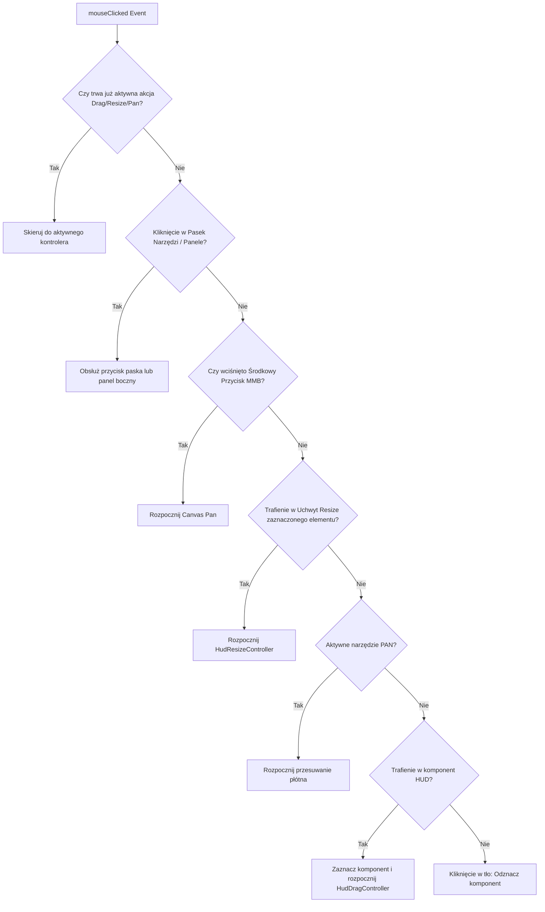

# Dyspozytor i Obsługa Wejścia Myszy (HudEditorMouseController) — ZombekClient (Etap 9B)

## 1. Wprowadzenie i Cel Modułu

Interfejs graficzny edytora HUD wymaga bezbłędnej i jednoznacznej hierarchii obsługi zdarzeń wskaźnika myszy.
Moduł **HudEditorMouseController** centralizuje przetwarzanie zdarzeń:
- `mouseClicked(double mouseX, double mouseY, int button)`
- `mouseDragged(double mouseX, double mouseY, int button, double deltaX, double deltaY)`
- `mouseReleased(double mouseX, double mouseY, int button)`
- `mouseMoved(double mouseX, double mouseY)`
- `mouseScrolled(double mouseX, double mouseY, double horizontalAmount, double verticalAmount)`

---

## 2. Hierarchia Priorytetów Dyspozytora (Priority Dispatching)

Aby wyeliminować konflikty (np. kliknięcie uchwytu resize nie powinno rozpoczynać przesuwania ani odznaczać elementu), kontroler stosuje ścisłą hierarchię:



---

## 3. Integracja z Loaderami (Multi-Loader Forwarding)

Wszystkie ekrany loaderów (`ZombekFabricHudEditorScreen`, `ZombekQuiltHudEditorScreen`, `ZombekForgeHudEditorScreen`, `ZombekNeoForgeHudEditorScreen`) delegują zdarzenia bezpośrednio do instancji `HudEditorManager`:

```java
@Override
public boolean mouseClicked(double mouseX, double mouseY, int button) {
    if (editorManager.mouseClicked(mouseX, mouseY, button)) {
        return true;
    }
    return super.mouseClicked(mouseX, mouseY, button);
}

@Override
public boolean mouseDragged(double mouseX, double mouseY, int button, double deltaX, double deltaY) {
    if (editorManager.mouseDragged(mouseX, mouseY, button, deltaX, deltaY)) {
        return true;
    }
    return super.mouseDragged(mouseX, mouseY, button, deltaX, deltaY);
}

@Override
public boolean mouseReleased(double mouseX, double mouseY, int button) {
    if (editorManager.mouseReleased(mouseX, mouseY, button)) {
        return true;
    }
    return super.mouseReleased(mouseX, mouseY, button);
}

@Override
public void mouseMoved(double mouseX, double mouseY) {
    editorManager.mouseMoved(mouseX, mouseY);
    super.mouseMoved(mouseX, mouseY);
}
```

Dzięki temu żaden gest myszy w edytorze nie przedostaje się do silnika świata gry, eliminując przypadkowe bicie, niszczenie bloków czy używanie przedmiotów w trakcie konfiguracji HUD.
