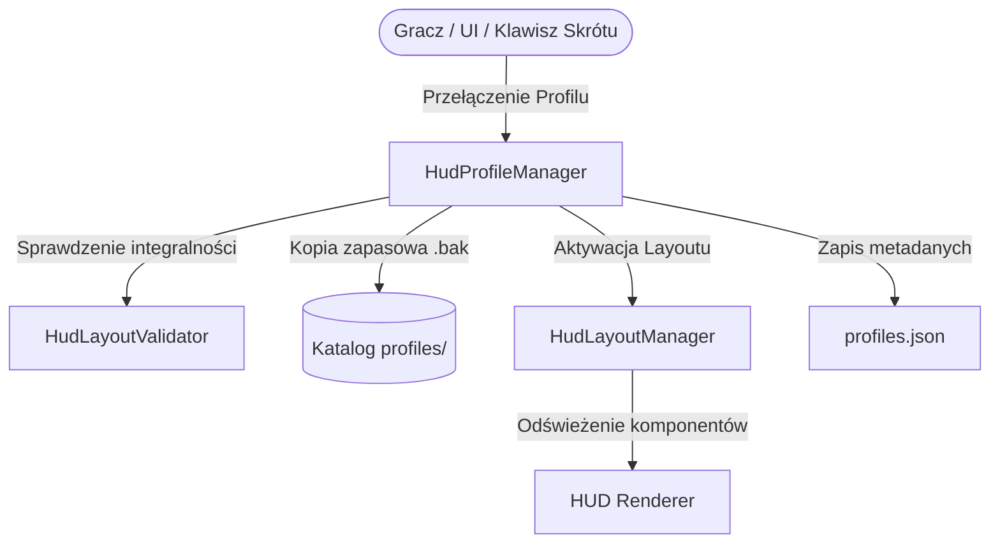

# ZombekClient — HUD Profile Manager

## 1. Wprowadzenie

Moduł **HUD Profile Manager** (`HudProfileManager`) odpowiada za zarządzanie niezależnymi profilami układów interfejsu HUD w ZombekClient. System profili pozwala graczom na błyskawiczne przełączanie kompletnych kompozycji interfejsu użytkownika w zależności od stylu gry, trybu serwerowego (PvP, Survival, UHC, Creative/Building, Minimal) lub indywidualnych preferencji bez konieczności ponownego konfigurowania każdego elementu.

Architektura gwarantuje **ścisłą separację odpowiedzialności**: HUD Profile Manager zarządza **wyłącznie** geometrią, widocznością, warstwami, z-indeksami i kotwicami komponentów HUD (`HudLayout`). Profil HUD **nie modyfikuje ani nie nadpisuje** ustawień rozgrywki (np. Toggle Sprint, Freelook, Zoom), przypisań klawiszy, konfiguracji modułów funkcjonalnych ani poświadczeń użytkownika.

---

## 2. Architektura i Przepływ Danych

### Ścieżki w systemie plików
Pliki konfiguracyjne profili przechowywane są w wydzielonym podkatalogu klienta:
- `.minecraft/config/zombekclient/hud/profiles.json` — rejestr metadanych profili (ID, nazwa, opis, data utworzenia/modyfikacji, aktywny profil).
- `.minecraft/config/zombekclient/hud/profiles/<profileId>.json` — plik z serializowaną strukturą `HudLayout` danego profilu.
- `.minecraft/config/zombekclient/hud/profiles/<profileId>.json.bak` — automatyczna kopia bezpieczeństwa tworzona przed każdą nadpisaniem lub importem.

---

## 3. Profile Domyślne (Systemowe)

ZombekClient dostarcza wbudowane profile startowe, zoptymalizowane pod popularne scenariusze:
1. **Domyślny (`default`)** — standardowy układ z kluczowymi wskaźnikami (Keystrokes, CPS, FPS, Ping, Armor Status).
2. **PvP (`pvp`)** — powiększone liczniki CPS, Keystrokes, Potion Effects, Armor Status w strefie centralnej i skrócony Scoreboard.
3. **Survival (`survival`)** — Coordinates, Direction HUD, Biome, Day Counter, Saturation w narożnikach.
4. **UHC (`uhc`)** — rozbudowany Armor Status, Potion Effects, Saturation, Net Graph oraz precyzyjne koordynaty.
5. **Budowanie (`building`)** — Coordinates, Direction HUD, Compass, schowane wskaźniki bojowe.
6. **Minimalistyczny (`minimal`)** — tylko dyskretne FPS i Ping w lewym górnym rogu.
7. **Niestandardowy (`custom`)** — czysta przestrzeń robocza dla gracza.

Profile systemowe posiadają flagę `readOnly = false`, co oznacza, że gracz może je dostosować, ale zawsze ma możliwość ich zresetowania do wzorca fabrycznego.

---

## 4. Operacje CRUD i Cykl Życia

- **Create:** `createProfile(String name, String description, HudLayout sourceLayout)` — tworzy nowy unikalny identyfikator (np. `profile_1715000000_abc`), waliduje schemat, tworzy kopię stanu komponentów i zapisuje na dysk.
- **Read:** `getProfile(String profileId)` / `getAllProfiles()` — odczytuje layout i metadane z pamięci podręcznej i dysku.
- **Update:** `saveProfile(String profileId, HudLayout layout)` — przed zapisem tworzy plik `.bak`, przeprowadza walidację i atomowo zapisuje plik JSON (UTF-8).
- **Delete:** `deleteProfile(String profileId)` — usuwa plik profilu i metadane; uniemożliwia usunięcie profilu domyślnego (`default`) ani aktualnie aktywnego (wymaga wcześniejszego przełączenia).
- **Duplicate:** `duplicateProfile(String profileId, String newName)` — klonuje istniejący profil z nowym ID i metadanymi.

---

## 5. Szybkie Przełączanie w Grze

ZombekClient rejestruje dedykowany skrót klawiszowy:
- **Identyfikator:** `key.zombekclient.hud_profile_switch`
- **Domyślny klawisz:** `Brak (nieprzypisany domyślnie, gotowy do skonfigurowania)`
- **Działanie:** Wywołanie `switchToNextProfile()` przełącza w pętli kolejny dostępny profil, emitując subtelne powiadomienie ekranowe z nazwą aktywowanego profilu oraz odświeżając pozycjonowanie na ekranie bez konieczności restartu gry.

---

## 6. Bezpieczeństwo i Odporność na Błędy

1. **Walidacja struktury:** Przy każdym ładowaniu profil przechodzi przez `HudLayoutValidator.repairLayout()`. Brakujące komponenty są automatycznie uzupełniane domyślnymi parametrami, a zduplikowane lub uszkodzone klucze naprawiane.
2. **Kopie zapasowe (`.bak`):** Zabezpieczenie przed nagłą awarią zasilania lub uszkodzeniem dysku podczas zapisu. W razie błędu parsowania JSON-a klient podejmuje próbę odzyskania układu z pliku `.bak`.
3. **Bezpieczeństwo ścieżek:** Wszystkie nazwy plików są sanityzowane regexem `^[a-zA-Z0-9_-]+$`, wykluczając ataki typu Path Traversal (`../`).
