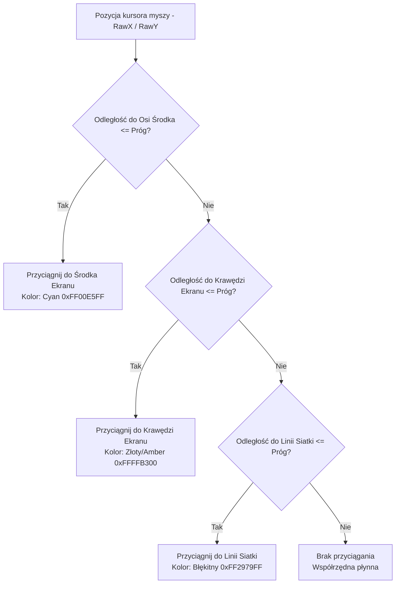

# System Przyciągania Elementów (HUD Snapping) — ZombekClient (Etap 9B)

## 1. Wprowadzenie i Założenia

Precyzyjne pozycjonowanie piksel po pikselu za pomocą samej myszy bywa uciążliwe.
System **HudSnapping** zapewnia inteligentne przyciąganie elementów interfejsu do kluczowych linii odniesienia na ekranie, eliminując drżenie (jitter) i ułatwiając zachowanie symetrii.

---

## 2. Warstwy i Hierarchia Przyciągania

Algorytm sprawdza warunki przyciągania w określonym porządku priorytetów:

---

## 3. Linie Pomocnicze (Guide Lines)

W momencie zadziałania przyciągania, na kanwie edytora pojawiają się delikatne linie pomocnicze przecinające cały ekran:
- **Linia Środka (Center Guide):** Rysowana przez całą wysokość/szerokość w kolorze turkusowym (`0xFF00E5FF`).
- **Linia Krawędzi (Edge Guide):** Rysowana wzdłuż krawędzi w kolorze bursztynowym (`0xFFFFB300`).
- **Linia Siatki (Grid Guide):** Rysowana w osi aktywnej linii siatki w kolorze błękitnym (`0xFF2979FF`).

Linie znikają natychmiast po zwolnieniu przycisku myszy lub wyjechaniu poza próg przyciągania (*threshold*, domyślnie 6 px).

---

## 4. Ochrona przed Drżeniem (Jitter Prevention)

Aby uniknąć gwałtownego przeskakiwania elementu pomiędzy blisko położonymi liniami (np. linia siatki 16 px obok osi środka 480 px):
1. Wybierana jest linia o **najmniejszej wartości bezwzględnej odchylenia** ($\min |\Delta|$).
2. Przyciąganie osi X i osi Y jest weryfikowane całkowicie niezależnie.
3. Pozycja przyciągnięta jest utrzymywana, dopóki ruch myszy nie przekroczy progu histerezy.
