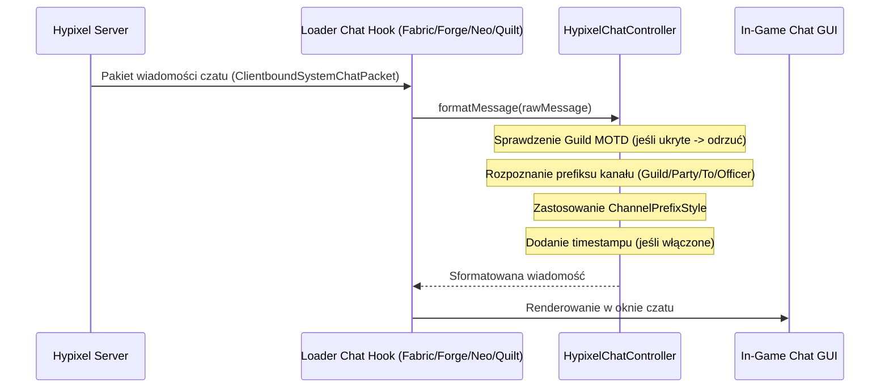

# Personalizacja czatu Hypixel — HypixelChatController

## 1. Cel i zakres działania

Komponent `HypixelChatController` (`pl.zombek.client.core.hypixel.HypixelChatController`) odpowiada za podnoszenie czytelności czatu podczas gry na serwerze Hypixel. Zmniejsza zaśmiecenie ekranu długimi prefiksami kanałów, usuwa powtarzające się komunikaty powitalne oraz pozwala na elegancką integrację znaczników czasu bez naruszania struktury wiadomości Minecrafta.

### Główne cechy:
1. **Skrócone nazwy kanałów:**
   - Kanał gildii: `[Guild]` -> `[G]`
   - Kanał drużyny: `[Party]` -> `[P]`
   - Wiadomości prywatne: `[To ...]` -> `[T ...]`
   - Kanał oficerów gildii: `[Officer]` -> `[O]`
2. **Zachowanie formatowania i zdarzeń:**
   - Wszelkie kody kolorów Minecraft (`§a`, `§6` itp.), zdarzenia najechania myszą (`hoverEvent`) oraz zdarzenia kliknięcia (`clickEvent`, np. dołączenie do party) są **w 100% zachowywane**.
3. **Ukrywanie Guild MOTD:**
   - Opcja automatycznego wygaszania wielolinijkowych wiadomości powitalnych gildii pojawiających się przy każdym logowaniu do lobby.
4. **Ukrywanie tagu gildii na tabliście:**
   - Czyszczenie przyrostka gildyjnego (np. `[TAG]`) z listy graczy (TabList), co czyni tablicę znacznie bardziej przejrzystą.
5. **Znaczniki czasu (Timestamps):**
   - Opcjonalne dodawanie znacznika godziny (np. `[19:45]`) na początku każdej wiadomości.

---

## 2. Style prefiksów kanałów (`ChannelPrefixStyle`)

Gracz może w ustawieniach wybrać jeden z 4 stylów prezentacji prefiksu:

| Styl prefiksu | Przykładowy format | Zastosowanie |
| :--- | :--- | :--- |
| **`BRACKETED` (Domyślny)** | `[G] Nick: treść` | Klasyczny, czytelny format w nawiasach kwadratowych. |
| **`COLON`** | `G: Nick: treść` | Format dwukropkowy, oszczędzający miejsce. |
| **`MINIMAL`** | `G Nick: treść` | Minimalistyczny format z pojedynczą spacją. |
| **`PLAIN`** | `[Guild] Nick: treść` | Oryginalny, niemodyfikowany prefiks serwera Hypixel. |

---

## 3. Schemat przetwarzania wiadomości

Wszystkie metody formatowania i warianty stylów zostały przetestowane w `HypixelChatControllerTest.java` (6 testów, 100% zaliczone).
