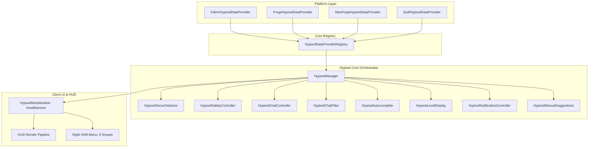

# Moduł Hypixel Mods — ZombekClient

## 1. Przegląd i przeznaczenie

Moduł **Hypixel Mods** (`hypixel_mods`) to kompleksowy, w 100% zgodny z zasadami Fair Play pakiet usprawnień interfejsu użytkownika dla graczy korzystających z sieci **Hypixel Network** (`hypixel.net`). Został zarejestrowany w kategorii `ModuleCategory.OTHER` (reprezentowanej w GUI jako **Social / Server** z ikoną `🌐`).

Inspiracją dla modułu jest pakiet Hypixel Mods znany z klienta Lunar Client, jednak w odróżnieniu od rozwiązań komercyjnych ZombekClient kładzie bezwzględny nacisk na **transparentność, bezpieczeństwo konta gracza oraz absolutną zgodność z regulaminem Hypixel Fair Play**.

> [!WARNING]
> **Oficjalne zastrzeżenie prawne:**
> *"Unofficial client modification. Use at your own risk."*
> Projekt ZombekClient nie jest powiązany, sponsorowany ani oficjalnie zatwierdzony przez Hypixel Inc. Wszelkie funkcje zostały zaprojektowane tak, aby działać wyłącznie po stronie klienta (Client-Side Only), bez wysyłania nieautoryzowanych pakietów sieciowych.

---

## 2. Podstawowe filary Fair Play (Zero-Risk Policy)

Hypixel posiada rygorystyczny regulamin dotyczący modyfikacji klienta. Aby zapewnić użytkownikom pełne bezpieczeństwo, moduł Hypixel Mods w ZombekClient opiera się na 5 nienaruszalnych regułach:

1. **Brak automatyzacji czatu (Zero Auto-Chat):**
   - Moduł **NIE posiada** funkcji automatycznego wysyłania wiadomości (np. AutoGG wysyłającego pakiety do serwera po zakończeniu gry).
   - Zamiast tego zaimplementowano **Manual Social Suggestions**: dyskretną kartę HUD z sugestią `GG` lub `GL` oraz przyciskiem kopiowania do schowka systemowego (1-Click Clipboard Copy). Gracz sam decyduje o wklejeniu i wysłaniu wiadomości.
2. **Brak makr i automatycznych komend:**
   - Brak funkcji typu AutoTip, AutoFriend, AutoWho czy AutoQueue wysyłających komendy w tle.
3. **Brak zapytań do publicznego API Hypixel podczas rozgrywki:**
   - Moduł nie odpytuje zewnętrznych API ani nie wysyła zapytań HTTP o statystyki graczy czy ukryte poziomy podczas trwania meczu, co eliminuje ryzyko flagowania IP lub limitów rate-limit.
4. **Przetwarzanie wyłącznie danych jawnych (Rendered Data Only):**
   - Wszelkie analizy (np. prefiksy kanałów, filtry spamu, poziomy) bazują wyłącznie na odebranych i renderowanych pakietach tekstowych Minecrafta.
5. **Domyślna polityka Strict Safety na Hypixelu:**
   - Przy wykryciu serwera Hypixel automatycznie aktywowany jest profil `STRICT_SAFETY`, blokujący wszelkie funkcje wykraczające poza czystą kosmetykę i lokalny UI.

---

## 3. Architektura systemu Hypixel Mods

Wszystkie podsystemy modułu znajdują się w pakiecie `pl.zombek.client.core.hypixel`:

### Kluczowe komponenty:

- **`HypixelServerDetector`**: Bezinwazyjny detektor serwera badający domenę hosta (`*.hypixel.net`) oraz markę serwera. Zero zapytań DNS, zero pingów na czacie.
- **`HypixelSafetyController`**: Strażnik bezpieczeństwa sprawdzający zgodność każdej operacji z profilem bezpieczeństwa (`STRICT_SAFETY`, `CUSTOM`, `OTHER_SERVERS`).
- **`HypixelChatController`**: Formater czatu skracający nazwy kanałów (`[Guild]` -> `[G]`), ukrywający Guild MOTD, filtrujący tagi gildii na tabliście i formatujący znaczniki czasu.
- **`HypixelChatFilter`**: Wysokowydajny silnik filtracji 13 kategorii wiadomości z wbudowanym zabezpieczeniem przed atakami ReDoS na wyrażenia regularne.
- **`HypixelAutocomplete`**: Lokalny słownik 22 najpopularniejszych komend Hypixela z podpowiedziami argumentów i opisami, bez odpytywania serwera pakietami podpowiedzi.
- **`HypixelLevelDisplay`**: Bezpieczny ekstraktor gwiazdek/poziomów z jawnych wiadomości tekstowych, rygorystycznie zablokowany na Hypixelu w trybie Strict.
- **`HypixelNotificationController`**: Płynny menedżer powiadomień toast (HUD) z animacją alfa (fade-in / fade-out) dla zaproszeń do party, wiadomości gildyjnych i alertów prywatnych.
- **`HypixelManualSuggestions`**: Bezpieczny odpowiednik AutoGG — prezentuje estetyczną kartę HUD po zakończeniu meczu z możliwością skopiowania gratulacji do schowka.
- **`HypixelManager`**: Centralna magistrala łącząca ticki gry, zdarzenia sieciowe, pakiety czatu oraz integrację z modułem `BedwarsHelper`.

---

## 4. Konfiguracja w menu Right Shift (9 grup ustawień)

Moduł udostępnia 9 szczegółowych grup konfiguracyjnych w menu `Right Shift`:

| Identyfikator grupy | Nazwa wyświetlana | Liczba opcji | Główne ustawienia |
| :--- | :--- | :--- | :--- |
| `server_detection` | Wykrywanie serwera | 3 | Tryb detekcji (`AUTO`, `FORCE_ON`, `FORCE_OFF`), status serwera, profil awaryjny. |
| `safety_mode` | Tryb bezpieczeństwa | 3 | Profil (`STRICT_SAFETY`, `CUSTOM`, `OTHER_SERVERS`), blokada ryzykownych funkcji, logowanie blokad. |
| `chat_customization` | Personalizacja czatu | 5 | Styl prefiksów (`BRACKETED`, `COLON`, `MINIMAL`, `PLAIN`), skrócone kanały, znaczniki czasu, ukrywanie MOTD gildii, ukrywanie tagów gildii na tabliście. |
| `chat_filters` | Filtry wiadomości | 5 | Aktywacja filtrów, kategorie wbudowane (13 typów), reguły własne, licznik zablokowanych wiadomości, wyłącznik awaryjny (`disableAllFilters`). |
| `tablist` | Tablista Hypixel | 4 | Kompaktowy układ, formatowanie kolorów rang, wskaźnik pingu, nagłówek/stopka tablisty. |
| `autocomplete` | Autouzupełnianie komend | 3 | Włączenie lokalnego słownika komend, nawigacja klawiszami strzałek, podgląd składni i opisów. |
| `level_display` | Wyświetlanie poziomów | 3 | Wyświetlanie gwiazdek/poziomów, źródło danych (jawny czat), status blokady bezpieczeństwa. |
| `manual_suggestions` | Sugestie socjalne (GG/GL) | 5 | Włączenie kart sugestii, typ szablonu (`GG`, `GL`, `CUSTOM`), czas wyświetlania (1–10 s), 1-klik kopiowanie do schowka, dźwięk powiadomienia. |
| `notifications` | Powiadomienia HUD | 6 | Włączenie powiadomień toast, powiadomienia party/friends/guild/match, głośność dźwięku, czas trwania na ekranie (1.0–10.0 s). |

---

## 5. Dostępne artefakty i wsparcie loaderów

Moduł jest w pełni zintegrowany i przetestowany na wszystkich 4 wspieranych loaderach w środowisku Minecraft 1.20.4:

| Loader | Plik artefaktu | Rozmiar (bajty) | Suma kontrolna SHA-256 |
| :--- | :--- | :--- | :--- |
| **Fabric** | `zombekclient-fabric-0.1.0-alpha.jar` | 104 955 | `9f77a55a3a66cda7c8966420dba0f6c0b1268ecb21bf8a10c2210e63cd37181c` |
| **Forge** | `zombekclient-forge-0.1.0-alpha.jar` | 522 847 | `a05cdfb628c8f4ab28dc7625878a1521960781ac7692eebdff6475cdee817022` |
| **NeoForge** | `zombekclient-neoforge-0.1.0-alpha.jar` | 521 600 | `438ed289e4c5669add0318a988efa283e90f8834c186b9da3fb0c1a0c8c67733` |
| **Quilt** | `zombekclient-quilt-0.1.0-alpha.jar` | 534 789 | `cbc10ab6b6f5ef700d849d50645aa37e7fca33d128d08e5017b691e5503d3fa6` |

---

## 6. Powiązane dokumenty techniczne

- [Detekcja serwera Hypixel](file:///c:/Users/Admin/Desktop/jules_session_17875811770345124279/docs/hypixel-server-detection.md)
- [Polityka bezpieczeństwa i Fair Play](file:///c:/Users/Admin/Desktop/jules_session_17875811770345124279/docs/hypixel-safety-mode.md)
- [Personalizacja czatu i kanały](file:///c:/Users/Admin/Desktop/jules_session_17875811770345124279/docs/hypixel-chat-customization.md)
- [Filtry czatu i ochrona ReDoS](file:///c:/Users/Admin/Desktop/jules_session_17875811770345124279/docs/hypixel-chat-filters.md)
- [Lokalne autouzupełnianie komend](file:///c:/Users/Admin/Desktop/jules_session_17875811770345124279/docs/hypixel-autocomplete.md)
- [Manualne sugestie socjalne (Alternatywa AutoGG)](file:///c:/Users/Admin/Desktop/jules_session_17875811770345124279/docs/hypixel-manual-suggestions.md)
- [Architektura ZombekClient](file:///c:/Users/Admin/Desktop/jules_session_17875811770345124279/docs/architecture.md)
