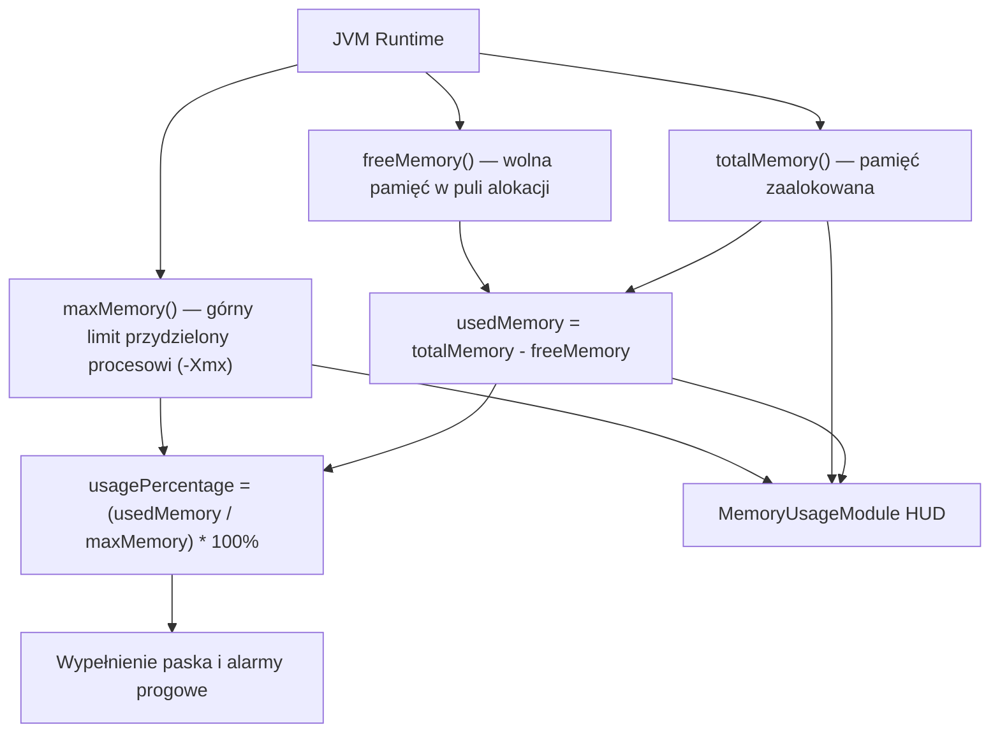

# Memory Usage Module — Specyfikacja Techniczna i Architektura

## 1. Cel i Założenia

Moduł `MemoryUsageModule` (`pl.zombek.client.core.modules.hud.info.MemoryUsageModule`, ID: `"memory_usage"`) odpowiada za bieżącą kontrolę zużycia pamięci sterty wirtualnej maszyny Javy (JVM Heap Memory) przez klienta gry i zainstalowane mody.

Główne założenia bezpieczeństwa i wydajności:
- **Zero wywołań Garbage Collectora (`System.gc()`):** Moduł pod żadnym pozorem nie forsuje odśmiecania pamięci, chroniąc przed zacięciami i mikro-lagami pętli gry (stop-the-world pauses);
- **Częstotliwość odświeżania pod kontrolą (Throttled Polling):** Odpytywanie `Runtime.getRuntime()` odbywa się z interwałem od 250 do 2000 ms (domyślnie 500 ms), eliminując ciągłe zapytania JNI/JVM na każdą klatkę;
- **Elastyczne formatowanie jednostek:** Wsparcie dla formatów `MB`, `GB` oraz inteligentnego `AUTO`;
- **Graficzny pasek zapełnienia (Memory Bar):** Pasek postępu z dynamiczną barwą w oparciu o progi ostrzegawcze (Warning i Critical).

---

## 2. Metryki Pamięci i Matematyka Zużycia

Metryki pobierane są bezpośrednio z `java.lang.Runtime`:

### 2.1 Wzory Obliczeniowe
1. **Pamięć Używana (Used Memory):**
   $$\text{usedBytes} = \text{totalMemory}() - \text{freeMemory}()$$
2. **Pamięć Przydzielona (Allocated Memory):**
   $$\text{allocatedBytes} = \text{totalMemory}()$$
3. **Pamięć Maksymalna (Max Memory):**
   $$\text{maxBytes} = \text{maxMemory}()$$
4. **Wskaźnik Procentowy Zużycia:**
   $$\text{usageRatio} = \frac{\text{usedBytes}}{\text{maxBytes}} \times 100\%$$

---

## 3. Graficzny Pasek Pamięci i Poziomy Alarmowe

Moduł udostępnia wizualny pasek zapełnienia pamięci (szerokość 60–200 px, wysokość 4–12 px):
- **Poziom Normalny ($\le 75\%$):** Barwa zielona / standardowa modowa;
- **Poziom Ostrzegawczy ($75\% - 90\%$):** Barwa żółto-pomarańczowa, sygnalizująca zapełnianie sterty przed kolejnym cyklem GC;
- **Poziom Krytyczny ($> 90\%$):** Barwa czerwona z opcją pulsowania, ostrzegająca gracza przed ryzykiem wystąpienia błędu `OutOfMemoryError` w rozbudowanych paczkach modów.

---

## 4. Typowane Ustawienia Modułu

| Grupa | Klucz | Typ | Domyślnie | Opis |
| :--- | :--- | :--- | :--- | :--- |
| `general` | `enabled` | `Boolean` | `false` | Włączenie modułu Memory Usage |
| `metrics` | `show_percentage` | `Boolean` | `true` | Wyświetlanie wartości procentowej |
| `metrics` | `show_allocated` | `Boolean` | `false` | Wyświetlanie aktualnie zaalokowanej pamięci |
| `metrics` | `show_max` | `Boolean` | `true` | Wyświetlanie limitu maksymalnego (-Xmx) |
| `metrics` | `memory_unit` | `Enum<MemoryUnit>` | `MB` | Jednostka pamięci: `MB`, `GB`, `AUTO` |
| `metrics` | `update_interval_ms`| `Number` (250–2000) | `500` | Częstotliwość odpytywania Runtime JVM (w ms) |
| `bar` | `show_bar` | `Boolean` | `true` | Wyświetlanie graficznego paska postępu |
| `bar` | `bar_width` | `Number` (40–200) | `80` | Szerokość paska w pikselach |
| `bar` | `bar_height` | `Number` (4–16) | `6` | Wysokość paska w pikselach |
| `thresholds` | `warning_percent` | `Number` (50–90) | `75` | Próg ostrzegawczy zmiany koloru paska |
| `thresholds` | `critical_percent` | `Number` (80–98) | `90` | Próg krytyczny zapełnienia pamięci |
| `colors` | `style` | `Enum<HudComponentStyle>` | `CLASSIC` | Styl tła: `MINIMAL`, `CLASSIC`, `MODERN`, `CUSTOM` |
| `colors` | `normal_color` | `Color` | `0xFF55FF55` | Kolor standardowy |
| `colors` | `warning_color` | `Color` | `0xFFFFAA00` | Kolor ostrzegawczy |
| `colors` | `critical_color` | `Color` | `0xFFFF5555` | Kolor krytyczny |
| `layout` | `anchor` | `Enum<HudAnchor>` | `TOP_RIGHT` | Zakotwiczenie modułu na ekranie |
| `layout` | `pos_x` | `Number` | `4` | Pozycja pozioma |
| `layout` | `pos_y` | `Number` | `4` | Pozycja pionowa |
| `layout` | `scale` | `Number` | `1.0` | Skalowanie elementu HUD |
