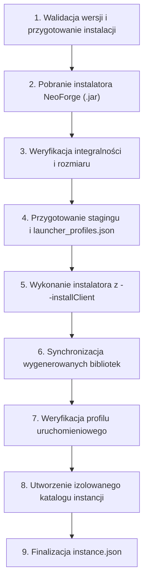

# Integracja z Minecraft NeoForge — ZombekClient

Niniejszy dokument szczegółowo opisuje architekturę, mechanizm pobierania, instalacji, potok procesorów oraz uruchamianie modloadera Minecraft NeoForge w launcherze ZombekClient (Etap 5C).

---

## 1. Źródła Metadanych i Repozytoriów

Wszystkie dane dotyczące wersji i instalatorów NeoForge pobierane są wyłącznie z oficjalnych źródeł projektu NeoForged:

1. **Oficjalne repozytorium Maven:**
   - Adres bazowy: `https://maven.neoforged.net/releases/`
2. **Metadane wydań współczesnych — Modern (Minecraft 1.20.2+):**
   - URL: `https://maven.neoforged.net/releases/net/neoforged/neoforge/maven-metadata.xml`
   - Koordynaty artefaktu: `net.neoforged:neoforge`
   - Konwencja wersji: `<major>.<minor>.<build>` (np. `20.4.237`, `21.1.265`)
3. **Metadane wydań przejściowych — Transition (Minecraft 1.20.1):**
   - URL: `https://maven.neoforged.net/releases/net/neoforged/forge/maven-metadata.xml`
   - Koordynaty artefaktu: `net.neoforged:forge`
   - Konwencja wersji: `1.20.1-47.1.<build>` (np. `1.20.1-47.1.106`)
4. **Instalatory JAR klienta:**
   - Modern: `https://maven.neoforged.net/releases/net/neoforged/neoforge/{version}/neoforge-{version}-installer.jar`
   - Transition: `https://maven.neoforged.net/releases/net/neoforged/forge/{version}/forge-{version}-installer.jar`
5. **Lokalny bufor dyskowy (Offline Support):**
   - Ścieżka: `%APPDATA%/ZombekClient/game-data/neoforge_meta_cache.json`
   - Przechowuje pobrane listy wersji z datą aktualizacji `lastUpdated`. W przypadku braku połączenia sieciowego launcher automatycznie korzysta z bufora dyskowego.

---

## 2. Obsługiwane Generacje NeoForge

Projekt NeoForge powstał jako fork Forge po wydaniu Minecraft 1.20.1. ZombekClient w module `NeoForgeMetaService` automatycznie rozróżnia generacje wydań:

| Wersja Minecraft | Generacja | Koordynaty Maven | Prefiks Wersji | Status Wsparcia |
| :--- | :---: | :---: | :---: | :---: |
| **1.21.1** | Modern | `net.neoforged:neoforge` | `21.1.` | Pełne wsparcie (np. `21.1.265`) |
| **1.21.0** | Modern | `net.neoforged:neoforge` | `21.0.` | Pełne wsparcie (np. `21.0.167`) |
| **1.20.4** | Modern | `net.neoforged:neoforge` | `20.4.` | Pełne wsparcie (np. `20.4.237`) |
| **1.20.2** | Modern | `net.neoforged:neoforge` | `20.2.` | Pełne wsparcie (np. `20.2.93`) |
| **1.20.1** | Transition | `net.neoforged:forge` | `1.20.1-47.1.` | Pełne wsparcie (np. `1.20.1-47.1.106`) |
| **1.19.4 i starsze** | Brak | — | — | **Nieobsługiwane** (NeoForge nie istniało) |

---

## 3. Proces Instalacji (9 Etapów)

Podobnie jak Forge, oficjalny instalator NeoForge wykonuje procesy binarnego patchowania bazowego klienta gry `client.jar` (m.in. deobfuskacja, split klas, aplikacja łatek LZMA).

Aby zagwarantować pełną izolację i czystość systemu użytkownika, instalacja realizowana jest w **9 ściśle określonych etapach**:



### Szczegóły poszczególnych kroków:

1. **Walidacja wersji:** Sprawdzenie kompatybilności wersji gry i loadera, wyznaczenie optymalnego wydania (np. zalecanego `20.4.237`).
2. **Pobranie instalatora:** Ściągnięcie `neoforge-{version}-installer.jar` (lub `forge-...` dla 1.20.1) za pośrednictwem wielowątkowego `DownloadManager`.
3. **Weryfikacja integralności:** Sprawdzenie rozmiaru pliku JAR (wymagane > 100 KB) oraz poprawności struktury ZIP.
4. **Przygotowanie środowiska staging (`game-data/neoforge-staging/`):**
   - Utworzenie minimalnego pliku `launcher_profiles.json` (`{ "profiles": {} }`) w katalogu pośrednim, aby oficjalny instalator uznał go za docelowe środowisko launchera.
   - Umieszczenie bazowego pliku `versions/{mcVersion}/{mcVersion}.jar` oraz JSON manifestu Mojang.
   - **Gwarancja izolacji:** Instalator nie dotyka folderu `%APPDATA%/.minecraft`.
5. **Uruchomienie instalatora:**
   - Wywołanie: `java -Djavax.net.ssl.trustStoreType=WINDOWS-ROOT -jar <installer.jar> --installClient <stagingDir>`.
   - Flaga `-Djavax.net.ssl.trustStoreType=WINDOWS-ROOT` zapewnia zaufanie do certyfikatów systemowych Windows (eliminuje błędy `PKIX path building failed` przy połączeniach HTTPS przez proxy).
   - Przechwytywanie strumieni stdout/stderr linijka po linijce i emitowanie do logów launchera.
6. **Synchronizacja bibliotek:**
   - Skopiowanie wygenerowanych bibliotek (np. `libraries/net/neoforged/...`, `cpw/mods/...`, `org/ow2/asm/...`) do globalnego `game-data/libraries/`.
   - Skopiowanie wygenerowanego profilu JSON z `versions/neoforge-{version}/` do `game-data/versions/`.
7. **Weryfikacja profilu:**
   - Potwierdzenie obecności profilu i pomyślne rozwiązanie przez `resolveProfile(...)`.
8. **Inicjalizacja katalogu instancji:**
   - Utworzenie dedykowanych folderów `instances/<id>/mods/`, `config/`, `saves/`, `resourcepacks/`, `screenshots/`, `natives/`, `logs/`.
9. **Zapis metadanych profilu:**
   - Aktualizacja pliku `instance.json` z konfiguracją: `loader: "neoforge"`, `loaderVersion: "{version}"`.
   - Czyszczenie katalogu staging.

---

## 4. Architektura Procesorów NeoForge (`install_profile.json`)

Do wewnętrznej obsługi i inspekcji procesorów instalacyjnych przygotowano moduł `NeoForgeProcessorManager`:

### Rozwiązywanie tokenów i zmiennych:
- `{MINECRAFT_JAR}`: Ścieżka do bazowego JAR klienta Mojang.
- `{INSTALLER}`: Ścieżka do pobranego instalatora JAR.
- `{ROOT}`: Ścieżka do katalogu roboczego staging.
- `{LIBRARY_DIR}`: Katalog bibliotek gry.
- `{KEY}`: Odwołanie do wpisu ze słownika `data` w `install_profile.json` (np. `{MC_SLIM}`, `{MERGED_MAPPINGS}`, `{BINPATCH}`).
- `[group:artifact:version:classifier@ext]`: Dynamiczne rozwijanie koordynatów Maven z uwzględnieniem rozszerzeń `@jar`, `@zip`, `@tsrg`.
- `'wartość'`: Literał tekstowy (odrzucenie apostrofów).
- `/data/...`: Ścieżka do zasobu wewnętrznego archiwum instalatora.

### Filtracja po stronie klienta:
Procesory posiadają tablicę `sides` określającą środowisko wykonania (np. `["client"]`, `["server"]` lub pusta).
`NeoForgeProcessorManager.filterClientProcessors` odrzuca procesory czysto serwerowe (`sides: ['server']`), wykonując jedynie te wymagane dla instalacji klienta.

---

## 5. Wymagania Środowiska Java Runtime

NeoForge wymaga odpowiedniej wersji środowiska Java w zależności od bazowej wersji Minecraft:

- **Minecraft 1.20.5+ oraz 1.21.x:** Wymaga **Java 21** (`java-runtime-delta`).
- **Minecraft 1.20.1 do 1.20.4:** Wymaga **Java 17** (`java-runtime-gamma`).

Launcher automatycznie odpytuje `JavaRuntimeManager`, pobierając lub wykrywając właściwy runtime Javy bez modyfikowania globalnej zmiennej `JAVA_HOME` użytkownika.

---

## 6. Generowanie Profili i Uruchamianie Gry

Wygenerowany profil NeoForge korzysta z mechanizmu dziedziczenia `inheritsFrom`:

```json
{
  "id": "neoforge-20.4.237",
  "inheritsFrom": "1.20.4",
  "mainClass": "cpw.mods.bootstraplauncher.BootstrapLauncher"
}
```

Podczas uruchomienia gry przez `GameLauncher`:
1. Wczytywany jest bazowy pakiet wersji Vanilla (`1.20.4.json`).
2. Nakładane są biblioteki i argumenty z profilu NeoForge:
   - Klasa główna ustawiana jest na `cpw.mods.bootstraplauncher.BootstrapLauncher`.
   - Do Classpath dodawane są: bazowy `1.20.4.jar`, wygenerowany `neoforge-20.4.237-client.jar` oraz biblioteki NeoForge i Mojang.
   - Przekazywane są argumenty modularyzacji JVM (`-DignoreList=...`, `-DmergeModules=...`).
   - Przekazywany jest katalog `--gameDir` wskazujący dedykowaną instancję `instances/<id>/`.
3. Podłączana jest aktywna sesja Microsoft Premium (z tokenem JWT) lub profil lokalny Offline.
4. Tokeny w wierszu poleceń podlegają automatycznemu redagowaniu (`--accessToken [REDACTED]`).

---

## 7. Porównanie Wszystkich 4 ModLoaderów w ZombekClient

| Cecha | Vanilla | Fabric | Forge | NeoForge |
| :--- | :--- | :--- | :--- | :--- |
| **Oficjalne źródło** | Piston Meta v2 | Fabric Meta API v2 | `files.minecraftforge.net` | `maven.neoforged.net` |
| **Metoda instalacji** | Bezpośredni download | Profil JSON z API | Oficjalny instalator JAR | Oficjalny instalator JAR |
| **Patchowanie client.jar** | Nie | Nie (runtime bytecode) | Tak (`forge-*-client.jar`) | Tak (`neoforge-*-client.jar`) |
| **Główna klasa startowa** | `net.minecraft.client.main.Main` | `net.fabricmc...KnotClient` | `net.minecraftforge...ForgeBootstrap` | `cpw.mods...BootstrapLauncher` |
| **Izolacja folderu mods** | Niewykorzystywany | `instances/<id>/mods/` | `instances/<id>/mods/` | `instances/<id>/mods/` |
| **Obsługiwane wersje MC** | Wszystkie (1.0 - 1.21.x) | 1.14 - 1.21.x | 1.1 - 1.21.x | 1.20.1 - 1.21.x |
| **Wsparcie dla kont** | Microsoft & Offline | Microsoft & Offline | Microsoft & Offline | Microsoft & Offline |

---

## 8. Znane Ograniczenia i Obsługa Błędów

1. **Wersje starsze niż 1.20.1:** NeoForge powstał w 2023 r. dla Minecraft 1.20.1. Próba wyboru NeoForge dla wydań starszych (np. 1.19.4, 1.16.5, 1.12.2) wyświetla czytelne powiadomienie o braku wsparcia.
2. **Czas instalacji:** Pierwsza instalacja danej wersji NeoForge wymaga przetworzenia spatchowanego klienta przez instalator Javy (~25-45 sekund). Kolejne uruchomienia profilu nie wymagają ponownej instalacji.
3. **Recovery i izolacja:** Jeśli instalator ulegnie przerwaniu, katalog `neoforge-staging/` jest czyszczony, a profil oznaczany statusem błędu bez uszkadzania innych profili.
