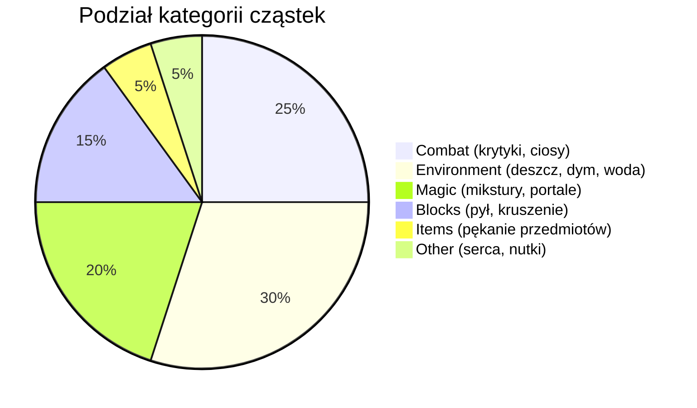

# Klasyfikacja cząsteczek i kontrola wydajności

## 1. Kategorie cząsteczek

Klasa [ParticleCategoryClassifier](file:///c:/Users/Admin/Desktop/jules_session_17875811770345124279/apps/minecraft-client/core/src/main/java/pl/zombek/client/core/rendereffect/particle/ParticleCategoryClassifier.java) przypisuje identyfikatory cząstek do 6 funkcjonalnych kategorii:

### Mapowanie identyfikatorów
- **COMBAT**: `crit`, `damage_indicator`, `sweep_attack`, `enchanted_hit`, `sonic_boom`
- **ENVIRONMENT**: `rain`, `splash`, `smoke`, `bubble`, `cloud`, `campfire_cosy_smoke`, `spore_blossom_air`, `ash`, `white_smoke`, `drip_water`, `cherry_leaves`, `snowflake`
- **MAGIC**: `witch`, `spell`, `instant_effect`, `dragon_breath`, `portal`, `enchant`, `glow`, `sculk_charge`, `soul`, `totem_of_undying`, `end_rod`
- **BLOCKS**: `block`, `dust`, `falling_dust`, `wax_on`, `wax_off`, `scrape`
- **ITEMS**: `item`, `item_slime`, `item_snowball`
- **OTHER**: `heart`, `note`, `angry_villager`, `happy_villager`

## 2. Mechanizm dławienia wydajnościowego

Metoda `shouldSpawnParticle()` weryfikuje cztery warunki przed dopuszczeniem cząstki do bufora:
1. **Licznik aktywnych cząstek**: `activeCount < maxParticleLimit`.
2. **Promień widzenia**: $dx^2 + dy^2 + dz^2 \le maxDistance^2$.
3. **Reguła indywidualna**: jeśli zdefiniowano regułę dla danego ID, stosowane jest losowanie gęstości z generatora `ThreadLocalRandom`.
4. **Mnożnik kategorii**: losowanie probabilistyczne w oparciu o iloczyn `globalDensity * categoryDensity`.
