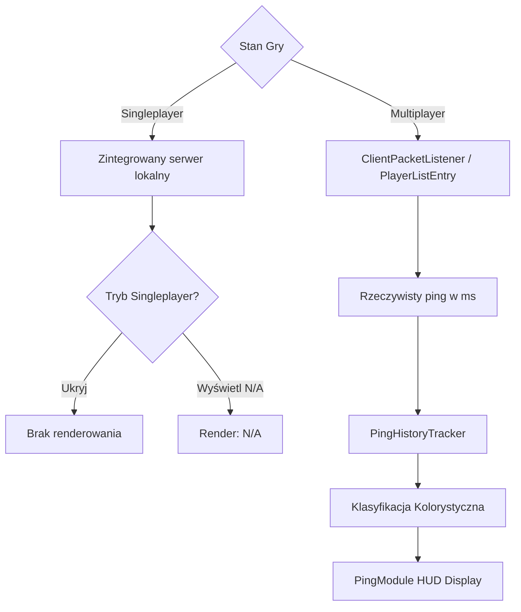

# Ping Module — Specyfikacja Techniczna i Architektura

## 1. Cel i Założenia

Moduł `PingModule` (`pl.zombek.client.core.modules.hud.info.PingModule`, ID: `"ping"`) odpowiada za precyzyjny pomiar i prezentację opóźnienia sieciowego (round-trip time w milisekundach) gracza do serwera gry.

Kluczowe założenia:
- Pobiera rzeczywiste dane opóźnienia z tablisty / połączenia sieciowego klienta (`IInfoHudDataProvider.getCurrentPingMs()`);
- **Rzetelna obsługa Singleplayer:** W trybie jednoosobowym (zintegrowany serwer wewnętrzny) moduł nie wyświetla wprowadzającego w błąd "0 ms", lecz przejrzystą informację `N/A` lub ulega automatycznemu ukryciu zgodnie z preferencjami gracza;
- Posiada bufor kołowy (`PingHistoryTracker`) uśredniający wartości i niwelujący fluktuacje;
- Posiada inteligentne kolorowanie progowe w oparciu o jakość połączenia (zielony, żółty, pomarańczowy, czerwony);
- Integruje się z systemem stylów HUD (Minimal, Classic, Modern, Custom).

---

## 2. Źródła Danych i Obsługa Połączeń

### 2.1 Tablista Graczy vs Informacja o Połączeniu
W trybie wieloosobowym opóźnienie pobierane jest z informacji o graczu w tabliście serwera (`PlayerInfo.getLatency()` / odpowiednik platformowy). Wartość uaktualniana jest wraz z przychodzącymi pakietami keep-alive.

### 2.2 Reżim Singleplayer
W świecie jednoosobowym pakiety nie opuszczają procesu JVM, przez co metryka sieciowa traci sens. Użytkownik ma do wyboru:
- `hide_in_singleplayer = true`: moduł automatycznie znika, nie zajmując miejsca na ekranie;
- `hide_in_singleplayer = false`: moduł wyświetla estetyczny badge `Ping: N/A`.

---

## 3. Klasyfikacja Jakości Łącza i Kolorowanie Progowe

Moduł dynamicznie dostosowuje barwę tekstu/wskaźnika w zależności od opóźnienia:

| Zakres Pingu | Stan Łącza | Kolor Domyślny | Kod Koloru |
| :--- | :--- | :--- | :--- |
| $\le 60\text{ ms}$ | **Doskonałe (Good)** | Jasnozielony | `0xFF55FF55` |
| $61 - 120\text{ ms}$ | **Umiarkowane (Medium)** | Żółty | `0xFFFFFF55` |
| $121 - 250\text{ ms}$ | **Wysokie (High)** | Pomarańczowy | `0xFFFFAA00` |
| $> 250\text{ ms}$ | **Krytyczne (Critical)** | Czerwony | `0xFFFF5555` |
| *Singleplayer* | **Niedostępne (N/A)** | Szary | `0xFFAAAAAA` |

---

## 4. Typowane Ustawienia Modułu

| Grupa | Klucz | Typ | Domyślnie | Opis |
| :--- | :--- | :--- | :--- | :--- |
| `general` | `enabled` | `Boolean` | `false` | Włączenie modułu Ping |
| `display` | `prefix` | `String` | `"Ping: "` | Prefiks etykiety |
| `display` | `suffix` | `String` | `" ms"` | Sufiks jednostki |
| `display` | `hide_in_singleplayer` | `Boolean` | `true` | Automatyczne ukrywanie na światach lokalnych |
| `display` | `color_by_ping` | `Boolean` | `true` | Dynamiczna zmiana barwy w oparciu o jakość łącza |
| `colors` | `style` | `Enum<HudComponentStyle>` | `CLASSIC` | Styl tła: `MINIMAL`, `CLASSIC`, `MODERN`, `CUSTOM` |
| `colors` | `good_color` | `Color` | `0xFF55FF55` | Kolor niskiego opóźnienia (< 60 ms) |
| `colors` | `medium_color` | `Color` | `0xFFFFFF55` | Kolor średniego opóźnienia (61–120 ms) |
| `colors` | `high_color` | `Color` | `0xFFFFAA00` | Kolor podwyższonego opóźnienia (121–250 ms) |
| `colors` | `critical_color` | `Color` | `0xFFFF5555` | Kolor krytycznego opóźnienia (> 250 ms) |
| `layout` | `anchor` | `Enum<HudAnchor>` | `TOP_LEFT` | Zakotwiczenie modułu na ekranie |
| `layout` | `pos_x` | `Number` | `4` | Pozycja pozioma |
| `layout` | `pos_y` | `Number` | `60` | Pozycja pionowa |
| `layout` | `scale` | `Number` | `1.0` | Skalowanie elementu HUD |
