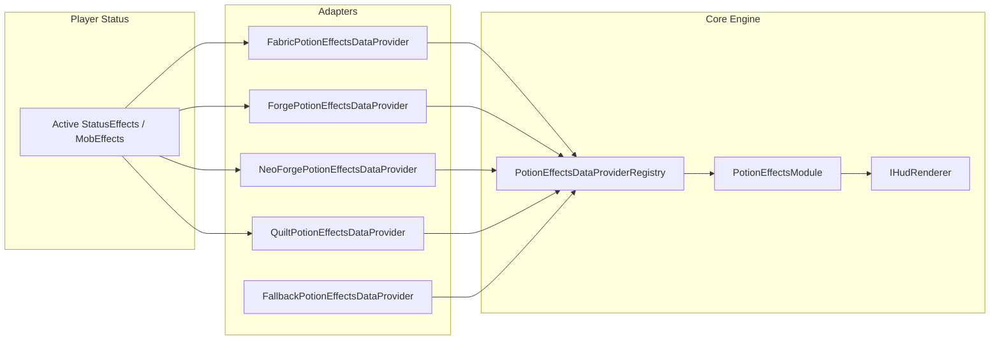

# Potion Effects Module — ZombekClient (Etap 8B2)

## 1. Przeznaczenie i Rola Modułu

Moduł `PotionEffectsModule` (`"potion_effects"`) w ZombekClient zapewnia pełny, niezależny interfejs HUD prezentujący aktywne efekty mikstur i statusy gracza (np. Speed, Strength, Regeneration, Poison, Wither). Zastępuje lub rozszerza domyślne ikony vanilla, oferując szczegółowe informacje o czasie trwania, poziomie wzmocnienia (amplifier), kodowaniu kolorystycznym kategorii oraz wizualnym ostrzeżeniu o rychłym wygaśnięciu efektu.

Pliki źródłowe:
- Klasa modułu: [PotionEffectsModule.java](file:///c:/Users/Admin/Desktop/jules_session_17875811770345124279/apps/minecraft-client/core/src/main/java/pl/zombek/client/core/modules/hud/potions/PotionEffectsModule.java)
- Modele danych: [StatusEffectData.java](file:///c:/Users/Admin/Desktop/jules_session_17875811770345124279/apps/minecraft-client/core/src/main/java/pl/zombek/client/core/hud/potions/StatusEffectData.java), [StatusEffectCategory.java](file:///c:/Users/Admin/Desktop/jules_session_17875811770345124279/apps/minecraft-client/core/src/main/java/pl/zombek/client/core/hud/potions/StatusEffectCategory.java)
- Tryby sortowania i układów: [PotionSortMode.java](file:///c:/Users/Admin/Desktop/jules_session_17875811770345124279/apps/minecraft-client/core/src/main/java/pl/zombek/client/core/hud/potions/PotionSortMode.java), [PotionLayoutMode.java](file:///c:/Users/Admin/Desktop/jules_session_17875811770345124279/apps/minecraft-client/core/src/main/java/pl/zombek/client/core/hud/potions/PotionLayoutMode.java)

---

## 2. Architektura i Przepływ Danych

1. **Odczyt Efektów:** Adaptery platformowe odczytują aktywne efekty z `client.player.getStatusEffects()` (Fabric/Quilt) lub `mc.player.getActiveEffects()` (Forge/NeoForge).
2. **Kategoryzacja:** Statusy dzielone są na 3 kategorie:
   - `BENEFICIAL` — efekty pozytywne (buff), renderowane domyślnie kolorem zielonym `#55FF55`.
   - `NEUTRAL` — efekty neutralne/specjalne, renderowane kolorem białym `#FFFFFF`.
   - `HARMFUL` — efekty szkodliwe (debuff), renderowane kolorem czerwonym `#FF5555`.
3. **Formatowanie Poziomu i Czasu:** Poziom 0 prezentowany jest jako brak cyfry, poziom 1 jako `II`, poziom 2 jako `III`, itp. Czas trwania formatowany jest jako `mm:ss` lub `**:**` dla efektów nieskończonych.
4. **Ukrywanie Vanilla HUD:** Przełącznik `hide_vanilla_hud` umożliwia wyłączenie domyślnych ikon efektów w prawym górnym rogu ekranu, eliminując nakładanie się elementów.

---

## 3. Tryby Sortowania (`PotionSortMode`)

- `DURATION_SHORTEST` — efekty kończące się najszybciej na samej górze.
- `DURATION_LONGEST` — efekty trwające najdłużej na samej górze.
- `BENEFICIAL_FIRST` — najpierw buffy, następnie neutralne, na końcu debuffy.
- `HARMFUL_FIRST` — najpierw debuffy, ułatwiając szybką reakcję w PvP.
- `ALPHABETICAL` — porządek alfabetyczny wg nazwy efektu.
- `CUSTOM_ORDER` — porządek zdefiniowany przez gracza.

---

## 4. Tryby Układu (`PotionLayoutMode`)

- `CLASSIC` — kafelek z ikoną, nazwą ze stopniem wzmocnienia oraz czasem poniżej.
- `COMPACT` — skondensowany jednolinijkowy wiersz z nazwą i czasem.
- `DETAILED` — rozszerzony widok z dokładnym czasem w sekundach i mini-paskiem ubywającego czasu.
- `ICONS_ONLY` — same ikony statusów ułożone w rządku lub kolumnie.
- `CUSTOM` — personalizowany układ w oparciu o suwaki skalowania i odstępów.

---

## 5. Konfiguracja w Menu Right Shift

- **Ogólne:** `show_icons`, `show_names`, `show_amplifier`, `show_duration`, `show_infinite`, `sort_mode`, `hide_vanilla_hud`, `preview_mode`.
- **Wyświetlanie:** `layout_mode`, `icon_size`, `row_spacing`, `max_effects`, `show_duration_bar`.
- **Zachowanie:** `highlight_expiring`, `warning_time` (domyślnie 10.0s), `hide_in_spectator`.
- **Kolory:** `beneficial_color`, `neutral_color`, `harmful_color`, `expiring_color`, `text_color`, `bg_color`.
- **Pozycja:** `anchor` (`TOP_RIGHT`), `pos_x`, `pos_y`, `scale`.
