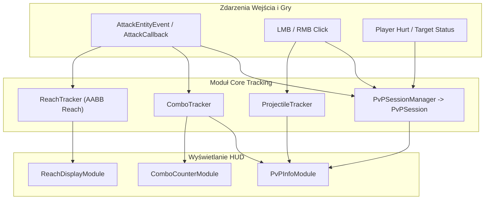

# ZombekClient — PvP Tracking & Session Architecture

## 1. Wprowadzenie

Architektura śledzenia statystyk potyczek PvP w ZombekClient opiera się na separacji detekcji zdarzeń od ich prezentacji wizualnej. Wszystkie obliczenia i rejestracje danych realizowane są przez dedykowane komponenty w pakiecie `pl.zombek.client.core.tracking`:
1. `ReachTracker` — dokładne obliczenia zasięgu do AABB celu.
2. `PvPSessionManager` & `PvPSession` — cykl życia sesji potyczki, statystyki walki wręcz, obrażeń i zdrowia.
3. `ProjectileTracker` — śledzenie wystrzelonych oraz celnych pocisków.
4. `ComboTracker` — ciąg nieprzerwanych trafień.
5. `ClickTracker` & `KeyTracker` — analityka wejścia gracza.

---

## 2. Diagram Przepływu Danych

---

## 3. Komponenty Systemu

### 3.1 `ReachTracker`
- Metoda statyczna `calculateDistanceToAABB(...)`: clamping pozycji oczu do zakresu `[min, max]` w osiach X, Y, Z oraz wyznaczenie odległości euklidesowej.
- Rejestracja zdarzeń `recordObservedHit(distance, entityId, entityName)` oraz `recordAttackAttempt(distance, entityId, entityName)`.
- Buforowana historia z automatycznym obliczaniem średniej arytmetycznej, minimum i maksimum.

### 3.2 `PvPSession`
- **Ataki i Trafienia**: `meleeAttacks`, `observedHits`, `estimatedHitRate` $\left(\frac{\text{hits}}{\text{attacks}} \cdot 100\%\right)$.
- **Obrażenia**: Rejestrowanie utraty zdrowia przy `hurtTime == 9` (faza rozpoczęcia animacji otrzymania obrażeń w silniku gry).
- **Punkty Życia Przeciwnika**: Aktualizacja `targetHealth` na podstawie encji namierzonej w celowniku gracza (`targetedEntity` / `crosshairPickEntity`).

### 3.3 `ProjectileTracker`
- Obsługa typów: `ARROW`, `SPECTRAL_ARROW`, `TRIDENT`, `SNOWBALL`, `EGG`, `FIREBALL`, `POTION`, `FISHING_BOBBER`, `OTHER`.
- Rejestrowanie wystrzelenia na krawędzi wciśnięcia prawego przycisku myszy (`recordProjectileFired`) z uwzględnieniem przedmiotu trzymanego w dłoni głównej lub dodatkowej.

---

## 4. Odporność i Zabezpieczenia Stanu
Wszystkie trackery implementują mechanizmy bezpiecznego resetu:
- Reset przy śmierci gracza (`onPlayerDeath`).
- Reset przy odłączeniu od serwera bądź zmianie świata (`onWorldChange`).
- Reset przy utracie fokusu okna aplikacji (`resetAll`).
- Bezpieczeństwo współbieżności: metody modyfikujące stan są zabezpieczone słowem kluczowym `synchronized` lub strukturami `ConcurrentHashMap` i `AtomicInteger`.
