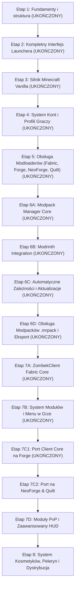

# Mapa Rozwoju (Roadmap) — ZombekClient

Poniższa mapa przedstawia kolejne kroki rozwoju projektu ZombekClient.

## Szczegółowy opis kolejnych etapów

### Etap 1: Fundamenty i struktura (Bieżący — Ukończony)
- Przygotowanie struktury monorepo, pnpm workspaces, TypeScript Project References.
- Utworzenie aplikacji `apps/launcher` (Electron + React + Vite) oraz `apps/minecraft-client/fabric` (Gradle + Fabric Loom).
- Stworzenie współdzielonych bibliotek: `@zombek/shared-types`, `@zombek/config-schema`, `@zombek/contracts`.
- Wdrożenie bezpiecznego mostka IPC i testów jednostkowych fundamentów.

### Etap 2: Architektura IPC, Konfiguracja i Zarządzanie Stanem
- Rozbudowa kanałów IPC o zarządzanie plikami konfiguracyjnymi (zapis/odczyt z dysku).
- Wdrożenie zarządzania stanem w React (Zustand / Jotai).
- Rejestracja zdarzeń systemowych (wykrywanie pamięci RAM, instalacji Javy).

### Etap 3: System Kont i Autoryzacji
- Implementacja logowania Microsoft (Device Code Flow / OAuth2 PKCE).
- Bezpieczne przechowywanie tokenów w bezpiecznym magazynie systemowym (keytar / safeStorage w Electron).
- Obsługa profili lokalnych (Offline) do testów deweloperskich.

### Etap 4: Menadżer Instancji i Uruchamianie Minecrafta
- Pobieranie metadanych wersji z oficjalnych serwerów Mojang API i Fabric Meta.
- Sprawdzanie i weryfikacja sum kontrolnych (SHA1/SHA256) plików gry, bibliotek i assetów.
- Budowanie linii poleceń JVM i uruchamianie procesu gry w trybie izolowanym.

### Etap 5: Interfejs Użytkownika i Identyfikacja Wizualna
- Projekt interfejsu inspirowany Lunar Client z motywem świątecznym (festive pixel-art).
- Integracja maskotki Ząbek w oprawie graficznej.
- Ekrany: strona główna, wybór wersji, menadżer kont, ustawienia graficzne i pamięci.

### Etap 6: Klient w Grze (Fabric Mod)
- Implementacja szkieletu modułów in-game (`modules/` i `hud/`).
- Nakładki HUD: Keystrokes, CPS Counter, FPS Counter, Armor Status.
- Menu konfiguracji modułów wewnątrz Minecrafta (GUI nakładkowe).

### Etap 7: Wieloplatformowość Modloaderów i Modpacki
- Dodanie modułów `apps/minecraft-client/forge` oraz `apps/minecraft-client/neoforge`.
- System tworzenia i eksportowania profili/modpacków użytkownika.

### Etap 8: System Kosmetyków i Serwis Zewnętrzny
- Budowa mikroserwisu `services/cosmetics-api`.
- Renderowanie peleryn, skrzydeł i czapek wewnątrz gry dla użytkowników klienta.
- Przygotowanie instalatorów produkcyjnych (Windows NSIS / MSI, Linux AppImage/deb).
