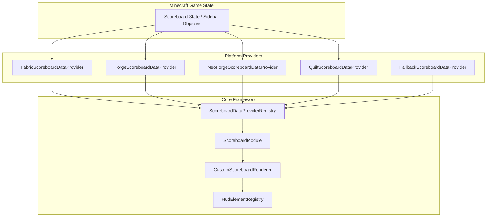

# Scoreboard Module — ZombekClient (Etap 8B2)

## 1. Przeznaczenie i Rola Modułu

Moduł `ScoreboardModule` (`"scoreboard"`) w ZombekClient zapewnia pełną, niezależną personalizację i zaawansowane renderowanie bocznej tablicy wyników (sidebar scoreboard) w grze Minecraft. Zastępuje domyślny, surowy interfejs vanilla Minecraft nowoczesnym, w pełni konfigurowalnym komponentem HUD o 5 unikalnych stylach graficznych, zapobiegając problemom podwójnego renderowania oraz wspierając dynamiczne dopasowanie szerokości, przycinanie wierszy i wyrównanie tekstu.

Pliki źródłowe:
- Klasa modułu: [ScoreboardModule.java](file:///c:/Users/Admin/Desktop/jules_session_17875811770345124279/apps/minecraft-client/core/src/main/java/pl/zombek/client/core/modules/hud/scoreboard/ScoreboardModule.java)
- Niestandardowy renderer: [CustomScoreboardRenderer.java](file:///c:/Users/Admin/Desktop/jules_session_17875811770345124279/apps/minecraft-client/core/src/main/java/pl/zombek/client/core/hud/scoreboard/CustomScoreboardRenderer.java)
- Modele danych: [ScoreboardObjectiveData.java](file:///c:/Users/Admin/Desktop/jules_session_17875811770345124279/apps/minecraft-client/core/src/main/java/pl/zombek/client/core/hud/scoreboard/ScoreboardObjectiveData.java), [ScoreboardLineData.java](file:///c:/Users/Admin/Desktop/jules_session_17875811770345124279/apps/minecraft-client/core/src/main/java/pl/zombek/client/core/hud/scoreboard/ScoreboardLineData.java)

---

## 2. Architektura i Przepływ Danych

1. **Pobieranie Danych:** Platforma (`Fabric`, `Forge`, `NeoForge`, `Quilt`) odczytuje cel boczny przypisany do slotu `sidebar` (`ScoreboardDisplaySlot.SIDEBAR` / `DisplaySlot.SIDEBAR`).
2. **Abstrakcja Core:** Dane trafiają do niezmiennego obiektu DTO `ScoreboardObjectiveData`, zawierającego listę wierszy `ScoreboardLineData` (wynik, nazwa właściciela, prefiks, sufiks, sformatowany tekst).
3. **Zapobieganie Double-Rendering:** Zdarzenia loaderów oraz mixiny sprawdzają `ScoreboardModule.shouldOverrideVanilla()`. Gdy moduł jest aktywny i włączony jest `use_custom_renderer`, renderowanie domyślnego scoreboardu vanilla jest bezpiecznie anulowane (`ci.cancel()` / `event.setCanceled(true)`).
4. **Fallback na Błędy:** Jeśli moduł ulegnie awarii (`hasError() == true`), `shouldOverrideVanilla()` natychmiast zwraca `false`, a silnik gry bezpiecznie powraca do standardowego scoreboardu vanilla.

---

## 3. Style Wizualne (`ScoreboardStyle`)

Moduł implementuje 5 motywów wizualnych:
1. `VANILLA` — klasyczne, półprzezroczyste szare tło z czerwonymi numerami wyników po prawej stronie, odwzorowujące styl oryginalnego Minecrafta.
2. `MINIMAL` — pozbawiony ramek i ciężkich teł, lekki i czytelny styl minimalistyczny.
3. `MODERN` — nowoczesny ciemny motyw ze szklanym tłem (`#0F172A`), zaokrąglonymi narożnikami i subtelnym niebieskim akcentem (`#38BDF8`).
4. `GLASS` — elegancki efekt matowego szkła (glassmorphism) z ciemnym wypełnieniem i jasną, cienką ramką.
5. `CUSTOM` — pełna swoboda konfiguracji kolorów tekstu, tła, wierszy naprzemiennych, wyników i ramki.

---

## 4. Grupy Ustawień

Moduł udostępnia 6 grup konfiguracyjnych w menu Right Shift:
- **`general` (Ogólne):**
  - `use_custom_renderer` (Boolean, domyślnie `true`) — przejęcie renderowania vanilla.
  - `preview_mode` (Boolean, domyślnie `false`) — prezentacja przykładowego scoreboardu przy braku aktywnego celu.
  - `scoreboard_style` (Enum: `VANILLA`, `MINIMAL`, `MODERN`, `GLASS`, `CUSTOM`, domyślnie `MODERN`).
- **`title` (Tytuł):**
  - `show_title` (Boolean, domyślnie `true`).
  - `custom_title` (String, opcjonalny własny tytuł zastępujący serwerowy).
  - `title_color` (Color, domyślnie `#FFFFFF`).
  - `title_scale` (Number, 0.5–2.0).
  - `title_alignment` (Enum: `LEFT`, `CENTER`, `RIGHT`).
  - `title_shadow`, `title_bg`, `title_padding`.
- **`lines` (Linie):**
  - `show_lines`, `show_scores`, `show_prefixes`, `show_suffixes`.
  - `line_spacing`, `line_alignment`, `line_scale`, `line_shadow`, `line_bg`, `alt_bg`.
- **`advanced` (Zaawansowane):**
  - `max_lines` (1–15, domyślnie 15).
  - `truncate_lines` (Boolean) i `max_line_length` (10–64 znaki).
  - `dynamic_width` (Boolean) oraz `fixed_width` (80–300px).
  - `hide_empty_lines`, `hide_empty_scores`, `border_thickness`, `show_border`.
- **`colors` (Kolory):**
  - `text_color`, `score_color`, `bg_color`, `alt_bg_color`, `border_color`.
- **`layout` (Pozycja):**
  - `anchor` (Enum: `TOP_RIGHT` domyślnie), `pos_x`, `pos_y`, `scale`.
