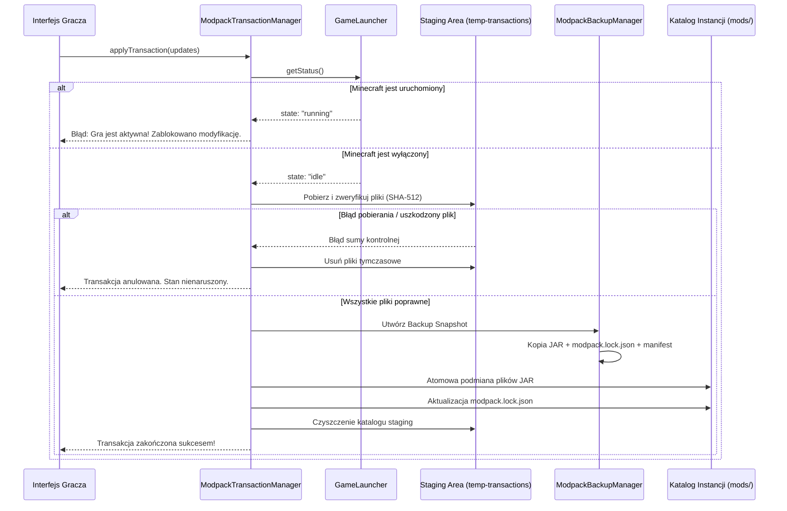

# Potok Transakcyjny i System Przywracania (Rollback)

Dokumentacja techniczna mechanizmu atomowych modyfikacji modpacków, izolacji procesu gry oraz procedury tworzenia i przywracania kopii zapasowych w **ZombekClient**.

---

## 1. Zasada Nienaruszalności i Bezpieczeństwa

Modyfikacja plików `.jar` w aktywnym modpacku niesie za sobą ryzyko przerwania połączenia internetowego, uszkodzenia archiwum na dysku lub blokady zapisu przez system operacyjny.

Aby wyeliminować ryzyko pozostawienia modpacka w stanie uszkodzonym, w ZombekClient wdrożono wzorzec **ACID-inspired Transactions** zorientowany na system plików:



---

## 2. Zabezpieczenie przed Działaniem Gry (Running Game Guard)

W systemie Windows pliki JAR załadowane do wirtualnej maszyny Javy (JVM) są blokowane na poziomie jądra systemu (`EBUSY` / `EPERM`).

Przed rozpoczęciem transakcji `ModpackTransactionManager` weryfikuje:
```ts
const status = GameLauncher.getInstance().getStatus();
if (status.state === 'running' && status.currentInstanceId === targetInstanceId) {
  throw new Error('Instalacja Minecraft jest aktualnie uruchomiona. Wyłącz grę przed aktualizacją modów.');
}
```
Zapewnia to 100% ochronę przed uszkodzeniem plików spowodowanym kolizją z uruchomioną grą.

---

## 3. Izolowany Katalog Staging

Wszystkie pliki kandydujące do instalacji są najpierw pobierane do odizolowanego katalogu tymczasowego:
`%APPDATA%/ZombekClient/temp-transactions/<txId>/`

Dopiero po:
1. Pomyślnym pobraniu wszystkich wymaganych plików głównych oraz zależności,
2. Pozytywnej weryfikacji sum kontrolnych SHA-512 i SHA-1 każdego pobranego pliku,
3. Sprawdzeniu integralności archiwów przez `JarArchiveReader`,

transakcja przechodzi do fazy podmiany. Jeśli jakikolwiek plik okaże się uszkodzony, katalog staging jest kasowany, a katalog gry `mods/` pozostaje **w 100% nienaruszony**.

---

## 4. Kopia Bezpieczeństwa (Snapshot) i Retencja

Przed dotknięciem fizycznego katalogu `mods/`, moduł `ModpackBackupManager` tworzy migawkę w:
`%APPDATA%/ZombekClient/backups/<instanceId>/<backupId>/`

Zawartość migawki:
- Fizyczne kopie plików JAR, które mają zostać zastąpione lub usunięte.
- Migawka pliku `modpack.lock.json`.
- Plik `manifest.json` przechowujący identyfikator, datę utworzenia, opis, liczbę plików i rozmiar.

### Polityka retencji (Retention Policy):
Launcher automatycznie utrzymuje **maksymalnie 10 najnowszych kopii zapasowych** na instancję. Po wykonaniu 11 kopii, najstarsza jest automatycznie usuwana z dysku.

---

## 5. Procedura 1-Kliknięcie Rollback

W przypadku gdy po aktualizacji gra ulega awarii (np. niekompatybilność świata), gracz może otworzyć modal **Historia i Rollback** i wybrać dowolny poprzedni punkt przywracania:
1. Silnik weryfikuje istnienie pliku `manifest.json`.
2. Z folderu `mods/` usuwane są pliki JAR, które pojawiły się po wykonaniu kopii.
3. Pliki z folderu backupu są bezpiecznie kopiowane z powrotem do `mods/`.
4. Plik `modpack.lock.json` jest przywracany do stanu sprzed aktualizacji.
5. Pamięć podręczna `ModRepository` jest unieważniana, a UI natychmiast odświeża listę modów.
