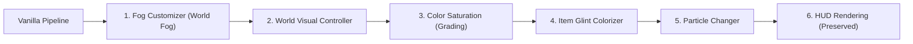

# Centralny kontroler efektów renderowania (ZombekRenderEffectController)

## 1. Rola i koordynacja

Klasa [ZombekRenderEffectController](file:///c:/Users/Admin/Desktop/jules_session_17875811770345124279/apps/minecraft-client/core/src/main/java/pl/zombek/client/core/rendereffect/ZombekRenderEffectController.java) spaja cztery podsystemy wizualne etapu 8C3:
1. **Fog Customizer** (`FogVisualController`)
2. **Color Saturation** (`ColorGradingController`)
3. **Glint Colorizer** (`GlintRenderController`)
4. **Particle Changer** (`ParticleRenderController`)

## 2. Deterministyczny porządek potoku renderowania

Warstwy renderowania są przetwarzane w ściśle określonej kolejności, wykluczającej kolizje buforów i artefakty:

## 3. Cykl życia i czyszczenie stanu

- **`onClientTick()`**: wywołuje synchroniczne przejścia animacji w `FogVisualController` i `ColorGradingController`, oraz oczyszcza liczniki `ParticleRenderController`.
- **`onWorldChange()`**: powiadamia moduły o zmianie wymiaru/świata, resetując bufory tranzycji.
- **`onWorldLeave()`**: bezpiecznie przywraca waniliowe ustawienia renderowania, zapobiegając przenikaniu efektów do menu głównego.
- **`shutdown()`**: całkowite czyszczenie zasobów przy zamykaniu klienta.
