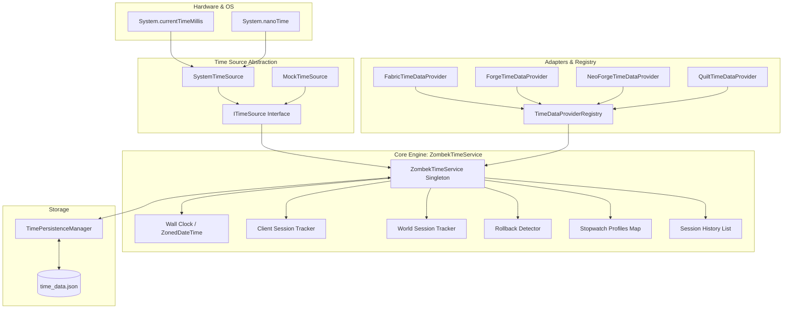

# ZombekTimeService — Central Time Engine (Etap 8B3)

## 1. Przeznaczenie i Rola Komponentu

`ZombekTimeService` stanowi centralny silnik czasu w ZombekClient Core (`pl.zombek.client.core.time.ZombekTimeService`). Odpowiada za koordynację, standaryzację i precyzyjne wyliczanie wszystkich wymiarów czasu w kliencie gry:
1. Zegar ścienny / systemowy czasu rzeczywistego (Wall Clock).
2. Monotoniczny zegar o wysokiej rozdzielczości (Monotonic Nano Clock).
3. Czas i doba świata Minecraft (In-game World Time & Game Time).
4. Czas trwania sesji klienta (Client Session Duration).
5. Czas trwania sesji połączenia ze światem / serwerem (World Session Duration).
6. Historia i statystyki sesji gracza (Session History & Playtime Statistics).
7. Profile wielozadaniowego stopera (Stopwatch Profiles).
8. Dławiony, asynchroniczny zapis i odczyt stanu trwałego (`time_data.json`).

Pliki źródłowe:
- Klasa główna: [ZombekTimeService.java](file:///c:/Users/Admin/Desktop/jules_session_17875811770345124279/apps/minecraft-client/core/src/main/java/pl/zombek/client/core/time/ZombekTimeService.java)
- Interfejs źródła czasu: [ITimeSource.java](file:///c:/Users/Admin/Desktop/jules_session_17875811770345124279/apps/minecraft-client/core/src/main/java/pl/zombek/client/core/time/ITimeSource.java)
- Domyślne źródło: [SystemTimeSource.java](file:///c:/Users/Admin/Desktop/jules_session_17875811770345124279/apps/minecraft-client/core/src/main/java/pl/zombek/client/core/time/SystemTimeSource.java)
- Środowisko testowe: [MockTimeSource.java](file:///c:/Users/Admin/Desktop/jules_session_17875811770345124279/apps/minecraft-client/core/src/main/java/pl/zombek/client/core/time/MockTimeSource.java)
- Rejestr dostawców loaderów: [TimeDataProviderRegistry.java](file:///c:/Users/Admin/Desktop/jules_session_17875811770345124279/apps/minecraft-client/core/src/main/java/pl/zombek/client/core/time/TimeDataProviderRegistry.java)
- Menadżer trwałości: [TimePersistenceManager.java](file:///c:/Users/Admin/Desktop/jules_session_17875811770345124279/apps/minecraft-client/core/src/main/java/pl/zombek/client/core/time/TimePersistenceManager.java)

---

## 2. Architektura Silnika Czasu

---

## 3. Kluczowe Metody i Odpowiedzialności

1. **`getWallClockZonedDateTime()` / `getWallClockLocalTime()`:** Zwraca aktualny czas strefowy oparty na `timeSource.currentTimeMillis()`.
2. **`getWorldTimeOfDay()` / `getWorldGameTime()`:** Bezpiecznie pobiera ticki świata z zarejestrowanego dostawcy platformy (`TimeDataProviderRegistry`).
3. **`updateWorldTime(timeOfDay, gameTime)`:**
   - Wykrywa resetowanie czasu świata ($\text{lastGameTime} - \text{gameTime} > 24000$).
   - Rejestruje flagę diagnostyczną `isTimeResetDetected()`.
4. **`onWorldJoin(worldName, serverAddress, singleplayer)`:**
   - Zamyka ewentualną poprzednią otwartą sesję.
   - Rejestruje czas startu nowej sesji świata.
5. **`onWorldLeave()`:**
   - Oblicza czas trwania ukończonej sesji.
   - Tworzy niemutowalny obiekt `PlaytimeSessionRecord`.
   - Dodaje rekord do bufora historii (zachowując do 100 ostatnich sesji).
   - Wymusza zapis na dysk za pośrednictwem `TimePersistenceManager`.
6. **`tick()`:**
   - Wywoływane co klatkę/tick klienta.
   - Odpytuje stan świata.
   - Wywołuje dławiony zapis stanu trwałego (co 60 sekund).
7. **`shutdown()`:**
   - Bezpiecznie zamyka aktywne sesje.
   - Wymusza natychmiastowy synchroniczny zapis stanu stopera i czasu do `time_data.json`.
